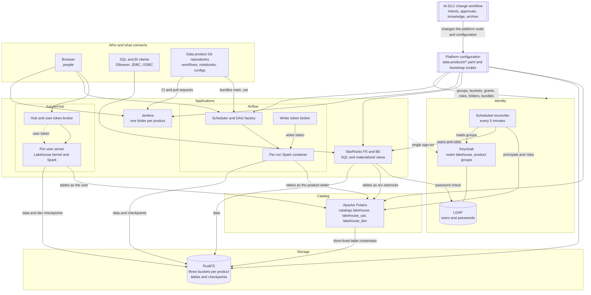

# Open Source Lakehouse Infrastructure

## Contents

1. [Objective](#objective)
2. [Architecture](#architecture)
3. [Components](#components)
4. [Quick start](#quick-start)
5. [Data products](#data-products): what a data product is
6. [User journeys](#user-journeys)
   - [Platform admin](docs/journeys/platform-admin.md)
   - [Data product owner](docs/journeys/data-product-owner.md)
   - [Data product developer](docs/journeys/data-product-developer.md)
   - [Data analyst or BI user](docs/journeys/data-analyst.md)
7. [Security](#security) ([full page](docs/security.md))
8. [All documentation](#all-documentation)
   - [Components in depth](docs/components.md)
   - Reference: [AI-DLC](docs/reference/aidlc.md), [Identity](docs/reference/identity.md), [Polaris](docs/reference/polaris.md), [RustFS](docs/reference/rustfs.md), [JupyterHub](docs/reference/jupyterhub.md), [Airflow](docs/reference/airflow.md), [StarRocks](docs/reference/starrocks.md), [Jenkins](docs/reference/jenkins.md), [Workload Python](docs/reference/workload-python.md), [Streaming checkpoints](docs/reference/streaming-checkpoints.md), [Operations](docs/reference/operations.md), [Scripts](docs/reference/scripts.md), [Known limitations](docs/reference/limitations.md)
   - [Platform evolution](docs/evolution.md)
9. [Known limitations](#known-limitations) ([full list](docs/reference/limitations.md))
10. [Future work](#future-work) ([details](docs/future-work.md))

## Objective

Provide a local, single-machine lakehouse platform on Docker Compose that hosts **[data products](#data-products)** securely: each product gets its own storage, catalog namespaces, permissions, notebooks, scheduled workloads, CI and SQL access, all driven by one YAML file and one set of Keycloak groups. Everything binds to `127.0.0.1` and is meant for local development only.

## Architecture



Text alternative, by layer:
- **Access**: people use JupyterHub, Airflow and Jenkins in the browser; SQL and BI clients connect to StarRocks; each data product's Git repository feeds Airflow (its `main` and `uat` bundles) and Jenkins (CI and pull requests).
- **Applications**: JupyterHub starts a server per user, whose Spark session uses the user's own token from the Hub's broker. Airflow's scheduler builds each product's DAGs with the platform DAG factory and starts one Spark container per run, which gets the product writer's token from the writer token broker. StarRocks serves SQL and materialized views. Jenkins has one folder per product.
- **Identity**: every application signs in through Keycloak, whose users and passwords live in LDAP (StarRocks checks passwords there directly). A scheduled reconciler reads the Keycloak groups every five minutes and keeps Polaris principals and StarRocks users and roles in line.
- **Catalog**: Apache Polaris holds the three shared Iceberg catalogs and checks every table access: as the user (Jupyter), as the product's writer (Airflow) or as `srv-starrocks` (StarRocks, which applies each user's own roles). It hands out short-lived, table-scoped storage credentials.
- **Storage**: RustFS holds three buckets per product with the tables and, under `checkpoints/`, the streaming checkpoints (reached with per-bucket checkpoint keys).
- **Platform configuration**: the data product files and bootstrap scripts create and keep in line the Keycloak groups, buckets and policies, Polaris catalogs and grants, StarRocks roles, Jenkins folders and Airflow bundles.
- **Change workflow**: AI-DLC plans, approves and records every change to the platform's code and configuration, and keeps the canonical design current.

Each journey page has its own diagram of how that role moves through the platform.

## Components

| Component | What it does | URL | Compose module |
|---|---|---|---|
| Keycloak 26.8 | Groups and single sign-on (realm `lakehouse`); keeps users in the LDAP directory | <http://127.0.0.1:8080> | core |
| OpenLDAP 2.6 | The users and passwords, shared by Keycloak and StarRocks (LDAPS only, internal) | none (not published) | core |
| Apache Polaris 1.8 | Iceberg REST catalog; enforces data permissions and issues short-lived storage credentials | <http://127.0.0.1:8181> | core |
| RustFS 1.0.4 | S3-compatible object storage, with a web console | S3 <http://127.0.0.1:9000>, console <http://127.0.0.1:9001/rustfs/console/> | core |
| JupyterHub 6.1 | Notebooks with Spark, signed in as yourself | <http://jupyterhub.localhost:8000> | jupyter |
| Airflow 3.3 | Scheduled Spark workloads from Git DAG bundles | <http://127.0.0.1:8085> | airflow (optional) |
| StarRocks 4.1.7 | Interactive SQL over the Iceberg tables, with materialized views for acceleration | `127.0.0.1:9030` (MySQL protocol) | starrocks |
| Jenkins 2.580 | CI for each data product's repository, one folder per product | <http://127.0.0.1:8090> | jenkins |
| AI-DLC | The change workflow: every platform change is a planned, approved and recorded intent, and the canonical design stays current | none (in the repository: `.claude/skills/aidlc-workflows`, `aidlc-docs/`) | — |

How they fit together: [Components](docs/components.md).

## Quick start

Requirements: an arm64 machine (Apple silicon; see [Known limitations](#known-limitations)), Docker with Compose V2, Python 3, and OpenSSL. StarRocks needs about 6 GB of memory; turn it off if your machine is small (see [Compose modules](docs/components.md#compose-modules)).

```sh
cp .env.example .env                    # first time only
./scripts/lakehouse.sh start            # 1. start core and the enabled modules
./scripts/bootstrap-default-product.sh  # 2. create realm, users, and every data product
./scripts/lakehouse.sh start-airflow    # optional: Airflow
```

Then sign in as one of the [bootstrap users](docs/reference/identity.md#bootstrap-users) with the password `ChangeM3!`. Details of both steps: [Platform admin journey](docs/journeys/platform-admin.md#1-start-the-platform).

## Data products

A **data product** is the unit the platform is built around: a set of data that **one team owns and delivers for others to use**, together with everything needed to build, run, secure and serve it. On this platform a data product is:

| Part | What it is | For `default` |
|---|---|---|
| **A definition** | One YAML file in `data-products/` that declares everything below; every component reads it, so it is the single place to look at or change the product | `data-products/default.yaml` |
| **Data, in three environments** | Iceberg tables in its own namespace in each shared catalog, stored in its own bucket: production, UAT and dev | `default_lh`, `default_lhuat`, `default_lhdev`; `bucket-default`, `-uat`, `-dev` |
| **People, in four roles** | Keycloak groups: **owners** (accountable; manage everything), **developers** (build in dev, read UAT and prod), **analysts** (consume production), and a **writer** service user (the identity its scheduled runs write as) | `role-default-owner`, `-developer`, `-analyst`, `-writer` |
| **Code** | An optional Git repository with its workflows, notebooks and configs; changes reach UAT and production through its `uat` and `main` branches | `opensource-lakehouse-sample-dp` |
| **Services** | Everything the platform provisions for it: Polaris grants, StarRocks roles and materialized-view databases, RustFS policies and checkpoint keys, a Jenkins folder with CI and pull-request pipelines, and Airflow bundles with its own writer | created by `create-data-product.sh` |

What makes it a *product*:
- **Owned**: one team is accountable for it, and its owners decide who gets which access.
- **Isolated**: its roles reach only its own namespaces, buckets and databases; other products can't see its tables.
- **Consumable**: analysts and BI tools query its production tables with SQL, accelerated by materialized views.
- **Promoted, not edited in place**: work happens in dev, is checked in UAT, and reaches production through reviewed branches.
- **Declared**: creating, changing or removing it is one file and one command for the platform admin, and the same rules apply to every product.

The platform starts with one product, `default`, and can host any number side by side ([create one](docs/journeys/platform-admin.md#3-create-change-or-remove-a-data-product), [file format](docs/components.md#data-products)).

## User journeys

| You are | You want to | Read |
|---|---|---|
| **Platform admin** (`platform-admin`) | run the platform, create data products and users, operate and recover | [Platform admin journey](docs/journeys/platform-admin.md) |
| **Data product owner** (`role-<product>-owner`) | decide who gets which access, own the product's repository, promote changes to production | [Data product owner journey](docs/journeys/data-product-owner.md) |
| **Data product developer** (`role-<product>-developer`) | build notebooks and workflows, run them in Jupyter and Airflow, author materialized views | [Data product developer journey](docs/journeys/data-product-developer.md) |
| **Data analyst or BI user** (`role-<product>-analyst`) | query the product's tables with SQL, from DBeaver or a BI tool | [Data analyst journey](docs/journeys/data-analyst.md) |

## Security

The platform is secured end to end:
- **one identity per person**: Keycloak single sign-on for every app, with passwords in LDAP over LDAPS;
- **least privilege everywhere**: per product and environment, derived from the product groups, with hand-made grants revoked;
- **no storage keys in workloads**: Polaris issues short-lived, table-scoped credentials;
- **isolated runs**: run-scoped writer tokens, with product code never running in the scheduler;
- **credentials kept out of code and logs**, and **TLS** wherever passwords or tokens travel.

It's meant for one machine: see [Security](docs/security.md) for every layer, the checks that prove it, and its limits.

## All documentation

- **Overview**: [Components](docs/components.md) (architecture, Compose modules, data layout, data products, access levels, materialized views).
- **Journeys**: [Platform admin](docs/journeys/platform-admin.md), [Data product owner](docs/journeys/data-product-owner.md), [Data product developer](docs/journeys/data-product-developer.md), [Data analyst](docs/journeys/data-analyst.md).
- **Reference**:
  - [Identity: Keycloak, LDAP, users and groups](docs/reference/identity.md)
  - [Polaris](docs/reference/polaris.md), [RustFS](docs/reference/rustfs.md)
  - [JupyterHub](docs/reference/jupyterhub.md), [Airflow and the DAG factory](docs/reference/airflow.md), [StarRocks](docs/reference/starrocks.md), [Jenkins](docs/reference/jenkins.md)
  - [Workload Python environment](docs/reference/workload-python.md), [Streaming checkpoints](docs/reference/streaming-checkpoints.md)
  - [AI-DLC: the change workflow](docs/reference/aidlc.md)
  - [Operations](docs/reference/operations.md), [Scripts](docs/reference/scripts.md), [Known limitations](docs/reference/limitations.md)
- **Security**: [Security](docs/security.md) (identity, authorization, data access, workload isolation, transport, secrets, supply chain, verification, limits).
- **History and plans**: [Platform evolution](docs/evolution.md) (the AI-DLC method and how the platform got here) and [Future work](docs/future-work.md).
- **Design knowledge** (canonical, kept by AI-DLC): `aidlc-docs/knowledge/opensource-lakehouse-infra/`.

## Known limitations

The most important ones; all of them, with workarounds, are in [Known limitations](docs/reference/limitations.md).

- **Local only**: browser logins use plain HTTP and the default password `ChangeM3!` is published. Do not expose this stack beyond your machine.
- **Pinned to arm64 (Apple silicon)**: the JupyterHub and Jupyter user-server base images are pinned to arm64-only digests, the user server's `JAVA_HOME` is the arm64 JDK, and the workload Python environment accepts only aarch64 wheels; everything else is multi-architecture. Running on x86_64 needs those re-pinned ([details](docs/reference/limitations.md)).
- **Memory on one machine**: all of an Airflow run's tasks share one Spark container (no per-workflow parallelism limit; order heavy tasks with `runs_after`), and a Jupyter server has 2 GiB (one Spark notebook at a time).
- **Credential lifetimes**: an Airflow run renews its tokens for up to 24 hours, a Jupyter session follows its Keycloak sign-in (at most 10 hours), and a single Iceberg write should finish within about 50 minutes.
- **Airflow**: roles are platform-wide, not per product; task arguments are fixed in the workflow file; adding or removing a product with a `repo` block restarts Airflow.
- **StarRocks**: no Iceberg table drops through it; after a restart, password logins recover within five minutes; a materialized view stops refreshing if its author leaves every product group.
- **Repositories and packages**: product repositories must be public; a product's extra packages come from public PyPI on every run and need aarch64 wheels.
- **Jenkins**: no webhooks (scans every 5 and 30 minutes), and pull request discovery is github.com only and unauthenticated.
- **RustFS console**: the bucket-list page keeps reloading for Keycloak users (upstream bug); open a bucket directly.

## Future work

Proposals under consideration, each a future AI-DLC intent ([details](docs/future-work.md)):
- **Governance with OpenMetadata**: a searchable catalog of every product's tables, lineage from Airflow and Spark, ownership, a glossary and classifications, and data quality results, with Keycloak sign-in.
- **Observability**: metrics (Prometheus), dashboards and alerts (Grafana), central logs (Loki or OpenSearch), and traces (OpenTelemetry) across the services and Spark runs.
- **Running on Kubernetes**: autoscaling Spark executors per job, Airflow tasks and Jupyter servers as pods, replicas for the stateless services and StarRocks compute, and managed secrets and TLS.
- **Platform improvements already identified**: a per-workflow parallelism limit, more Jupyter memory, workflow parameters at trigger time, materialized-view authoring and query rewrite, long-write credential refresh, and a least-privilege reconciler identity.
