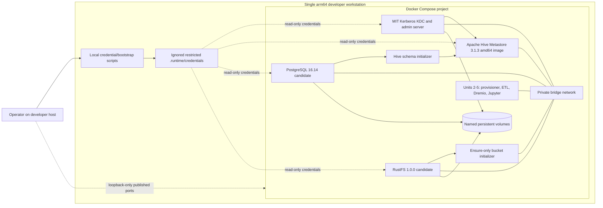

# Unit 1 Deployment Architecture

## Topology



Hive 3.1.3 runs under amd64 emulation on this arm64 host. All Compose-to-Compose calls use the private bridge network and DNS service names. The dotted operator path represents only published developer ports bound to `127.0.0.1`; PostgreSQL, Hive Thrift, and KDC administrative ports remain internal by default.

## Service Order

```text
Local credential bootstrap
  ├── KDC -> realm/principal setup
  ├── PostgreSQL healthy -> Hive schema inspection/init -> Hive Metastore
  └── RustFS healthy -> ensure-only lake bucket

Hive Metastore healthy + bucket ready + KDC credentials ready
  -> Unit 2 identity/permission provisioner
  -> Unit 3 ETL as write-service-account
  -> Unit 4 Dremio and Unit 5 Jupyter query/authorization scenarios
```

Independent KDC, PostgreSQL, and RustFS services may start concurrently. Compose must gate each initializer on its specific healthy dependency and each consumer on successful one-shot completion. Hive service health does not mean authorization success.

## Port and Protocol Boundary

| Protocol | Container endpoint | Host publication |
|---|---|---|
| Hive Metastore Thrift | Hive service port 9083 | Internal Compose network only by default |
| PostgreSQL | PostgreSQL service port 5432 | Internal Compose network only |
| Kerberos KDC | TCP/UDP 88 | Internal Compose network only by default |
| Kerberos administration | TCP 749 | Internal Compose network only; no public host exposure |
| RustFS S3 API and console | Existing configured container endpoints | Publish only operator-needed endpoints on `127.0.0.1` using existing configured host ports |
| Dremio UI/JDBC/Flight and Spark UI | Existing service endpoints | Owned by later units; retain only required ports and bind to `127.0.0.1` |

Do not publish a port to `0.0.0.0` or a LAN interface. If host-side tools later require PostgreSQL, Hive, or KDC access, add a reviewed loopback-only mapping.

## Persistence and Reset

| Named volume | Data | Stop/restart | Full reset |
|---|---|---|---|
| PostgreSQL metadata volume | Hive schemas, databases, tables, and catalog metadata | Preserved | Removed only after explicit destructive confirmation/action |
| KDC database volume | Realm database and KDC state | Preserved | Removed only as part of explicit full reset |
| RustFS object volume | Bucket objects and Iceberg metadata/data files | Preserved | Removed only as part of explicit full reset |
| Dremio data volume | Dremio local state; owned by Dremio unit | Preserved | Reset scope documented with that unit |

Credential files are host-local runtime artifacts, not named data volumes. Stop-only actions preserve them. Rotation/reinitialization must be an explicit documented operation because it can invalidate keytabs or service connectivity.

## Failure and Recovery

- If the KDC is unavailable or realm bootstrap fails, Kerberos-dependent Hive startup and all downstream setup remain blocked.
- If PostgreSQL or schema inspection/initialization fails, Hive Metastore remains blocked; existing schema/data is left untouched.
- If RustFS or ensure-only bucket setup fails, storage-dependent services remain blocked; no objects are deleted.
- If Hive Metastore health fails, identities, ETL, and authorization scenarios do not proceed.
- Diagnose via `docker compose ps` and redacted service logs. Rerun only safe idempotent steps; preserve partial named volumes.
- A full reset is a separately named, explicitly destructive operator action. It is never called by startup, healthcheck, retry, or failure recovery.

## Operator Access and Runtime Files

- Local credential bootstrap prepares restricted `.runtime/credentials/` content before `docker compose up` and validates required files without echoing values.
- Compose mounts credentials to only the services that need them, read-only where supported.
- Host-facing service URLs and readiness outcomes are reported by local status instructions; logs do not print passwords, S3 secret keys, or keytab contents.
- The project's current `.env` contains fixed S3 credential values. Code Generation must move secret material to ignored runtime files and add repository ignore coverage before startup instructions are considered complete.

## Mermaid Text Alternative

One local arm64 developer workstation runs the Docker Compose project. A local bootstrap prepares ignored credentials. The KDC, PostgreSQL, Hive Metastore, RustFS, and one-shot initializers communicate over a private bridge network. PostgreSQL, KDC, and RustFS persist in separate named volumes. Hive 3.1.3 uses amd64 emulation. Operators access only explicitly published ports bound to loopback. Units 2 through 5 consume the foundation after readiness and initialization gates pass.
