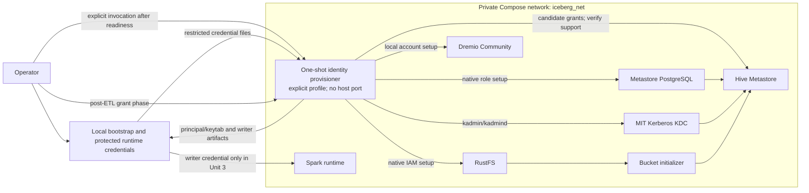

# Unit 2 Identity Provisioning — Deployment Architecture

## Logical Deployment View

The profile and invocation are conceptual infrastructure decisions; Code Generation defines exact Compose syntax. The one-shot provisioner is excluded from default `up`, exposes no port, and is removed after each run. Runtime credentials are stored on the host, not in a provisioner volume.

## Service Topology and Dependency Contract

| Service/consumer | Network | Required condition before identity setup | Host publication |
|---|---|---|---|
| `identity-provisioner` | Existing `iceberg_net` only | Explicit operator invocation; all component preflights pass | None |
| `kdc` | Existing `iceberg_net` | Healthy KDC/admin endpoint; realm exists; bootstrap administration credential available | None |
| `metastore-db` | Existing `iceberg_net` | PostgreSQL accepts authenticated connections; Hive schema exists | None |
| `hive-metastore` | Existing `iceberg_net` | Thrift readiness succeeds after schema and service principal setup | None |
| `object-store` | Existing `iceberg_net` | RustFS readiness and required bucket exist | Existing S3/console ports stay loopback-only |
| `dremio` | Existing `iceberg_net` | Container is available and an operator has completed first-run local admin setup; authenticated preflight succeeds | Existing Dremio ports stay loopback-only |
| `spark` | Existing `iceberg_net` | Not a provisioning dependency; later workloads wait for identity provisioning success | Existing Spark ports stay loopback-only |

Service health is distinct from account-provisioning success. `identity-provisioner` must validate dependencies before performing any mutation. A Dremio container merely running is not sufficient; its initialized local administrator must authenticate successfully.

## Protected Credential Layout (Logical)

The exact file names remain Code Generation details. The local layout must support separate, owner-restricted files for:

- Kerberos bootstrap admin credential/keytab used only by the provisioner, plus separate final keytabs for `admin`, `write-service-account`, `user_a`, and `user_b`.
- RustFS root/setup credential, named RustFS admin credential, and separate writer/test-user access keys.
- Dremio first-run/local admin credential and separate writer password.
- PostgreSQL bootstrap/current role credential, separate `admin` role credential, and Hive service credential.

The provisioner receives component-specific read-only setup inputs and writes generated artifacts under a restricted runtime output directory. Avoid mounting the entire credentials tree into unrelated services. Do not pass credential values in process arguments or log output. Existing `rustfs.env` currently carries root values into Spark; remove that Spark mount in the Unit 2 integration, then have Unit 3 and Unit 5 inject only their respective identities' files.

## Kerberos Bootstrap and Principal Setup

The existing KDC image runs `kadmin.local` during realm bootstrap and has a `kadm5.acl` entry for `kadmin/admin@LAKEHOUSE.LOCAL`, but the Unit 1 runtime created only the Hive service principal. A networked one-shot provisioner therefore needs a protected bootstrap credential for that already-allowed KDC admin principal (or an equivalently restricted KDC-owned bootstrap interface) before it can create the platform `admin`, writer, and test principals and export their keytabs.

Keep the KDC provisioning credential distinct from the final platform `admin` principal and from all component passwords. Generate/protect it in local runtime storage, allow it only in the provisioning workflow, and add the final `admin@REALM` KDC administrative ACL only after that principal is created. Preserve the Hive service keytab and verify `kinit` for every resulting principal without printing keytab contents. If the existing KDC initialization cannot safely create/export the bootstrap keytab, return that as an implementation blocker; do not mount the Docker socket into the provisioner.

## Component Account and Permission Interfaces

### RustFS

Use the RustFS root/setup credential only for creating named identities and policies. The root identity bypasses IAM identity-policy evaluation, so it is a bootstrap/break-glass account, not an ETL or user-session identity. Create separate named admin/writer/test identities and a policy per approved data scope. Writer access is limited to the warehouse prefixes needed for `databaseA` and `databaseB`; test-user policies are aligned with their database paths. Exact `s3:ListBucket`, object, multipart, and Iceberg commit permissions require testing against the pinned client and RustFS version; do not guess a broader policy and call it least privilege. RustFS documentation describes IAM users and policy attachment but the current documentation must be checked against the pinned image. [RustFS IAM](https://docs.rustfs.com/en/security-compliance/iam).

### Dremio

Per the user's clarification, create Dremio's first-run local `admin` manually and create `write-service-account` through the Dremio UI using the protected generated credentials. Do not add the writer to the administrator role. Space creation/object write is not included here; Unit 4 must test the approved JDBC scenario and report a block if Community cannot authorize it. [Dremio editions](https://docs.dremio.com/editions/), [Dremio local-user management](https://docs.dremio.com/current/security/authentication/users).

### PostgreSQL

The current Compose setup uses `POSTGRES_USER=hive`. On a fresh data directory, the official image creates that configured role as a superuser. Implement an idempotent in-place migration that creates a separate PostgreSQL `admin`, preserves the Hive metadata database/schema, and removes unnecessary superuser privilege from the Hive service account only after confirming it retains the privileges Hive and `schematool` need. Initialization scripts do not rerun on an existing data directory, so the migration must be a one-shot authenticated operation and must preserve current volumes. Validate a fresh deployment separately. If service behavior fails after restriction, stop and report the required privilege rather than resetting the volume. [Official Postgres image documentation](https://github.com/docker-library/docs/blob/master/postgres/README.md?plain=1).

### Hive Metastore and Hadoop

Keep HiveServer2 excluded. The existing configuration enables Kerberos/SASL and `hive.metastore.execute.setugi`; those settings authenticate the service path and request effective-user execution but do not establish that the standalone Metastore can grant/restrict database operations over S3A/RustFS. Represent writer capability and post-ETL reader grants as adapters only if an exact supported Hive-owned mechanism is identified and verified. Current Dremio Hive docs describe storage-based authorization with user impersonation, but the end-to-end RustFS/Spark behavior is still unproven. [Dremio Hive source documentation](https://docs.dremio.com/current/data-sources/lakehouse-catalogs/hive/).

## Provisioning Sequence and Failure Path

1. Start the existing core stack and wait for KDC, PostgreSQL/schema, RustFS/bucket, Hive Metastore, and Dremio to become available.
2. Create Dremio's local `admin` during first-run and `write-service-account` manually in the UI, using their protected runtime credentials.
3. Invoke the explicit provisioning profile. It ensures Kerberos principals/keytabs and attempts the PostgreSQL admin/service-role separation.
4. Create RustFS named identities/policies and change Hive to its named S3 credential only after that adapter and its authorization path have been verified. Until then, provisioning must report incomplete and Hive retains root S3 credentials.
5. Stop on the first required error. Preserve prior component state, return a redacted failed/incomplete result, and allow a safe rerun.
6. Unit 3 runs the sample ETL as writer. After both databases exist, invoke a separate grant phase for `user_a` and `user_b`.

The default `scripts/start.sh` continues to start services only; it must not implicitly create all platform identities or depend on a Dremio first-run UI step. Document the explicit provisioning command and its expected result in the implementation/operator docs.

## Persistence and Reset

- Existing KDC, metastore PostgreSQL, RustFS object, and Dremio volumes remain authoritative and are not removed or recreated by provisioning.
- Provisioner container and writable layer are ephemeral. New credentials/keytabs persist only under `.runtime/credentials/`.
- A normal rerun preserves existing values. Rotation is a distinct operation with consumer update/restart steps.
- Failure never triggers `scripts/clean.sh`, volume deletion, or account removal.

## Infrastructure Category Decisions

- **Messaging**: Not applicable; the workflow is synchronous and sequential.
- **Monitoring**: No new monitoring/alerting service; use Compose health/status and redacted logs.
- **Shared infrastructure**: Not applicable; one project and one operator.
- **Scaling**: One ephemeral provisioner run; no concurrent/bulk provisioning.

## Sources and Validation Boundary

- RustFS documents root and IAM identities and policy attachment; exact availability in RustFS `1.0.0-glibc` must be tested: [RustFS IAM documentation](https://docs.rustfs.com/en/security-compliance/iam).
- Dremio lists local identities for Community 26.0+ and documents local user management; exact pinned 26.0.5 automation remains to verify: [Dremio editions](https://docs.dremio.com/editions/), [Dremio user management](https://docs.dremio.com/current/security/authentication/users).
- Dremio documents Hive 3.x and storage-based authorization with user impersonation; this does not certify effective-user enforcement against RustFS for this PoC: [Dremio Hive source](https://docs.dremio.com/current/data-sources/lakehouse-catalogs/hive/).
- The official PostgreSQL image creates `POSTGRES_USER` with superuser privilege on fresh initialization and runs init scripts only for an empty data directory: [Postgres image documentation](https://github.com/docker-library/docs/blob/master/postgres/README.md?plain=1).
