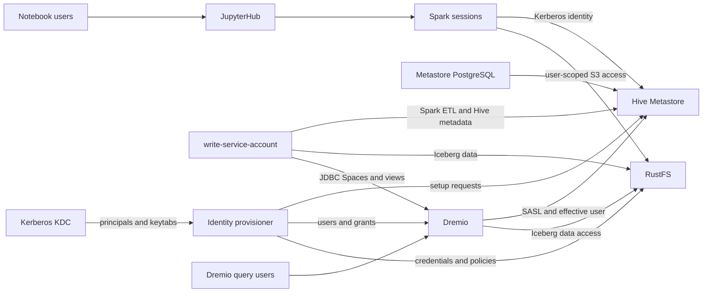

# Component Dependencies and Communication

## Dependency Matrix

Rows depend on columns. `R` means runtime dependency; `I` means initialization/setup dependency; `O` means operational or documentation relationship.

| Component | Compose | KDC | Provisioner | PostgreSQL | Hive | RustFS | Spark | TPCH loader | Dremio | JupyterHub |
|---|---:|---:|---:|---:|---:|---:|---:|---:|---:|---:|
| Identity/permission provisioner | R | I | — | I | I | I | — | — | I | — |
| Hive Metastore | R | R | — | R | — | — | — | — | — | — |
| Bucket initializer | R | — | — | — | — | I | — | — | — | — |
| Spark runtime | R | R | — | — | R | R | — | — | — | — |
| TPCH loader | R | R | — | — | R | R | R | — | R (JDBC) | — |
| Dremio | R | R | — | — | R | R | — | — | — | — |
| JupyterHub | R | — | — | — | — | — | R (spawned Spark) | — | — | — |
| Lifecycle scripts | O | — | — | — | — | — | — | — | — | — |

## Communication Patterns

| From → To | Pattern | Identity/context |
|---|---|---|
| Compose → services | Container lifecycle, health/readiness, dependency ordering | Local Compose network; no authorization semantics. |
| Provisioner → KDC | KDC-native principal/keytab administration | Bootstrap/admin credentials; secrets remain local runtime artifacts. |
| Provisioner → Hive | Hive-supported setup/admin path for database grants | Administrative setup identity; effective query users remain distinct. |
| Provisioner → RustFS | S3-compatible or native administration operations | RustFS component-native admin credentials, separate from Kerberos. |
| Provisioner → Dremio | Supported user/account administration interface | Dremio admin setup credential; not used as writer ETL identity. |
| Spark/TPCH loader → Hive | Hive Metastore Thrift API with Kerberos/SASL | Writer principal for ETL; per-user principal for notebook sessions. |
| Spark/TPCH loader → RustFS | S3-compatible API | Writer-scoped credentials for ETL; distinct user credentials for notebooks. |
| TPCH loader → Dremio | JDBC | `write-service-account`; Space/view creation support is a feasibility gate. |
| Dremio → Hive | Hive Metastore API with Kerberos/SASL and query-user mapping | Dremio service identity authenticates; mapped user is the effective authorization identity. |
| Dremio → RustFS | S3-compatible table data access as supported by selected Hive source integration | Exact credential/impersonation behavior requires compatibility verification. |
| JupyterHub → Spark runtime | DockerSpawner and user-scoped mounts/environment | Notebook user gets their own Kerberos and RustFS credentials. |

## Data and Identity Flow

Text alternative: the KDC issues identities and the one-shot provisioner asks each owning component to create its accounts or grants. The writer uses Spark to create Hive metadata and RustFS data, then JDBC to create matching Dremio Spaces and views. Notebook users reach Spark through JupyterHub with their own Kerberos and RustFS credentials. Dremio authenticates to Hive with a service identity while passing the mapped query identity for authorization, and reads the associated table data from RustFS.

## Dependency Constraints

- Hive Metastore depends on PostgreSQL schema readiness and its Kerberos service identity.
- ETL depends on KDC credentials, Hive readiness, RustFS bucket/policy readiness, and the Spark catalog configuration.
- Dremio view creation depends on the Hive tables existing and JDBC authentication/permissions being available.
- Jupyter query sessions depend on per-user keytabs, storage credentials, and compatible Spark/Hive/Iceberg libraries.
- Hive authorization consistency between Dremio and Spark, and the storage path used by Dremio, require exact-version validation. The matrix does not imply these feasibility items have been solved.
- No dependency on Airflow or Jenkins is introduced.
