# Execution Plan

## Detailed Analysis Summary

### Transformation Scope

- **Transformation type**: Cross-service infrastructure and identity redesign within one existing Docker Compose PoC.
- **Primary changes**: Replace Nessie with standalone Hive Metastore backed by PostgreSQL; introduce a disposable Kerberos KDC; add a one-shot identity/permission provisioning service; configure per-user and service identities; migrate Spark/TPCH ETL; add JupyterHub; connect Dremio to Hive; define authorization demonstrations; provision Dremio Spaces and table views through the writer's JDBC connection.
- **Related components**: Docker Compose and lifecycle scripts, identity/permission provisioner, Hive Metastore, metastore PostgreSQL, KDC, Spark/TPCH loader, Dremio, RustFS, JupyterHub, sample SQL, and operator documentation.
- **Explicitly deferred**: Airflow/Jenkins deployment or job integration. The sample Spark ETL runs as `write-service-account` in this PoC. Direct RustFS authorization demonstration is out of scope.

### Change Impact Assessment

- **User-facing changes**: Yes. Admin, restricted and broader query users, notebook users, and the write-service identity have distinct access and workflow outcomes.
- **Structural changes**: Yes. Catalog, identity, database and notebook services are added or replaced in Compose.
- **Data model changes**: Yes. Two Hive databases and their Iceberg tables are initialized under `write-service-account`.
- **API changes**: Yes. Dremio JDBC and Hive Metastore/SASL connection paths are configured; no new application API is planned.
- **NFR impact**: High. Credential separation, least privilege, identity propagation, and observable allow/deny results are required.

### Component Relationships

- **Primary component**: `hive-dremio-rustfs` Docker Compose PoC.
- **Infrastructure components**: Hive Metastore, its PostgreSQL backend, local Kerberos KDC, RustFS, Dremio, JupyterHub.
- **Workload components**: Spark runtime, TPCH generator, TPCH loader and registration scripts, sample SQL.
- **Supporting components**: Compose startup/cleanup scripts, environment examples, operator documentation.
- **Dependency direction**: The one-shot provisioner coordinates identity and permission setup through component-owned interfaces; it is not an authorization authority. KDC identities and service configuration support Hive/Spark/Dremio; Spark ETL writes the Hive catalog and RustFS and creates corresponding Dremio views over JDBC; Dremio and user Spark sessions query the resulting data; JupyterHub supplies isolated notebook sessions.

### Multi-Component Update Strategy

- **Approach**: Sequential across shared identity/catalog contracts, then integrate dependent services.
- **Critical path**: Select compatible Hive 3.x/Spark/Dremio versions and authorization mechanism; establish KDC and principal names; configure Hive/PostgreSQL and RustFS; provision identities and database/storage permissions through the one-shot provisioner; run ETL as `write-service-account`; create matching Dremio Spaces and per-table views through JDBC; connect Dremio and Jupyter; complete authorization scenarios.
- **Coordination points**: Kerberos principal names and keytabs, effective username mapping, Hive database names, Iceberg catalog properties, RustFS warehouse paths and credentials, Compose network aliases, Dremio local-user/JDBC behavior.
- **Integration checkpoints**: Catalog registration/query; service-account ETL and least privilege; Dremio Hive connection; Jupyter Spark identity; each allow/deny case; non-admin JDBC Space write.
- **Package structure**: One Compose project with multiple configuration/workload directories; no separately versioned packages or build modules were detected.

### Risk Assessment

- **Risk level**: High. Hive 3.x, Spark/Iceberg, Dremio Community, Kerberos impersonation, and S3-compatible storage authorization must work together. Dremio Community Space-write permissions and Hive/RustFS authorization are known feasibility items.
- **Rollback complexity**: Moderate. The PoC is local and Compose-managed, but catalog changes affect persistent volumes and generated table metadata. Keep the original project copy available and document volume cleanup/migration assumptions.
- **Verification complexity**: Complex. Acceptance needs multiple identities, two databases, two query paths, both allowed and denied outcomes, and a separate JDBC create operation.
- **Test handling**: No automated tests or test code are planned by this execution plan. The required verification phase will prepare manual build/acceptance instructions; execution of tests is not authorized by this plan.

## Workflow Visualization

```mermaid
flowchart TD
    Start([Approved requirements and stories])
    WD[Workspace Detection - COMPLETED]
    RE[Reverse Engineering - COMPLETED]
    RA[Requirements Analysis - COMPLETED]
    US[User Stories - COMPLETED]
    WP[Workflow Planning - COMPLETED]
    AD[Application Design - COMPLETED]
    UG[Units Generation - COMPLETED]
    FD[Functional Design - EXECUTE]
    NR[NFR Requirements - EXECUTE]
    ND[NFR Design - EXECUTE]
    ID[Infrastructure Design - EXECUTE]
    CG[Code Generation - EXECUTE]
    BT[Build and Test instructions - EXECUTE]
    DP[Deploy handoff - EXECUTE]
    End([Intent handoff])

    Start --> WD --> RE --> RA --> US --> WP --> AD --> UG
    UG --> FD --> NR --> ND --> ID --> CG --> BT --> DP --> End

    style Start fill:#CE93D8,stroke:#6A1B9A,stroke-width:3px,color:#000
    style End fill:#CE93D8,stroke:#6A1B9A,stroke-width:3px,color:#000
    style WD fill:#4CAF50,stroke:#1B5E20,stroke-width:3px,color:#fff
    style RE fill:#4CAF50,stroke:#1B5E20,stroke-width:3px,color:#fff
    style RA fill:#4CAF50,stroke:#1B5E20,stroke-width:3px,color:#fff
    style US fill:#4CAF50,stroke:#1B5E20,stroke-width:3px,color:#fff
    style WP fill:#4CAF50,stroke:#1B5E20,stroke-width:3px,color:#fff
    style AD fill:#4CAF50,stroke:#1B5E20,stroke-width:3px,color:#fff
    style UG fill:#4CAF50,stroke:#1B5E20,stroke-width:3px,color:#fff
    style FD fill:#FFA726,stroke:#E65100,stroke-width:3px,stroke-dasharray: 5 5,color:#000
    style NR fill:#FFA726,stroke:#E65100,stroke-width:3px,stroke-dasharray: 5 5,color:#000
    style ND fill:#FFA726,stroke:#E65100,stroke-width:3px,stroke-dasharray: 5 5,color:#000
    style ID fill:#FFA726,stroke:#E65100,stroke-width:3px,stroke-dasharray: 5 5,color:#000
    style CG fill:#4CAF50,stroke:#1B5E20,stroke-width:3px,color:#fff
    style BT fill:#4CAF50,stroke:#1B5E20,stroke-width:3px,color:#fff
    style DP fill:#FFA726,stroke:#E65100,stroke-width:3px,stroke-dasharray: 5 5,color:#000

    linkStyle default stroke:#333,stroke-width:2px
```

### Text Alternative

Inception: Workspace Detection, Reverse Engineering, Requirements Analysis, User Stories, Workflow Planning, Application Design, and Units Generation are complete. Construction: Functional Design, NFR Requirements, NFR Design, Infrastructure Design, Code Generation, and Build and Test instructions will execute. Deploy: prepare a handoff document and operational instructions where needed. No deployment will be performed by this plan.

## Phases to Execute

### Inception

- [x] Workspace Detection — brownfield Compose PoC.
- [x] Reverse Engineering — approved on 2026-10-23.
- [x] Requirements Analysis — approved, including the write-service ETL amendment.
- [x] User Stories — approved on 2026-10-23.
- [x] Workflow Planning — original plan and revised canonical inventory approved on 2026-10-23.
- [x] Application Design — completed and approved on 2026-10-23.
- [x] Units Generation — completed and approved on 2026-10-23; five units and all story assignments are documented.

### Construction

- [ ] Functional Design — **EXECUTE** per unit. Define ETL identity/permissions, user mapping, Dremio JDBC object creation, database authorization behavior, and startup/cleanup flows.
- [ ] NFR Requirements — **EXECUTE** per unit where applicable. Credential handling, least privilege, identity observability, and local-only limitations are explicit requirements.
- [ ] NFR Design — **EXECUTE** where NFR Requirements applies. Translate credential boundaries, keytab mounts, and logging requirements into component design.
- [ ] Infrastructure Design — **EXECUTE** per unit. Compose services, dependencies, health/readiness, networks, volumes, runtime secret mounts, and service configuration must be specified.
- [ ] Code Generation — **EXECUTE** (always). Update Compose and workload/configuration files according to approved plans.
- [ ] Build and Test — **EXECUTE** as a workflow stage. Prepare verification instructions for the cross-service acceptance criteria. This plan does not authorize adding or running tests.

### Deploy

- [ ] Deploy handoff — **EXECUTE** (always). Prepare a PR request and ordered local deployment instructions; do not deploy or modify a running environment.

## Canonical Knowledge Impact Inventory

No canonical application design or functional-design documents currently exist under `aidlc-docs/knowledge/` for this project. `CREATE` records a missing design document for an affected component; it does not imply a new runtime boundary unless stated. For `RETAIN` and `RETIRE` rows, no canonical file exists today: the action describes the component responsibility or active service boundary, and the reason states that no document is being retained/archived.

| Canonical path | Action | Requirement and owning component | Reason / boundary justification |
|---|---|---|---|
| `aidlc-docs/knowledge/hive-dremio-rustfs/application-design.md` | CREATE | FR-01–23; whole PoC | No canonical project design exists; capture the approved architecture and component relationships. |
| `aidlc-docs/knowledge/hive-dremio-rustfs/functional-design/compose-orchestration.md` | CREATE | FR-01–23; existing Compose project | No canonical orchestration design exists; record service dependencies and lifecycle ownership. |
| `aidlc-docs/knowledge/hive-dremio-rustfs/functional-design/hive-metastore.md` | CREATE | FR-01–03, FR-08–16, FR-23; Hive Metastore | Hive Metastore is a new runtime service boundary replacing Nessie catalog use. |
| `aidlc-docs/knowledge/hive-dremio-rustfs/functional-design/metastore-postgresql.md` | CREATE | FR-03; metastore database | PostgreSQL changes from Nessie persistence to Hive metadata persistence; document schema lifecycle and ownership. |
| `aidlc-docs/knowledge/hive-dremio-rustfs/functional-design/kerberos-kdc.md` | CREATE | FR-06–11, FR-19, FR-21, FR-23; local KDC | The disposable KDC is a new runtime service boundary and principal/keytab source. |
| `aidlc-docs/knowledge/hive-dremio-rustfs/functional-design/identity-provisioner.md` | CREATE | FR-06–11, FR-19–23; one-shot identity/permission provisioning service | User selected a dedicated one-shot coordinator for principal/user setup and database/storage permission provisioning. It invokes component-owned interfaces and does not become a runtime authorization authority. |
| `aidlc-docs/knowledge/hive-dremio-rustfs/functional-design/dremio.md` | CREATE | FR-08–09, FR-15–16, FR-20–22; existing Dremio | Existing component has no canonical design; document Hive auth, user mapping, admin account, matching database Spaces, per-table view creation, and JDBC writer constraints. |
| `aidlc-docs/knowledge/hive-dremio-rustfs/functional-design/spark-runtime.md` | CREATE | FR-05, FR-10–11, FR-18; existing Spark runtime | Existing Spark runtime has no canonical design; document catalog settings and per-user notebook Spark sessions. |
| `aidlc-docs/knowledge/hive-dremio-rustfs/functional-design/tpch-loader.md` | CREATE | FR-05, FR-14, FR-23; existing TPCH loader | Existing one-shot loader has no canonical design; document its Hive catalog migration and service-account ETL permissions. |
| `aidlc-docs/knowledge/hive-dremio-rustfs/functional-design/jupyterhub.md` | CREATE | FR-10–13, FR-18; JupyterHub | JupyterHub is a new runtime service boundary based on `jupyter-platform/`. |
| `aidlc-docs/knowledge/hive-dremio-rustfs/functional-design/rustfs.md` | CREATE | FR-04, FR-17–18, FR-23; existing RustFS | Existing storage component has no canonical design; document bucket/warehouse paths and distinct user/service credentials. |
| `aidlc-docs/knowledge/hive-dremio-rustfs/functional-design/bucket-initializer.md` | RETAIN | Existing `create-bucket`; FR-04, FR-23 | The bucket initialization responsibility remains; confirm it does not need admin data-write credentials. |
| `aidlc-docs/knowledge/hive-dremio-rustfs/functional-design/tpch-generator.md` | RETAIN | Existing TPCH generator; FR-14 | Source-data generator is not changing; keep its existing responsibility and avoid expanding its boundary. |
| `aidlc-docs/knowledge/hive-dremio-rustfs/functional-design/sql-workloads.md` | CREATE | Existing `sql/queries.sql`; FR-14–16 | No canonical workload design exists; document sample queries and authorization demonstrations within the existing query workload boundary. |
| `aidlc-docs/knowledge/hive-dremio-rustfs/functional-design/lifecycle-scripts.md` | CREATE | Existing `scripts/start.sh`, `scripts/clean.sh`; NFR-04 | No canonical lifecycle design exists; document startup/cleanup dependencies and persistent-volume behavior. |
| `aidlc-docs/knowledge/hive-dremio-rustfs/functional-design/nessie.md` | RETIRE | FR-01, FR-05; existing Nessie service | Nessie is removed from the active topology; no canonical design file currently exists, so do not create one for the retired service. |
| `aidlc-docs/knowledge/hive-dremio-rustfs/functional-design/nessie-postgresql.md` | RETIRE | FR-01, FR-03; existing Nessie database | Nessie persistence is removed/reassigned; no canonical design file currently exists. Hive metadata ownership is documented in `metastore-postgresql.md`. |

## Package and File Change Sequence

1. Establish version, principal, identity-mapping, database, and warehouse contracts during design.
2. Add Compose foundations for KDC, metastore PostgreSQL, Hive Metastore, the one-shot identity/permission provisioner, networks, volumes, and secure local credential generation.
3. Replace Nessie configuration in Spark, TPCH scripts, and lifecycle documentation; run the sample ETL as `write-service-account` with restricted Hive/RustFS write credentials, then create matching Dremio Spaces and a view for each Hive table through JDBC.
4. Configure Dremio's Kerberos Hive source, local identity mapping, admin identity, and JDBC writer user; resolve the Community Space-write and non-admin view-creation feasibility items before claiming those acceptance criteria.
5. Add JupyterHub from the approved baseline with per-user Kerberos identities, keytabs, and RustFS credentials.
6. Implement the database authorization scenarios and update sample SQL, startup/cleanup docs, and manual verification instructions.
7. Verify the combined acceptance paths and prepare deploy handoff documents. Do not modify `airflow-spark-jenkins/` in this intent.

## Estimated Timeline

- **Total planned stages**: 9 distinct stages after this approval gate (Application Design, Units Generation, four per-unit design stages, Code Generation, Build and Test, Deploy).
- **Estimated duration**: Not estimated; no delivery date or effort constraints were provided. Detailed effort can be revisited after Units Generation.

## Success Criteria

- **Primary goal**: Replace Nessie with Hive 3.x and demonstrate identity-aware access through Dremio and Spark/Jupyter while using `write-service-account` for initial sample ETL.
- **Key deliverables**: Approved application/component designs, unit plan, Compose and service configuration, service identities, sample ETL and database access demonstration, operator docs, verification instructions, deploy handoff.
- **Quality gates**: Keep credentials out of tracked artifacts; do not grant writer admin privileges; demonstrate the `user_a`/`user_b` allow/deny matrix; verify Dremio Community JDBC Space write without broadening privileges; document any infeasible outcome for approval.

## Extension Compliance Summary

- **Security Baseline**: N/A — disabled by user choice. The functional security requirements in the approved requirements remain in scope.
- **Property-Based Testing (Partial)**: No property-testable pure functions or serialization round-trips were identified in the existing workload code; `find_metadata_files` performs S3 I/O. PBT-02, PBT-03, PBT-07, and PBT-08 are currently N/A for this planning stage. Reassess during Functional Design if new pure transformations or serialization helpers are introduced; if applicable, select a framework per PBT-09. No test code or test execution is authorized by this plan.
- **Resiliency Baseline**: N/A — disabled by user choice.
