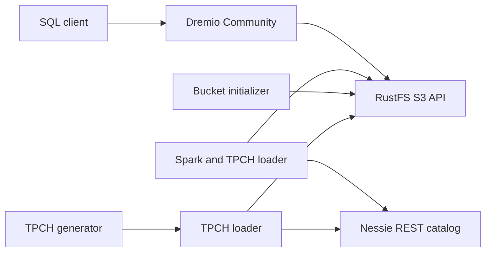

# System Architecture

## System Overview

The workspace is a single-host Docker Compose PoC. Services share `iceberg-poc-net`. Spark and Dremio access RustFS over S3-compatible HTTP. Spark currently uses Iceberg's Nessie catalog implementation; Dremio is configured separately through its UI according to the README.

## Architecture Diagram

## Component Descriptions

| Component | Type | Purpose | Dependencies |
|---|---|---|---|
| `object-store` | Infrastructure | RustFS S3 API and console | Compose network and volume |
| `create-bucket` | Initialization | Creates `lake` bucket | `object-store` |
| `nessie` | Infrastructure | Iceberg catalog REST service | `nessie-db` |
| `nessie-db` | Infrastructure | Nessie JDBC persistence | PostgreSQL volume |
| `spark` | Application/runtime | Interactive Spark with Iceberg | RustFS and bucket initializer |
| `tpch-generator` | Data generation | Produces TPCH flat files | Local TPCH data mount |
| `tpch-loader` | Data loading | Writes TPCH tables using Spark | Generator, Nessie, RustFS |
| `dremio` | Application/runtime | SQL query engine | RustFS; UI source configuration is manual |

## Data Flow

1. Compose starts RustFS and the bucket initializer.
2. TPCH generator writes source files into the shared `tpch/data` directory.
3. TPCH loader runs Spark with `spark-defaults.conf`, writes Iceberg metadata through Nessie, and stores table data in RustFS.
4. Dremio reads the object-store data after an operator configures its source in the Dremio UI.

## Integration Points

- **S3-compatible API**: RustFS on port 9000 internally and configurable host port.
- **Nessie REST API**: Port 19120; Spark uses `/api/v2`.
- **PostgreSQL**: Internal Nessie persistence.
- **Dremio UI/JDBC/Flight**: Ports supplied by `.env`.
- **Kerberos**: No KDC, realm configuration, keytabs, krb5 configuration, or authenticated service setup is present currently.

## Deployment Model

Single Docker Compose project with named data volumes and a user-defined bridge network. The deployment runs locally; external realm/KDC connectivity is not yet described.
