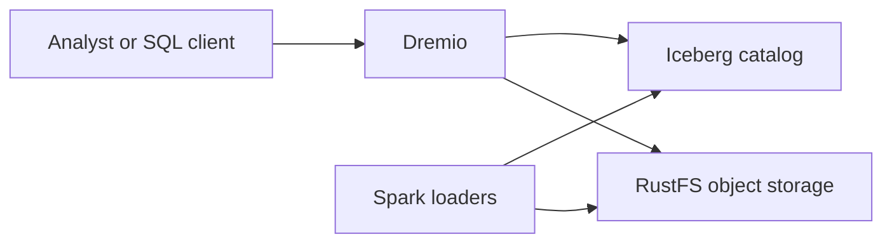

# Business Overview

## Business Context

This PoC demonstrates SQL analytics over Iceberg data stored in an S3-compatible object store. Dremio is the query engine, Spark creates and loads Iceberg tables, RustFS stores the data, and the catalog resolves table metadata. The requested change replaces the current Nessie catalog with Hive 3.x and adds Kerberos impersonation to the environment.

## Business Transactions

- Start the local services and initialize the RustFS `lake` bucket.
- Generate TPCH data and load it as Iceberg tables through Spark.
- Resolve namespaces and tables through the catalog.
- Query the Iceberg data through Dremio.
- Clean up the PoC containers and volumes.

## Business Dictionary

- **Catalog**: Service storing Iceberg namespace and table metadata references.
- **Impersonation**: A service acting on behalf of an authenticated user, subject to configured identity and authorization rules.
- **Warehouse**: Object-store root path used for Iceberg table data.

## Component Descriptions

### Compose Environment
- **Purpose**: Runs and networks the local PoC services.
- **Responsibilities**: Service configuration, dependencies, ports, persistent volumes, and startup health checks.

### Spark Workloads
- **Purpose**: Generate and load demonstration data into Iceberg tables.
- **Responsibilities**: Catalog configuration, S3 connectivity, TPCH table writes, and registration helpers.

### Dremio
- **Purpose**: Interactive SQL over the stored datasets.
- **Responsibilities**: Querying data and exposing JDBC/Flight/UI endpoints.
