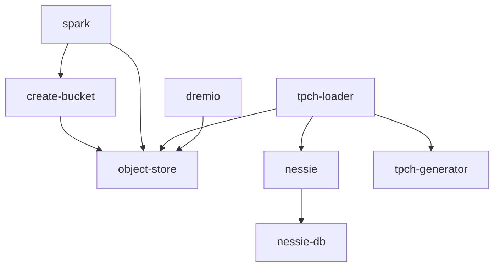

# Dependencies

## Runtime Dependency Graph

## External Dependencies

- `dremio/dremio-oss:26.0.5` — SQL query engine.
- `rustfs/rustfs:1.0.0` — S3-compatible storage.
- `tabulario/spark-iceberg:3.5.5_1.8.1` — Spark and Iceberg runtime.
- `ghcr.io/projectnessie/nessie:0.109.0` — current catalog service.
- `postgres:17` — Nessie persistence.
- `python:3.12-alpine` — bucket creation helper; installs boto3 at container startup.
- TPCH dbgen source archive — compiled by the generator Dockerfile.

## Configuration Coupling

The Nessie catalog name is referenced in Spark properties, TPCH loader SQL and table-registration SQL. Replacing the catalog therefore spans Compose service topology, Spark catalog configuration, and workload references. Kerberos identity settings also cross service configuration and mounted runtime credentials/configuration.
