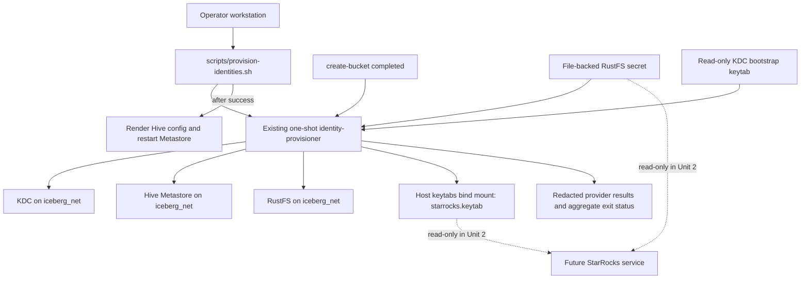

# Deployment Architecture — Unit 1 Identity Provisioning

## Local Deployment Topology

Text alternative: the operator wrapper runs the existing one-shot identity-provisioner after KDC/Hive health and bucket completion. The provisioner accesses KDC, Hive, and RustFS over `iceberg_net`, reads the file-backed RustFS secret and read-only KDC bootstrap keytab, writes/reuses the StarRocks keytab in the existing host bind mount, and emits redacted per-provider results. On success, the wrapper renders Hive config and restarts the Metastore. Unit 2 will consume the StarRocks keytab and secret read-only.

The diagram describes the current/approved topology and planned credential path only. It does not add a service or authorize deployment changes.

## Network and Exposure

- The provisioner uses the existing Compose `iceberg_net` and Compose DNS names.
- KDC, Hive, and RustFS administration/provider traffic is not newly published on host ports.
- No load balancer, gateway, or dedicated identity network is added.

## Storage and Secret Flow

| Host source | Provisioner access | Future StarRocks access | Persistence |
|---|---|---|---|
| `.runtime/credentials/rustfs-starrocks-secret-key` | File-backed Compose secret, read-only secret mount | Same file-backed secret, read-only mount (Unit 2) | Existing ignored host credential directory |
| `.runtime/credentials/keytabs/starrocks.keytab` | Existing keytabs bind mount, writable for create-if-absent provisioning | Keytab file mounted read-only (Unit 2) | Existing host keytabs directory |
| KDC principal database | Via existing KDC API and bootstrap keytab | Not directly mounted; StarRocks authenticates using its own keytab | Existing `kerberos-kdc-data` volume |

No credential value is passed through Compose environment variables, command-line arguments, or output. Host credential modes are `0700` for directories and `0600` for secret/keytab files.

## Lifecycle

1. Existing Compose prerequisites become healthy/completed.
2. The operator invokes the existing one-shot provisioning wrapper.
3. The provisioner executes the Kerberos and RustFS operations independently and exactly once each.
4. The aggregate result is successful only if both provider validations succeed; successful provider state is preserved on a partial failure.
5. The existing Hive config render/restart step follows only successful full provisioning.
6. On failure, the operator receives redacted per-provider outcomes and can rerun after correcting the cause.

## Shared State and Isolation

- Existing named volumes and host credential files are retained.
- The identity-provisioner continues to share the current Compose network and dependencies with existing identity provisioning.
- No separate data volume, queue, persistent audit log, monitoring service, or new host endpoint is introduced.
- StarRocks runtime mounts are a downstream Unit 2 responsibility; Unit 1 defines the credential paths and access mode contract only.
