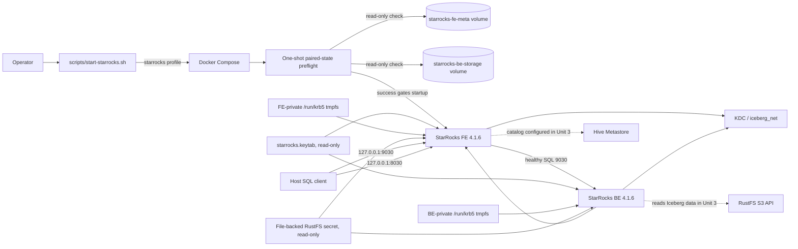

# Deployment Architecture — Unit 2 StarRocks Runtime

## Local Compose Topology

All services communicate on the existing `iceberg_net`. Only FE UI and SQL ports are host-published, both on loopback. FE/BE coordination and all KDC, Hive Metastore, and RustFS service ports remain internal. The dotted catalog/data paths become operational after Unit 3 configures the Iceberg catalog.

## Image and Credential Contract

| Runtime component | Image/base | Persistent state | Credentials/configuration |
|---|---|---|---|
| FE | Derived from `starrocks/fe-ubuntu:4.1.6` pinned to index digest `sha256:d07aa750be77625a09866a76dbfe0ee032baeb5e48fe0e952d30cb525329dc31` | `starrocks-fe-meta` at `/opt/starrocks/fe/meta` | Read-only `starrocks.keytab`; read-only `/etc/krb5.conf`; private `/run/krb5` tmpfs; read-only RustFS secret file |
| BE | Derived from `starrocks/be-ubuntu:4.1.6` pinned to index digest `sha256:bf0f5ca7fd9fc4e568d4d0e593e362f229b376976b513a5a549b1b922d9ec23b` | `starrocks-be-storage` at `/opt/starrocks/be/storage` | Read-only `starrocks.keytab`; read-only `/etc/krb5.conf`; private `/run/krb5` tmpfs; read-only RustFS secret file |
| Preflight | Small local utility image, pinned by its local build inputs | Read-only mounts of both StarRocks volumes | No credentials; no access to shared platform volumes |

Images use the same StarRocks release. Derived FE/BE builds install the Kerberos client and cron and preserve the official startup scripts. The source image references are immutable; the locally built FE/BE image digests must be recorded during construction/verification. Host keytab and secret paths follow the Unit 1 credential handoff; no credential values are embedded in this architecture document.

## Port Map

| Component | Port | Use | Host exposure |
|---|---:|---|---|
| FE | 8030 | FE HTTP/UI | `127.0.0.1:8030` |
| FE | 9030 | MySQL-protocol SQL | `127.0.0.1:9030` |
| FE | 9010 | Edit-log service | Internal only |
| FE | 9020 | RPC service | Internal only |
| BE | 8040 | HTTP service | Internal only |
| BE | 9050 | Heartbeat service | Internal only |
| BE | 9060 | BE Thrift service | Internal only |
| BE | 8060 | bRPC service | Internal only |
| BE | 9070 | Starlet service | Internal only |
| KDC | 88 | Kerberos | Existing service; internal only |
| Hive Metastore | 9083 | Thrift metastore | Existing service; internal only |
| RustFS | 9000 | S3-compatible API | Existing loopback mapping; FE/BE use internal service DNS |

## Lifecycle

- Enable StarRocks through `scripts/start-starrocks.sh`, which targets the `starrocks` profile; the existing default Compose startup remains unchanged.
- On each start, the wrapper runs a fresh preflight before starting FE/BE. It removes only an earlier successful preflight container; a failed coordinator remains available for inspection. A nonzero result blocks startup. FE and BE also declare `service_completed_successfully` on the coordinator.
- FE starts first. BE waits for FE SQL health, registers idempotently, and then starts.
- FE and BE each perform initial `kinit -kt` before starting StarRocks and refresh every hour through cron. A failed refresh is logged as a safe category; the service continues while its current TGT remains valid.
- Health checks assess the FE SQL service and whether both StarRocks nodes are alive. They do not claim catalog or storage-query readiness.
- Compose restart/recreate preserves the FE metadata and BE storage volumes. Routine operations never run volume deletion.

## Paired-State Safety

The preflight mounts only the two StarRocks volumes read-only. It returns success for a known-clean empty pair or a recognized paired existing layout. It fails safely for a one-sided empty/missing path or unreadable/inconsistent state. It does not create directories, repair data, write an initialization marker, or touch other state. FE/BE native startup remains responsible for validating their persisted formats; failed starts leave the volumes available for operator diagnosis. The implementation must confirm the release-specific data-path markers and fail closed if it cannot distinguish paired state safely.
