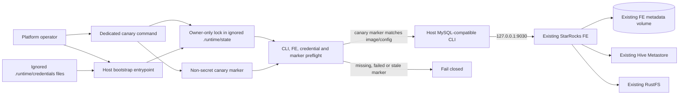

# Deployment Architecture — Unit 3 SQL Bootstrap and Catalog Access

## Local Topology

The Unit 3 operator tooling runs on the host. It connects only to the already published loopback FE SQL port. FE, BE, Hive Metastore, PostgreSQL, Kerberos, and RustFS remain the existing Unit 1/2 Compose topology. No Unit 3 helper container, service, port, or persistent volume is introduced.

## Endpoints and Persistence

| Path | Endpoint/storage | Owner and purpose |
|---|---|---|
| Host SQL client to FE | `127.0.0.1:9030` | Existing Unit 2 MySQL-protocol SQL listener; loopback only. |
| FE metadata | Existing `starrocks-fe-meta` volume | StarRocks-owned catalog, account, and authorization state. Unit 3 never edits the volume directly. |
| SQL credentials | Ignored `.runtime/credentials/` | Owner-only protected credential files; existing contents are not overwritten. |
| Lock and verification marker | Ignored `.runtime/state/` | Owner-only local state. Marker contains only canary result plus image/config fingerprints. |
| Platform dependencies | Existing Compose internal endpoints | FE/BE use current HMS/Kerberos/RustFS configuration and service identities. |

The host MySQL-compatible CLI is an operator prerequisite and is not currently installed/declared by this project. The Code Generation stage must choose and document a compatible CLI contract and its availability check without adding a runtime service.

## Deployment and Invocation Sequence

1. The operator starts StarRocks using the existing Unit 2 workflow and confirms FE/BE readiness.
2. The operator runs the dedicated secret-exposure canary. It validates the current FE image digest/logging-configuration fingerprint, exercises non-secret probe values, inspects relevant FE logging/history surfaces, and removes only its own probe objects.
3. On complete success, the canary stores a protected non-secret marker under ignored `.runtime/state/`. No marker is written on uncertainty or cleanup failure.
4. The operator invokes the host bootstrap. It checks for the host SQL CLI, FE readiness, protected credential files, canary marker freshness, and lock availability before any mutating operation.
5. Bootstrap acquires the shared local lock, reconciles only approved missing SQL state, authenticates target principals, reports redacted status, and releases the lock.
6. If the FE image or relevant logging configuration changes, the old marker no longer matches; the operator must rerun the canary before bootstrap can submit real credentials.

The canary and bootstrap are manual one-shot operations. There is no automatic retry, scheduler, background process, or automatic rollback. Partial additive changes remain and are inspected on a later operator rerun.

## Trust Boundaries and Prohibited Flows

- Secrets flow from protected host files to the bootstrap process and, only after the canary gate passes, to FE via the SQL client. They do not flow through CLI arguments, shell tracing, tracked configuration, Compose environment values, stdout/stderr, or persistent SQL files.
- FE-side SQL logs, audit/profile facilities, and history are treated as potentially secret-bearing until the canary demonstrates otherwise for the exact runtime. The host client alone is not considered a protection.
- Canary probes use non-secret values only and do not read production credential files. Logs/history are inspected, never cleared as part of probe cleanup.
- The FE continues to access Hive Metastore and RustFS using the dedicated Unit 1 service identities. SQL user impersonation is not introduced.
- Host bootstrap cannot modify FE/BE volumes directly or delete shared lakehouse data.

## Operations and Recovery

- Missing client, unavailable FE, lock conflict, missing/stale canary marker, or unsafe diagnostics causes a pre-mutation failure with safe guidance.
- Any uninspectable FE logging/history surface is treated as a canary failure. Do not proceed to real credential DDL based on partial evidence.
- A stale/ambiguous lock is not automatically removed. The operator inspects process/lock ownership and resolves it explicitly.
- A canary failure does not authorize deleting FE logs or pre-existing StarRocks objects. Probe cleanup is constrained to names owned by the canary invocation.
- Bootstrap failures preserve credentials, existing grants, catalog objects, and data. Operators resolve the reported category and rerun manually.

## Stage Gate

This document describes planned topology and procedures; it does not assert that the canary passed or that credential-bearing SQL is safe. Before Code Generation, the user must approve the infrastructure design. Before real credential-bearing DDL can be applied, the implemented canary must establish the approved no-secret behavior against the exact pinned FE image and current relevant logging configuration. If it cannot, the workflow stops pending explicit requirement/design resolution.
