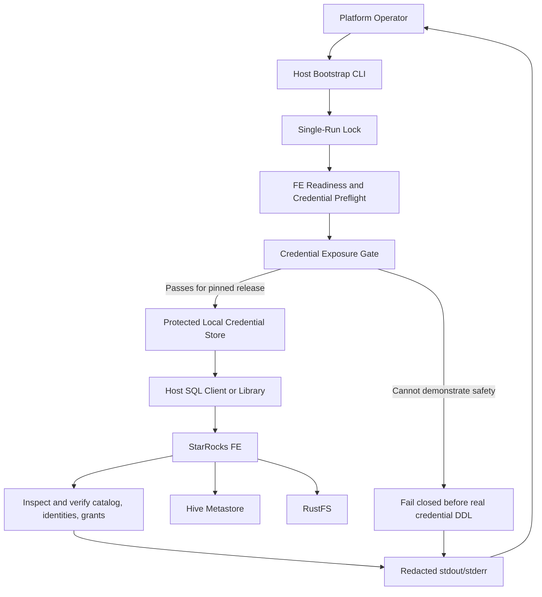

# Logical Components — Unit 3 SQL Bootstrap and Catalog Access

## Component Inventory

| Component | Responsibility | State and inputs | Failure behavior |
|---|---|---|---|
| Platform Operator | Start the StarRocks runtime separately, invoke bootstrap manually, review redacted status | Project scripts, Docker Compose, protected host credential files | Corrects the cause and invokes a safe rerun; no automatic scheduler or retry |
| Host Bootstrap CLI | Coordinate preflight, secret handling, SQL reconciliation, authentication checks, and final status | Existing FE loopback SQL endpoint; local credentials; non-secret project configuration | Stops before mutation on preflight/security failure; returns failure for conflicts or operation errors |
| Single-Run Lock | Prevent overlapping credential/SQL mutations | Owner-only lock state in ignored `.runtime/` | Rejects a second invocation without mutation; ambiguous stale lock requires operator resolution |
| Local SQL Credential Store | Hold root/admin/user_a/user_b/write_service_account password files | Ignored `.runtime/credentials/`, `0700` directories, `0600` files | Generates missing files only; preserves existing values; drift is not reset |
| FE SQL Client/Library | Submit StarRocks catalog, account, role, and grant operations from host to loopback FE | In-process client inputs and SQL operations; no secrets in argv or persistent temporary SQL files | Reports only redacted failure categories; credentials are not submitted until the exposure gate passes |
| Credential Exposure Gate | Verify pinned-release behavior for credential-bearing SQL and FE logs/history using non-secret canaries | StarRocks 4.1.6 FE logs, audit/profile facilities, query history, client diagnostics | Blocks credential-bearing DDL if a supported secret-safe route is not demonstrated |
| StarRocks FE | Persist external Iceberg catalog and native SQL authorization state; serve client connections | FE persistent state; SQL over loopback; StarRocks service identity for external access | Existing state is inspected and preserved; no automatic destructive repair |
| Hive Metastore and RustFS | Supply Iceberg metadata and object storage to StarRocks | Existing services and dedicated Unit 1 StarRocks Kerberos/RustFS service credentials | Dependency failure is reported separately from SQL authorization denial |

## Bootstrap Sequence

1. Operator starts the StarRocks services and invokes the host bootstrap.
2. Host Bootstrap CLI acquires Single-Run Lock. If another run is active or lock state is ambiguous, it exits without changing state.
3. CLI verifies FE SQL readiness and expected protected credential file locations/modes.
4. Credential Exposure Gate must already have passed against the pinned 4.1.6 runtime using non-secret canary values. If it has not passed, no real credential-bearing SQL is sent.
5. CLI loads existing password files or creates only missing files, using the approved atomic/protected project credential convention. It does not display values or place them in process arguments.
6. FE SQL Client/Library inspects the existing Iceberg catalog, account authentication state, and effective privileges.
7. If the state is compliant, report it. If expected state is safely absent, add the approved state. If a password mismatch, broader grant, or conflicting catalog is found, fail closed and preserve existing state.
8. Authenticate target SQL identities using their protected credential files and verify effective privileges according to the approved matrix.
9. Return concise per-step/final status and release the run lock. Partial additive changes are left in place for a safe later rerun.

## Logical Flow

## Credential and Trust Boundaries

- Host credential files are read by the operator bootstrap and are never copied into tracked configuration or printed.
- SQL traffic uses the existing loopback FE SQL endpoint. Secret values must not be placed in shell arguments, shell tracing, or persistent temporary SQL files.
- The FE log/query-history boundary is a required gate because StarRocks logging can capture SQL text. The gate must be verified against the exact pinned image; a host-side client does not by itself prevent FE-side logging.
- The FE uses the dedicated StarRocks service identity for HMS and RustFS. SQL users are native StarRocks principals and do not become Kerberos/RustFS identities.
- The FE/BE persistent volumes, catalog/data objects, and unrelated grants are outside the bootstrap's destructive authority.

## Deferred Infrastructure Decisions

- Select the host SQL client/library already available in the supported operator environment and confirm it can use protected file inputs without exposing secrets in argv.
- Select a portable lock primitive and safe stale-lock recovery for supported host operating systems.
- Confirm exact StarRocks 4.1.6 privilege SQL and account/catalog inspection commands.
- Prove that credential-bearing DDL does not expose passwords, verifiers, or RustFS secrets in FE logs, audit/profile facilities, query history, or diagnostics. Until then, actual secret-bearing DDL remains blocked.
- Define the implementation and integrated verification steps only after these decisions are approved.
