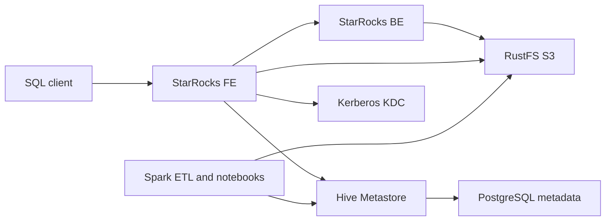
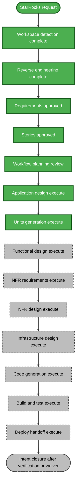

# Execution Plan — StarRocks OSS Integration

## Detailed Analysis Summary

### Transformation Scope

- **Transformation Type**: Infrastructure integration and addition of a new analytical service; not a replacement of Hive Metastore or Spark.
- **Primary Changes**: Add single-node StarRocks FE/BE, configure its Iceberg HMS catalog and RustFS storage, provision dedicated service identities and native SQL roles, and document/test local operations.
- **Related Components**: Docker Compose, `infra/starrocks/` (new), `infra/identity-provisioner/`, Kerberos/KDC, RustFS, Hive Metastore, README/operations documentation, integration verification. The sibling `airflow-spark-jenkins` project is explicitly out of scope.

### Change Impact Assessment

- **User-facing changes**: Yes — new StarRocks SQL endpoint, user accounts, and access-controlled query/write behavior.
- **Structural changes**: Yes — adds a FE/BE service pair and a catalog/storage integration.
- **Data model changes**: No schema migration planned; StarRocks must read/write existing Iceberg data compatibly.
- **API changes**: Yes — adds the MySQL-compatible StarRocks SQL interface and internal HMS/S3 client dependencies.
- **NFR impact**: Yes — Kerberos ticket lifecycle, S3 credential scope, SQL authorization, secrets handling, persistence, loopback exposure, and local resource use.

### Component Relationships

Text alternative: the SQL client talks to StarRocks FE, which coordinates BE query execution. StarRocks uses HMS for Iceberg metadata, Kerberos for HMS authentication, and a dedicated RustFS identity to read/write object data. Existing Spark paths continue using their current identities and catalog configuration.

| Component | Change type | Reason | Priority |
|---|---|---|---|
| Compose / `infra/starrocks/` | Major, new | Add pinned FE/BE service, config, persistent volumes, health checks, loopback ports | Critical |
| Identity provisioner / KDC | Minor to major | Add StarRocks HMS service principal/keytab and dedicated RustFS identity/policy; preserve all existing identities | Critical |
| StarRocks bootstrap | Major, new | Create catalog, native SQL users, roles, grants and safe test setup after FE is ready | Critical |
| Hive Metastore / PostgreSQL | Configuration dependency only | Existing secured HMS and catalog metadata must remain intact; no DB schema/data changes expected | Critical |
| RustFS | Identity/policy addition only | Dedicated scoped access for the Iceberg warehouse; do not change existing object data | Critical |
| README / operations docs | Minor | Document startup, endpoints, credentials, resources, validation and cleanup boundaries | Important |
| `airflow-spark-jenkins` sibling project | Retain | Requirements explicitly exclude changes to its Nessie configuration and Spark job | Retain |

### Risk Assessment

- **Risk Level**: Medium — local PoC and additive deployment, with meaningful unknowns around StarRocks/HMS Kerberos, Iceberg writes, and RustFS compatibility.
- **Rollback Complexity**: Moderate — remove StarRocks services/configuration and StarRocks-only volumes/credentials while preserving shared Hive metadata and RustFS data. Any StarRocks write test must use disposable or reversible test data.
- **Testing Complexity**: Complex — requires Compose validation, Kerberos/HMS catalog access, RustFS reads/writes, cross-engine Iceberg compatibility, and positive/negative SQL authorization checks.

## Canonical Knowledge Impact Inventory

| Canonical path | Action | Requirement and owning component | Reason |
|---|---|---|---|
| `aidlc-docs/knowledge/hive-dremio-rustfs/application-design.md` | UPDATE | FR-1 to FR-7; project architecture | Add StarRocks as query service and describe boundaries among SQL authorization, Kerberos HMS access, and RustFS credentials. |
| `aidlc-docs/knowledge/hive-dremio-rustfs/functional-design/lakehouse-workload-and-access.md` | UPDATE | FR-2 to FR-7; shared Iceberg workload/access | Record how StarRocks coexists with Spark and the existing sample access matrix after implementation decisions are validated. |
| `aidlc-docs/knowledge/hive-dremio-rustfs/functional-design/starrocks-analytics.md` | CREATE | FR-1 to FR-6; new StarRocks service | Justified by the newly introduced analytical component with its own catalog, identity, SQL authorization, and query/write behavior. |
| Workload/domain index | RETAIN / not present | Existing project knowledge | No separate index currently exists; do not create a summary index without a durable need. |

These updates are proposed for durable knowledge after implementation/verification; archived records remain immutable. The execution-plan approval is the gate for this inventory. Any later scope or canonical ownership change requires an updated plan and approval.

## Workflow Visualization

Text alternative: workspace detection, reverse engineering, requirements, stories, Workflow Planning, Application Design, and Units Generation are complete. Construction is underway with Unit 1 Functional Design, followed by per-unit NFR/infrastructure design and Code Generation, then Build and Test, Deploy handoff, and closure review.

## Phases to Execute

### INCEPTION PHASE

- [x] Workspace Detection — brownfield project identified.
- [x] Reverse Engineering — current stack and adjacent orchestration configuration mapped.
- [x] Requirements Analysis — answers and clarifications approved.
- [x] User Stories — personas and five capability stories approved.
- [x] Workflow Planning — approved; proceed to Application Design.
- [x] Application Design — **EXECUTE; COMPLETE**. StarRocks components, interfaces, services, and dependencies were designed and approved.
- [x] Units Generation — **EXECUTE; COMPLETE**. Three units were defined with story ownership and sequential dependencies.

### CONSTRUCTION PHASE

- [ ] Functional Design — **EXECUTE**. Define catalog lifecycle, native SQL roles/grants, identity provisioning, write test isolation, and idempotent behavior.
- [ ] NFR Requirements — **EXECUTE**. Security, local resource, persistence, compatibility, and operability constraints are material.
- [ ] NFR Design — **EXECUTE**. Design secrets/keytabs, ticket refresh, S3 policies, volume persistence, health/readiness, and safe rollback.
- [ ] Infrastructure Design — **EXECUTE**. New Compose FE/BE services, network, ports, volumes, dependencies, resource limits, and startup/health behavior are required.
- [ ] Code Generation — **EXECUTE (ALWAYS)**. Implement the approved unit plan.
- [ ] Build and Test — **EXECUTE (ALWAYS)**. Validate Compose and images, then perform catalog, query/write, authorization, and preservation checks.

### DEPLOY PHASE

- [ ] Deploy — **EXECUTE (ALWAYS)**. Prepare PR request and ordered local rollout/rollback handoff only; do not deploy automatically.

## Package Change Sequence

1. Add pinned StarRocks FE/BE Compose service definitions and component configuration under `infra/starrocks/`; preserve all current mounts, volumes, and data services.
2. Extend identity provisioning for a dedicated StarRocks Kerberos service identity, RustFS read/write identity/policy, and StarRocks native users/roles. Provision only after required KDC, HMS, and RustFS prerequisites are healthy.
3. Add an idempotent StarRocks catalog/user/grant bootstrap and readiness/smoke checks, ordered after FE startup and before integration checks.
4. Update root README and relevant deployment/run docs; do not edit the sibling `airflow-spark-jenkins` project.
5. Verify query, controlled Iceberg write/readback, denied access, credential redaction, persistent state, and that existing services/data were preserved.

## Multi-Module Update Strategy

- **Update Approach**: Sequential, with independent documentation review parallel to design but integrated code verification after service and identity provisioning.
- **Critical Path**: StarRocks image/config -> FE/BE readiness -> Kerberos HMS catalog connection and RustFS access -> SQL user/grant bootstrap -> query/write and authorization verification.
- **Coordination Points**: Compose network/service names, HMS Kerberos principal and ticket refresh, S3 endpoint/path style, RustFS prefix policies, Iceberg table feature compatibility, SQL account naming, and test-table cleanup.
- **Rollback Strategy**: Stop/remove only StarRocks services and StarRocks-only volumes/credentials after explicit operator action. Never remove shared Hive metadata or RustFS objects. Isolate write tests to a designated test table/prefix or reversible rows.

## Estimated Timeline

- **Total Phases**: Inception and construction design, implementation units, Build and Test, and Deploy handoff; each has review gates.
- **Estimated Duration**: Several iterative workflow turns. Runtime validation duration depends on image pulls, host resources, and compatibility findings; no calendar estimate is asserted.

## Success Criteria

- **Primary Goal**: StarRocks OSS works as a SQL analytics engine over the existing Hive Metastore/RustFS Iceberg lake without replacing existing services.
- **Key Deliverables**: Pinned Compose FE/BE deployment, dedicated identities, Iceberg catalog and storage integration, native user grants, documented operations, repeatable verification.
- **Quality Gates**: Compose/image validation; secured HMS catalog discovery; RustFS data reads and controlled writes; allowed/denied SQL matrix; credentials redacted; persistent state; existing data/services preserved.
- **Integration Testing**: All StarRocks/HMS/Kerberos/RustFS/Spark interoperability checks pass or are explicitly recorded as unverified under an approved waiver.
- **Release Handoff**: PR request and ordered deployment/rollback instructions prepared; no automatic deployment.

## Planning Progress

- [x] Load and review reverse-engineering, approved requirements, stories/personas, and canonical knowledge.
- [x] Assess transformation impact, risk, update sequence, and canonical knowledge actions.
- [x] Select conditional stages and record rationale.
- [x] Prepare execution plan and visualization.
- [x] Obtain explicit user approval before proceeding to Application Design.
