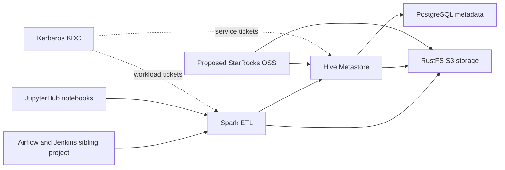

# System Architecture

## System Overview

The active project is a local Docker Compose lakehouse. Hive Metastore 3.1.3 uses PostgreSQL for catalog metadata. Spark 3.5.5 with Iceberg 1.8.1 creates and queries Iceberg tables, while RustFS stores their objects. Kerberos provisions service and workload identities. JupyterHub starts user notebook containers. Dremio has already been removed from active Compose by the prior closed intent. This intent proposes StarRocks OSS as a new SQL query engine.

## Architecture Diagram

Text alternative: Airflow/Jenkins can launch Spark; Spark reads/writes Iceberg through Hive Metastore and RustFS. JupyterHub supplies notebook sessions. The proposed StarRocks cluster independently connects to Hive Metastore for Iceberg catalog metadata and RustFS for data files. Kerberos currently authenticates the Hive/Spark paths; StarRocks identity and authorization behavior remains a requirement to resolve.

## Components

- **Hive Metastore 3.1.3**: Iceberg catalog metadata API; backed by PostgreSQL. Standalone HMS, no HiveServer2.
- **PostgreSQL 16**: Metastore database.
- **RustFS**: S3-compatible object store; stores `lake` bucket contents.
- **Kerberos KDC**: Local `LAKEHOUSE.LOCAL` realm and service/user principals.
- **Spark 3.5.5 / Iceberg 1.8.1**: ETL and notebook compute.
- **JupyterHub 5.3.0**: Starts isolated user Spark notebook containers.
- **TPCH generator/loader**: Optional workload; loader writes as `write-service-account`.
- **StarRocks OSS (proposed)**: New MPP SQL serving engine; no current service or configuration exists.
- **Airflow/Jenkins sibling project**: Separate Compose project, external shared Docker network, Airflow DockerOperator launches Spark. Spark defaults currently select Nessie and use placeholder S3 credentials.

## Key Integration Boundaries

1. StarRocks FE and BE/CN must reach the HMS Thrift endpoint and RustFS S3 endpoint over the shared Docker network.
2. The current HMS and storage are Kerberos/S3-credential protected. StarRocks documentation describes keytab/TGT setup for Kerberos-enabled HMS/HDFS and explicit S3-compatible credentials; whether this fits current RustFS authorization needs a focused prototype.
3. StarRocks SQL authorization is a distinct layer from Spark/HMS/RustFS authorization. Adding it alone will not enforce policies on direct Spark or object-store access.
4. The sibling Airflow Spark settings require migration from Nessie to HMS if that is included in scope.

## Deployment Model

Current services use one Compose network, `iceberg-poc-net`, and named volumes. StarRocks would require FE and BE/CN services, persistent state and resource sizing, plus MySQL-protocol and HTTP/UI endpoints. No ports, version, or persistence choices have yet been approved.
