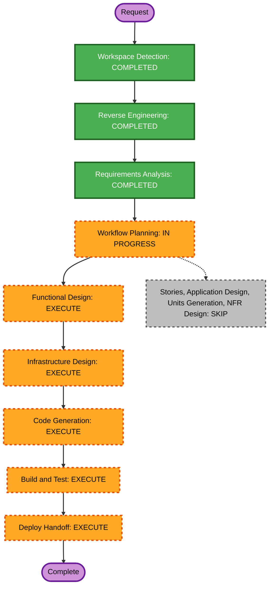

# Execution Plan — Remove Dremio and Clean the Project

## Detailed Analysis Summary

### Transformation Scope

- **Transformation type:** Multi-component infrastructure and workload integration removal.
- **Primary changes:** Remove Dremio service/runtime integrations and preserve the existing Hive/RustFS/Spark/Jupyter platform and data.
- **Related components:** Docker Compose and environment files; Kerberos bootstrap and identity provisioner; Hive proxy configuration; TPCH loader image/workload; bootstrap/start/clean scripts; SQL examples; README and canonical knowledge.

### Change Impact Assessment

- **User-facing changes:** Yes — Dremio UI, JDBC, and Flight endpoints will be removed; Spark, Hive, RustFS, and Jupyter workflows remain.
- **Structural changes:** Yes — the supported stack no longer includes Dremio or the optional `tpch-jdbc` service.
- **Data model changes:** No — Hive catalog schemas and TPCH tables are preserved.
- **API changes:** Yes — Dremio endpoints and the Dremio-specific JDBC workload interface are removed.
- **NFR impact:** Data preservation and cleanup safety are required; no new performance or resiliency goals are introduced.

### Component Relationships

- **Primary component:** Compose-managed lakehouse PoC.
- **Infrastructure components:** Compose services, KDC bootstrap/healthcheck, Hive core-site template, local runtime credentials and named volume.
- **Shared components:** Spark, RustFS, Hive Metastore, PostgreSQL, Kerberos, JupyterHub, TPCH Spark ETL.
- **Dependent components:** TPCH JDBC phase and Dremio-facing docs/scripts depend on Dremio and will be removed or updated.
- **Supporting components:** Identity provisioning and startup/cleanup scripts must continue to operate for retained services.

### Risk Assessment

- **Risk level:** Medium — changes cross several files and persistent runtime state, with explicit preservation constraints.
- **Rollback complexity:** Moderate — source edits are reversible, while the user-authorized Dremio principal, credentials, and Dremio volume removal is not reversible without backups.
- **Testing complexity:** Moderate — static references/configuration can be inspected locally; retained service integration may require Compose validation and selectively scoped runtime checks.

## Workflow Visualization

Text equivalent: requirements approval is complete. The proposed sequence is Workflow Planning approval, Functional Design, Infrastructure Design, Code Generation, Build and Test, then Deploy handoff. User Stories, Application Design, Units Generation, NFR Requirements, and NFR Design are skipped for the defined scope.

## Phases to Execute

### INCEPTION

- [x] Workspace Detection — completed.
- [x] Reverse Engineering — completed; current-state integration map exists.
- [x] Requirements Analysis — approved by user.
- [x] User Stories — skip; this is internal infrastructure cleanup without new user journeys.
- [x] Workflow Planning — plan prepared; approval pending.
- [ ] Application Design — skip; no new component, service, method, or boundary is introduced.
- [ ] Units Generation — skip; no new data model, API, or algorithm is introduced.

### CONSTRUCTION

- [ ] Functional Design — execute. Specify preserved Spark/Hive/RustFS TPCH behavior and the removed Dremio JDBC phase; identify testable properties if pure helper logic changes.
- [ ] NFR Requirements — skip. Requirements already establish the relevant preservation and verification constraints; no new performance, availability, or security-baseline targets are needed.
- [ ] NFR Design — skip because no new NFR design is introduced.
- [ ] Infrastructure Design — execute. Define safe Compose/script changes and ordered removal of only Dremio runtime state.
- [ ] Code Generation — execute. Remove Dremio code/config/docs and update canonical knowledge while preserving retained operations and data.
- [x] Build and Test — completed. Compose configuration, relocation assertions, shell/Python syntax checks, and enabled-profile image builds passed. Live retained-workload behavior and Dremio runtime-state removal were not exercised; see `construction/build-and-test/build-and-test-summary.md`.

### DEPLOY

- [ ] Deploy handoff — execute. Provide ordered local Compose instructions and report any runtime actions that could not be safely verified.

## Canonical Knowledge Impact Inventory

| Canonical path | Action | Requirement and owning component | Reason |
|---|---|---|---|
| `aidlc-docs/knowledge/hive-dremio-rustfs/application-design.md` | UPDATE | FR-1, FR-3, FR-5; platform architecture and identity boundaries | Remove Dremio as a retained component and describe the supported Hive/RustFS/Spark/Jupyter stack. |
| `aidlc-docs/knowledge/hive-dremio-rustfs/functional-design/lakehouse-workload-and-access.md` | UPDATE | FR-2, FR-5; TPCH workload and identity flow | Preserve the Spark/Hive/RustFS workload while removing Dremio behavior and obsolete access outcomes. |
| `aidlc-docs/knowledge/hive-dremio-rustfs/functional-design/` new component document | RETAIN / no new file | FR-5; existing component boundary | No new component or durable domain is introduced. |
| `aidlc-docs/archive/20261023-hive-dremio-kerberos/` | RETAIN | FR-5; historical intent record | Preserve prior intent history unchanged. |

## Package Update Strategy

- **Update approach:** Sequential, with edits grouped by dependency layer.
- **Critical path:** Compose and environment definitions → Kerberos/Hive identity configuration → TPCH loader/workload → operational scripts → docs and canonical knowledge → verification.
- **Coordination points:** TPCH Spark ETL must remain independent of the removed JDBC driver and Dremio service; identity scripts must retain all non-Dremio principals; cleanup scripts must not remove protected volumes.
- **Rollback strategy:** Revert source changes from the workspace history as available. Runtime deletion is limited to Dremio-only state and may not be recoverable; no shared named volume or KDC reset is permitted.

## Success Criteria

- The Dremio service, integrations, credentials, keytab, principal, and only its Docker data state are removed.
- Retained Compose services, Spark TPCH ETL, credentials, identities, data, and Jupyter workspaces remain configured and preserved.
- Active documentation and canonical knowledge describe the retained stack; the prior archive is unchanged.
- Configuration and relevant retained behavior are verified, with any runtime verification limits stated.

## Estimated Timeline

- **Total planned stages after approval:** 5 (Functional Design, Infrastructure Design, Code Generation, Build and Test, Deploy Handoff).
- **Estimated duration:** One implementation/review cycle; runtime verification time depends on retained services already being available.
