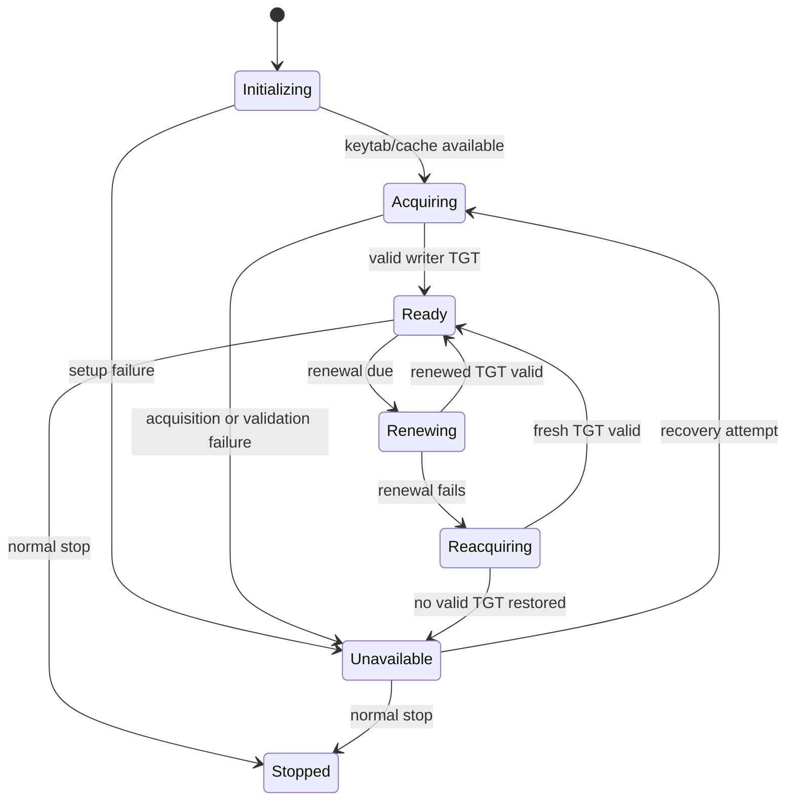

# Business Logic Model — Spark Writer Runtime

## Scope

This model defines how the existing Spark service and Unit 2's Airflow-created worker containers establish and maintain the shared writer identity needed by remote ETL executors. It covers the worker-side Kerberos ticket lifecycle and the distinct RustFS credential path. The per-run driver has a separate ticket cache managed by Unit 2.

## Actors and Responsibilities

- **Long-lived Spark service lifecycle** starts the existing Spark master, worker, and history server only after writer-ticket bootstrap succeeds. It supervises the service-local writer credential lifecycle and remains available for notebooks and other clients.
- **Per-run Spark worker lifecycle** starts a worker-only process in a temporary container after its own writer TGT validates; it registers with the shared master and is removed by Unit 2 after the DAG run.
- **Writer ticket lifecycle** obtains and validates a TGT for `write-service-account@LAKEHOUSE.LOCAL`, maintains a private cache, and reports whether the worker may accept new ETL work.
- **Spark workers/executors** use their local writer ticket when accessing Hive Metastore and read-only RustFS writer credential files for object-store access. This includes the existing long-lived worker and Unit 2's per-run ephemeral workers.
- **Airflow-created Spark driver** is an independent Unit 2 actor. It submits to the verified Spark master endpoint using its own run-scoped ticket cache and the agreed writer identity.
- **Hive Metastore and RustFS** are separate authorization endpoints: Hive uses Kerberos, while RustFS uses the S3-compatible key/secret pair.

## Service Lifecycle

1. **Initialize**: The Spark service reads the existing writer principal/keytab reference and creates or selects its private ticket cache.
2. **Acquire**: Each worker runtime requests a TGT for the configured writer principal in its own private cache and validates that the resulting ticket belongs to that principal and is currently usable.
3. **Gate readiness**: Only after successful validation does it start/enable the Spark worker for ETL. Bootstrap failure leaves the worker unavailable and reports a non-secret diagnostic.
4. **Serve work**: Remote Spark executors use the ticket of the worker process on which they run for Hive requests and that worker's separate RustFS writer files for S3 requests. Spark Standalone may assign executors to any registered worker, so a per-run worker does not ensure exclusive placement.
5. **Maintain**: Before the current ticket becomes unusable, the lifecycle attempts renewal. If renewal fails, it attempts to acquire a fresh ticket from the same keytab.
6. **Degrade safely**: If renewal and reacquisition cannot restore a valid ticket, the service becomes unavailable for new ETL work. It does not intentionally terminate already-running workloads; in-flight operations succeed or fail according to the credentials accepted by the endpoint.
7. **Recover**: Once a fresh valid ticket is acquired, service readiness may be restored and new ETL work may be accepted again.

NFR Design will set renewal lead time, retry count/backoff, cache permissions, and readiness/health signaling. Infrastructure Design will decide exact process ordering and endpoint/network details.

## Functional State Model

**Text alternative**: The service starts by initializing its private cache and acquiring a valid writer TGT. It becomes ready only after validation. While ready it renews the ticket; on failure it tries to reacquire from the existing keytab. If no valid ticket is restored, the worker is unavailable for new ETL work. Later successful recovery returns it to ready. Normal shutdown stops either ready or unavailable states.

## Workload Data Flow

1. Airflow submits a driver to the verified Spark master using the Unit 1 contract.
2. Spark Standalone schedules executor work across any registered worker, including the existing long-lived worker and Airflow-created per-run workers. The per-run worker is removed after that run but is not an exclusive execution boundary.
3. An executor requests catalog metadata from Hive Metastore using the shared writer Kerberos identity.
4. An executor reads or writes Iceberg data objects through RustFS using the separate writer S3 credentials.
5. The Spark service's ticket readiness controls admission of new ETL work; it does not dynamically change RustFS credentials or grant per-author identity.

## Functional Outcomes

- Ready: the writer TGT has been validated and the service can admit new writer ETL work.
- Unavailable: no valid writer TGT is available; no new writer ETL work is admitted.
- Running-workload outcome: the service does not deliberately cancel a workload on credential loss; each in-flight HMS/S3 operation reports its actual endpoint outcome.
- Credential diagnostics: report lifecycle state and failure category without exposing keytab contents, ticket material, or RustFS secret values.
