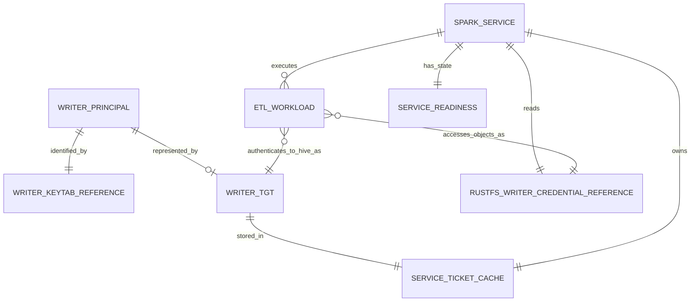

# Domain Entities — Spark Writer Runtime

This unit adds no persisted business records or catalog entities. The following runtime concepts define credential ownership and service readiness.

## Entities and Value Objects

| Concept | Attributes | Owner / lifetime | Relationships |
|---|---|---|---|
| Writer Principal | Principal name `write-service-account@LAKEHOUSE.LOCAL` | Existing identity; persists outside the Spark process | Identified by the writer keytab and represented by the service's TGT |
| Writer Keytab Reference | Protected file reference; configured principal association | Existing protected runtime credential; service lifetime | Used to acquire/reacquire a TGT; never exposed to workload bundle content |
| Service Ticket Cache | Private cache reference and current ticket state/expiry | One long-lived or ephemeral worker runtime | Holds a TGT for the Writer Principal; separate across the service worker, each per-run worker, each driver, and notebook caches |
| Writer TGT | Principal, validity interval, renewable/expiry state | Cache lifetime; renewed/reacquired as needed | Enables Spark processes to authenticate to Hive Metastore |
| RustFS Writer Credential Reference | Read-only file references to S3 access and secret keys | Existing protected runtime credential | Used for object-store access independently of the Writer TGT |
| Spark Service Readiness | `Initializing`, `Acquiring`, `Ready`, `Renewing`, `Reacquiring`, `Unavailable`, or `Stopped` | Current service process | Controls whether new writer ETL work is admitted |
| ETL Workload | Airflow-submitted Spark application and its status | Run lifetime | Spark Standalone may schedule executors on any registered worker, including the existing worker and per-run workers; each uses the shared writer identity for HMS and RustFS access |

## Relationship Model

**Text alternative**: The existing writer principal is associated with its protected keytab and a TGT stored in a private cache owned by the Spark service. The Spark service separately reads the RustFS writer credential files. ETL workloads execute on the worker and use the TGT for Hive and the S3 credentials for RustFS. A readiness state determines whether new workloads can be admitted.

## Invariants

- At most one currently selected writer TGT is used by the Spark service cache at a time; ticket replacement is atomic from the perspective of readiness (implementation details are deferred).
- `Ready` implies a validated, unexpired TGT for the configured writer principal.
- `Unavailable` implies no new ETL workloads are admitted.
- RustFS credential identity does not derive from, and is not validated by, the Kerberos TGT.
- Driver and Spark service ticket caches have separate owners and lifetimes.
- No credential bytes or ticket contents are represented in ordinary domain state or diagnostic outputs.
