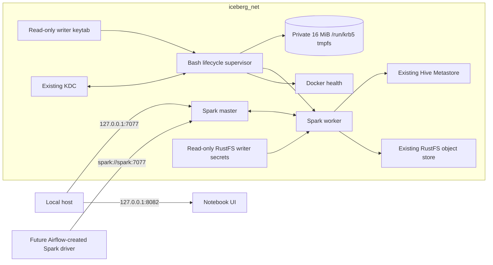

# Deployment Architecture — Unit 1 Spark Writer Runtime

## Local Docker Compose Topology

## Container and Endpoint Contract

The `spark` service uses a small local image derived from the existing pinned Spark base digest. It installs Debian `krb5-user` to provide the `kinit` and `klist` commands required by the lifecycle supervisor; it does not change the Spark version or add a service.

| Endpoint | Container/network address | Host binding |
|---|---|---|
| Spark master | `spark:7077` (`spark://spark:7077`) | `127.0.0.1:${SPARK_MASTER_PORT:-7077}` |
| Notebook UI | Existing Spark service UI port | `127.0.0.1:${SPARK_UI_PORT:-8082}:8080` |
| Hive Metastore | `hive-metastore:9083` on `iceberg_net` | Existing Compose exposure policy |
| RustFS S3 API | `object-store:9000` on `iceberg_net` | Existing Compose exposure policy |
| Kerberos KDC | `kdc` on `iceberg_net` | Existing Compose exposure policy |

Only local host access to the Spark master and notebook is published. Airflow's future driver joins `iceberg_net` and uses the Compose service DNS name, not the host loopback address. Unit 3 owns the Airflow container network attachment.

## Lifecycle and Health Paths

```mermaid
stateDiagram-v2
    [*] --> STARTING
    STARTING --> READY: valid TGT + Spark worker registered
    STARTING --> STARTING: TGT unavailable; retry; unhealthy
    READY --> DRAINING: TGT not recovered by two-minute guard
    DRAINING --> UNAVAILABLE: decommission confirmed; worker unschedulable
    DRAINING --> DRAINING: keep credential retries and let current tasks drain
    UNAVAILABLE --> RECOVERING: fresh TGT validated
    RECOVERING --> READY: worker restarted and registered
    READY --> STOPPING: Compose termination
    STARTING --> STOPPING: Compose termination
    UNAVAILABLE --> STOPPING: Compose termination
```

The health check reports healthy only in `READY`, with a valid TGT and worker registration. `STARTING`, `DRAINING`, `UNAVAILABLE`, `RECOVERING`, and `STOPPING` are unhealthy. The supervisor is the sole state writer; the health check reads state and runtime readiness without initiating recovery.

## Startup Dependencies

Compose waits for KDC health, object-store health, bucket initialization completion, and Hive Metastore health before starting Spark. After startup, the supervisor—not Compose—owns periodic Kerberos retry and worker recovery. The new Spark startup dependency does not change Hive schema, object-store data, or existing volume lifecycle.

## Isolation and Data Persistence

- Kerberos cache: ephemeral tmpfs, private to the Spark container, not backed by a named volume.
- Writer keytab: existing host file, mounted read-only; host mode `0600`.
- RustFS writer credentials: existing file-backed Compose secrets, read-only in the service.
- Spark work and existing lakehouse data: preserve current mounts and named-volume ownership; no reset or recreation is part of deployment.
- Network: reuse `iceberg_net`; no new network or public host binding.

## Operational Notes

Docker health and sanitized stdout/stderr provide local operator visibility. No external monitor, broker, or queue is deployed. Recovery and admission behavior must be demonstrated against the pinned Spark image before the Unit 1 requirements are reported as verified.
