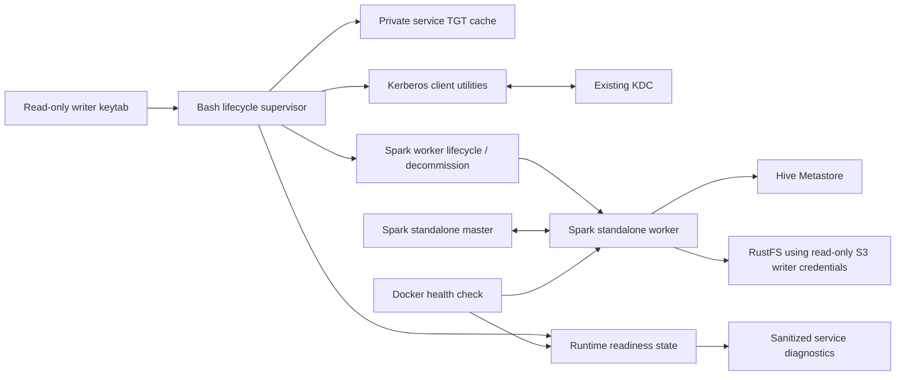

# Logical Components — Unit 1 Spark Writer Runtime

## Component View



## Responsibilities and Boundaries

| Component | Responsibility | Boundary |
|---|---|---|
| Bash lifecycle supervisor | Serializes TGT acquisition/renewal, lifecycle transitions, worker decommission/restart, and recovery | Existing Spark service; no helper service or new runtime package |
| Kerberos client utilities | Obtain/renew and validate the writer TGT from the existing keytab | Existing image tools; command output is suppressed or sanitized |
| Private TGT cache | Holds only the service-side writer TGT with owner-only access | Runtime-scoped and isolated from notebooks and Airflow's per-run cache |
| Spark master | Keeps the existing standalone cluster endpoint available | Continues running while worker is draining/unavailable, subject to existing topology |
| Spark worker | Executes work using the shared writer TGT and RustFS writer credentials | Gracefully decommissioned when admission must close; no forced termination |
| Readiness state and Docker health | Report credential and worker readiness to local operators | Health is not itself the admission enforcement mechanism |
| Hive Metastore and RustFS | Authorize metadata and object access independently | Hive uses Kerberos; RustFS uses the separate S3-compatible credential pair |

## State Ownership

The supervisor is the sole writer of lifecycle state. Health checks read state and verify the corresponding ticket/worker conditions; they do not mutate state. The supervisor sets `READY` only after valid-ticket validation and worker registration. It closes admission by requesting graceful worker decommission, confirms the worker is unschedulable, and keeps the state unhealthy until recovery completes.

## Failure and Recovery Flow

```mermaid
sequenceDiagram
    participant S as Lifecycle supervisor
    participant K as KDC / Kerberos tools
    participant W as Spark worker
    participant H as Docker health
    S->>K: Renew/reacquire before expiry
    K-->>S: Failure; retries continue
    S->>S: Enter DRAINING before safety threshold
    S->>W: decommission-worker.sh
    W-->>S: Worker drains; active tasks are allowed to finish
    S->>H: Unhealthy while worker is unschedulable
    S->>K: Retry acquisition at approved cadence
    K-->>S: Fresh TGT validated
    S->>W: Start/register worker with service cache
    W-->>S: Worker readiness confirmed
    S->>H: READY / healthy
```

The sequence describes the intended behavior. Build and Test must confirm the pinned image actually stops new assignments and drains existing work as designed; otherwise the admission requirement remains unverified and must return for a decision.
