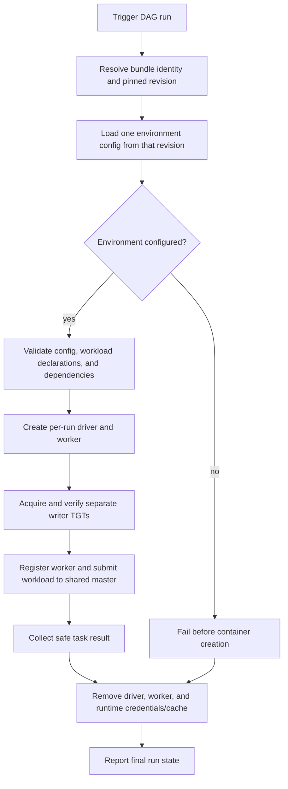

# Unit 2 Business Logic Model — Airflow Bundle Runner

## Purpose

An Airflow run executes workload code from one immutable Git Bundle revision on the shared remote Spark cluster, using the existing writer service identity. Each run owns one temporary Spark driver and one temporary Spark worker. Both are removed when the run finishes, whether it succeeds or fails.

## Run flow

1. Resolve the configured bundle identity to the immutable revision Airflow selected for this DAG run. All DAG code, environment configuration, helper modules, and workloads for the run come from that revision.
2. Read and validate the environment config before creating a container. The configured `dev` environment targets the local lakehouse. UAT and production bundle identities remain unavailable until external endpoints and credentials are configured; selecting them must fail clearly and never fall back to dev.
3. Validate required fields, workload declarations, and the dependency graph. Invalid input fails without starting either run container.
4. Create one ephemeral driver and one ephemeral worker for the DAG run. Mount the bundle revision read-only in the driver. Mount the existing writer keytab and RustFS credential files read-only in both containers; each container gets its own private, run-scoped Kerberos cache.
5. The driver and worker independently acquire and verify writer TGTs. Start the worker-only process and wait for it to register with the shared Spark master. Submit from the driver to Unit 1's remote Spark master (`spark://spark:7077`) using the selected catalog/namespace and RustFS configuration. Do not run the workload in local-only Spark mode.
6. Run independent workloads concurrently only when the declared graph permits it; honor each workload's `runs_after` dependencies. Preserve a stable outcome for each workload and the overall DAG run.
7. Remove the per-run driver and worker, including their temporary credential/cache state, after all tasks settle. Cleanup must not alter the bundle revision, long-lived Spark service, or persistent lakehouse data.
8. Report success only when workload execution and required cleanup succeed. On failure, preserve the primary workload/configuration error and report cleanup failure as an additional failure without exposing secrets or ticket material.

## Example workload target

The development bundle's synthetic table is `lakehouse_dev.test_database.test_airflow_generated_table`. It is managed below the dedicated dev catalog warehouse prefix `s3a://lake/warehouse/lakehouse_dev/`. The workload may create/replace this dedicated sample table; it must not overwrite the TPCH namespaces `databaseA` or `databaseB`, or any unrelated table.

## Catalog and access model

- Initialize the Hive Metastore with catalogs `lakehouse_dev`, `lakehouse_uat`, and `lakehouse_prod`; create `databaseA` and `databaseB` in each.
- Assign distinct RustFS warehouse prefixes to the three catalogs under `s3a://lake/warehouse/`; dev uses `s3a://lake/warehouse/lakehouse_dev/`.
- `write-service-account` is the service writer/admin identity for catalog and object creation and data writes across all three catalogs and their associated storage locations.
- `user_a` and `user_b` are equivalent normal readers. Both receive read-only access to `databaseA` and `databaseB` in all three catalogs and read-only access to the associated object data.
- StarRocks remains a query engine for this intent. It offers the equivalent reader identities read-only access; no reader write path is introduced.
- Airflow's current bundle environment gate remains in force: creating UAT/prod catalog metadata locally does not configure or authorize UAT/prod Airflow execution against this local stack.

## Per-run worker scheduling behavior

At most two DAG runs are active concurrently; further runs wait in the Airflow queue. Each active run creates a driver/worker container pair. The worker is dedicated to the run's container lifecycle, not to exclusive application placement: it registers with the shared Spark Standalone master, which may schedule the run's executors on any registered worker, including the existing long-lived worker and other runs' workers. This shared scheduling behavior is intentional. The long-lived `spark` worker remains available to notebooks and other clients.

## Compatibility and verification boundary

The checked-in Spark setup currently configures one Hive-backed Iceberg catalog, and StarRocks currently registers one Hive external catalog. The three-catalog policy above is the accepted functional target, not a claim that current engine configurations already provide it. Infrastructure/code generation must verify Hive 3 catalog initialization, Spark Iceberg catalog addressing, StarRocks external-catalog visibility and grants, and storage authorization for each catalog before runtime acceptance. It must also verify worker-only startup, independent TGT readiness, worker registration/removal, and resource behavior. If any engine cannot honor the target through supported interfaces, stop and return with a concrete design change request; do not silently map multiple logical environments into the existing single catalog.
