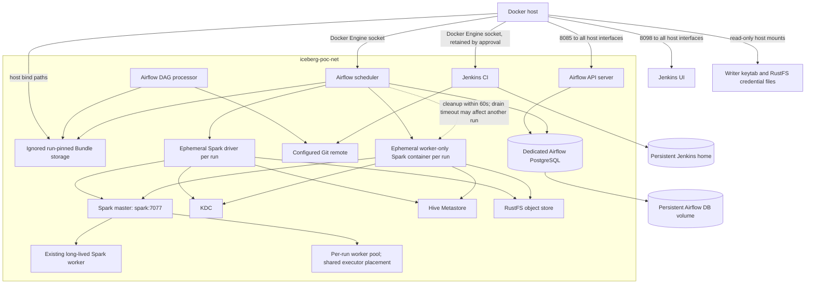

# Deployment Architecture — Unit 2 Airflow Bundle Runner

## Deployment Topology



## Deployment Ownership

| Resource | Owner | Persistence / exposure |
|---|---|---|
| Airflow API, scheduler, DAG processor, triggerer | Target Compose project | Recreated from configured images; API host port 8085 on all interfaces |
| Airflow PostgreSQL | Airflow only | Dedicated named volume; no host port |
| Git Bundle checkout cache | Airflow DAG processor | Ignored project runtime host path, visible at the same absolute path to Docker-created driver |
| Run driver and worker | One Airflow DAG run | Ephemeral, labeled with run ID, attached to `iceberg-poc-net`, removed during cleanup |
| Jenkins CI | Target Compose project | Persistent named home volume; UI host port 8098 on all interfaces; no inbound agent port |
| Jenkins and scheduler Docker socket | Docker host | Mounted only as approved; grants broad host-level Docker control |
| Writer credential files | Existing project runtime credential tree | Host-owned, restrictive permissions, read-only in run containers; never in images or Bundle storage |
| Lakehouse databases, tables, objects, and volumes | Existing lakehouse services | Preserved; not owned by Airflow/Jenkins initialization or run cleanup |

## Startup and Run Sequence

```mermaid
sequenceDiagram
    participant O as Operator
    participant A as Airflow
    participant G as Git Bundle processor
    participant D as Docker Engine
    participant R as Run driver
    participant W as Run worker
    participant S as Spark master

    O->>A: Trigger dev DAG
    A->>A: Validate environment/config and concurrency slot
    A->>G: Resolve immutable Bundle revision
    G-->>A: Pinned revision path
    A->>D: Create driver and worker-only containers
    D-->>R: Driver on iceberg-poc-net; Bundle read-only
    D-->>W: Worker on iceberg-poc-net; separate cache
    R->>R: Acquire and validate private writer TGT
    W->>W: Acquire and validate private writer TGT
    W->>S: Register worker
    S-->>A: Worker readiness observable
    A->>A: Poll both ready states (5s or faster; 5m deadline)
    A->>R: Submit workloads only after pair readiness
    R->>S: Spark remote submission
    A->>D: On completion, stop driver and decommission worker
    A->>S: Observe foreign executors within shared 60s cleanup deadline
    alt Worker drains
      A->>D: Remove run pair
    else Drain timeout
      A->>D: Stop/remove worker and driver
      A->>A: Emit worker_drain_timeout; another run may be affected
    end
```

## Operational Notes

- Compose initialization migrates only the dedicated Airflow metadata database. It does not initialize or clear the Hive metastore database or lakehouse storage.
- Jenkins validates repository changes. It does not deploy Compose services or move Airflow Bundle references.
- The Airflow web interfaces are intentionally LAN-reachable per the selected host binding. No TLS proxy is supplied by this Compose architecture.
- UAT/prod may have catalog metadata, but Airflow execution remains disabled until real endpoints and credentials are configured.
- Spark decommission and per-worker executor observation are design requirements to verify against the pinned image/master. If unavailable, implementation must return with a concrete gap rather than imply the drain worked.
- The three-catalog/read authorization matrix is a Build and Test gate, not a deployment fact.
