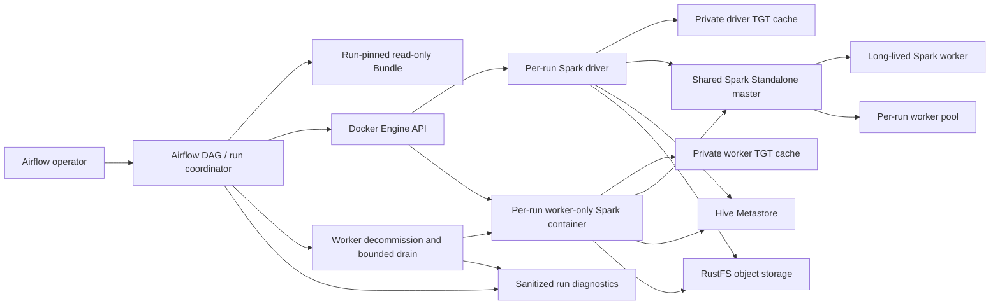

# Logical Components — Unit 2 Airflow Bundle Runner

## Component View



## Responsibilities and Boundaries

| Component | Responsibility | Boundary |
|---|---|---|
| Airflow DAG/run coordinator | Validate run configuration, enforce the two-run admission cap, create the run pair, gate submissions on readiness, track outcome, and orchestrate cleanup | Existing Airflow and Docker Engine boundary; no new long-lived coordinator |
| Run-pinned Bundle | Supply immutable DAG/workload/config content for the selected run | Mounted read-only; must not contain credentials |
| Docker Engine API | Create and remove containers by run-scoped identity; expose lifecycle and health data | Airflow's existing Docker access; cleanup is limited to this run's labeled containers |
| Per-run driver | Obtain and validate its own writer TGT, submit Bundle workloads, and report Spark submission/execution state | One container per DAG run; private cache; no credential sharing with worker |
| Per-run worker-only container | Obtain and validate its own writer TGT, register with the shared master, and host Spark executors | One container per DAG run; may host executors for other applications under shared scheduling |
| Spark Standalone master | Register workers and allocate executors from all registered workers | Existing shared scheduling; no per-run affinity guarantee |
| Long-lived Spark worker | Continue serving notebooks and other clients | Not managed by per-run cleanup |
| Kerberos KDC and keytab | Issue the approved writer identity ticket to each isolated container | Existing KDC; keytab is read-only and cache is container-private |
| RustFS credentials and object store | Provide S3-compatible write access for the approved workload identity | Existing RustFS identity; secret files remain read-only and separate from Kerberos credentials |
| Worker drain controller | Decommission the run worker, observe occupancy for up to 60 seconds, and stop/remove on drain or timeout | Coordinator-owned lifecycle; timeout may interrupt another application's executors |
| Sanitized diagnostics | Record lifecycle phase, run/revision/container identifiers, failure category, and drain/cleanup result | Must exclude secrets, TGT contents, and credential-bearing command output |
| Hive Metastore/catalogs | Store and serve catalog metadata | Existing service; three-catalog compatibility and permissions are not assumed until integrated verification |

## Lifecycle and Failure Flow

```mermaid
sequenceDiagram
    participant A as Airflow run coordinator
    participant D as Docker Engine
    participant R as Driver container
    participant W as Per-run worker
    participant M as Shared Spark master
    participant X as Other Spark application
    participant L as Sanitized diagnostics
    A->>A: Validate bundle/environment and acquire one of two slots
    A->>D: Create driver and worker-only containers with run labels
    D-->>A: Container IDs
    R->>R: Obtain and validate private writer TGT
    W->>W: Obtain and validate separate private writer TGT
    W->>M: Register worker
    M-->>A: Worker registration/readiness observable
    A->>A: Poll both readiness states (<=5s intervals, <=5m deadline)
    A->>R: Submit pinned workload only after both ready
    R->>M: Spark application submission
    M->>W: May schedule executors for this or another application
    M->>X: May schedule another application's executors on this worker
    A->>W: On run cleanup, decommission worker
    W-->>M: Stop accepting new executor assignments
    A->>A: Wait up to 60s for foreign executors to leave
    alt Worker drains before deadline
        A->>D: Stop and remove run driver and worker
    else Drain deadline expires
        A->>D: Stop/remove worker and driver
        A->>L: worker_drain_timeout; other run may be affected
    end
    A->>L: Preserve workload result and record cleanup outcome
```

The sequence expresses the intended behavior, not verified Spark runtime behavior. Unit 2 Infrastructure Design and integrated Build and Test must establish that the selected decommission interface is available in the pinned image and that occupancy/timeout handling is reliable.
