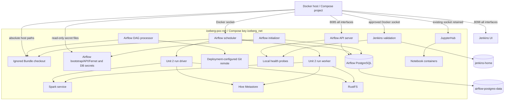
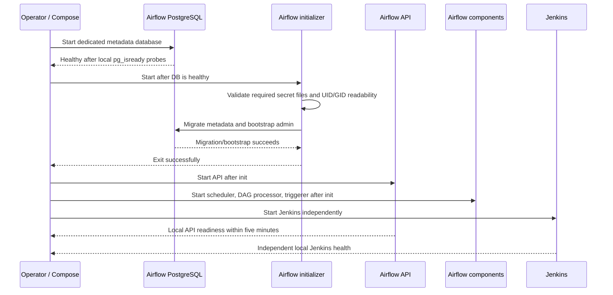

# Deployment Architecture — Unit 3 Platform Compose Integration

## Deployment Topology



## Deployment Ownership

| Resource | Owner | Persistence / exposure |
|---|---|---|
| Airflow API, scheduler, DAG processor, triggerer, initializer | Target Compose project | Same versioned Airflow image; API host port 8085 on all interfaces |
| Airflow metadata store | Airflow PostgreSQL only | Dedicated `airflow-postgres-data`; no host port |
| Git Bundle checkouts | DAG processor and scheduler | Ignored host runtime path, same container path; no automatic pruning until safe coordination is proven |
| Run driver/worker containers | Airflow DAG run (Unit 2) | Ephemeral, on `iceberg-poc-net`, read-only pinned Bundle/credential mounts per existing contract |
| Jenkins validation | Target Compose project | Dedicated `jenkins-home`; UI host port 8098; no agent port; approved socket |
| Docker sockets | Docker host | Airflow scheduler, Jenkins, and existing JupyterHub according to their distinct approved responsibilities |
| Existing lakehouse services and data | Existing Compose services | All service config, ports, credentials, and volumes preserved |

## Startup and Health Sequence



## Bundle and Docker Host Path Sequence

```mermaid
sequenceDiagram
  participant G as Git remote
  participant P as Airflow DAG processor
  participant S as Airflow scheduler
  participant H as Docker daemon host
  participant D as Run driver
  participant R as Retention coordinator

  P->>G: Fetch main and UAT Bundles
  P->>P: Resolve immutable Bundle revision
  P->>S: Shared checkout path and revision identity
  S->>H: Create run container using host-visible path
  H->>D: Mount exact revision read-only
  D-->>S: Execute under Unit 2 lifecycle contract
  S-->>R: Complete cleanup; release active revision reference
  R->>R: Pruning disabled unless active references and shared coordination are proven
  R-->>P: If unsafe/uncertain, skip deletion and report sanitized outcome
```

## Operational Notes

- Only the Airflow scheduler receives Docker socket access among Airflow services. Jenkins retains its approved socket. JupyterHub's existing socket mount is preserved; it is used for notebook-container management and was not introduced by this integration.
- Airflow PostgreSQL uses its own volume and credentials, separate from Hive Metastore PostgreSQL.
- Airflow secret source files are deployment-managed and are not created with values in this design artifact. Host mode is `0600`, file mounts are read-only, and consumer UID/GID must be validated.
- The configured `lakehouse-main` and `lakehouse-uat` Bundles create production and UAT DAGs. Their workload configs remain disabled; UAT/prod never fall back to another environment.
- Post-start verification must find `main-init_environment` under `lakehouse-main` and `uat-init_environment` under `lakehouse-uat`.
- Git Bundle revision pruning remains disabled until there is a proven race-safe active-run reference mechanism. Revisions may consume disk; preserving active code takes priority.
- API process health and component status are separate from Spark/Kerberos/metastore/RustFS workload readiness.
- Host UI bindings are HTTP and all-interface by explicit approval. Compose adds no TLS proxy.
- This diagram describes intended deployment. Build and Test must verify the rendered Compose configuration, host path behavior, volume persistence, and health deadlines.
