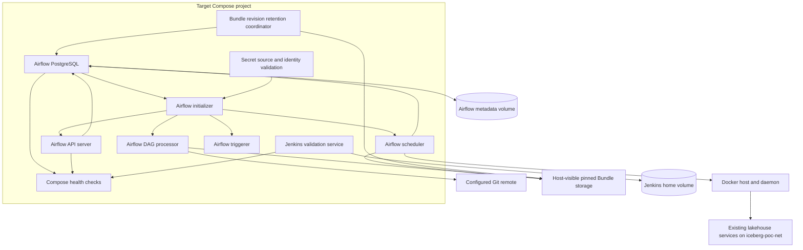

# Logical Components — Unit 3 NFR Design

## Component View

## Components and Responsibilities

### Airflow PostgreSQL and Metadata Volume

- Stores Airflow metadata only and owns dedicated `airflow-postgres-data`.
- Exposes local health to Compose using the 10-second/5-second/three-failure policy.
- Does not share storage or schema with Hive Metastore PostgreSQL.
- Has no Docker socket or writer credential mounts.

### Airflow Initializer

- Waits for Airflow PostgreSQL health.
- Validates required bootstrap/API/Fernet secret sources and consumer readability before migration/bootstrap.
- Exits successfully only after initialization completes; nonzero exit blocks Airflow application readiness.
- Has no Docker socket or writer credentials.

### Airflow API Server

- Serves UI/API on container port 8080 and approved host port 8085 on all interfaces.
- Becomes healthy within five minutes after database health and successful initializer completion.
- Uses local health checks; Git and workload dependencies do not define API liveness.
- Has no Docker socket or writer credentials.

### Airflow Scheduler

- Coordinates Unit 2 workflow tasks and Docker lifecycle through the approved socket mount.
- Shares Bundle checkout at the configured container path and passes host-resolvable paths to Docker Engine.
- Uses the approved host/container mapping and Unit 2 run-container contract.
- Has no writer secret values in its environment; it may use approved host path references required for Docker bind mounts.

### Airflow DAG Processor

- Fetches/resolves configured Git Bundles and parses the selected development bundle.
- Shares the exact Bundle storage mapping with the scheduler.
- Has no Docker socket or writer credentials and does not use sibling runtime cache as maintained source.

### Airflow Triggerer

- Supports deferrable Airflow tasks.
- Has no Docker socket or writer credential mounts; its service health is independent from workload readiness.

### Jenkins Validation Service and Home Volume

- Runs repository validation only and owns separate `jenkins-home` storage.
- Publishes UI on host port 8098 to container port 8080 on all interfaces; does not publish agent port 50000.
- Retains its explicitly approved Docker socket; no Bundle publication, deployment, or ref mutation is permitted.
- Has no writer credential mounts.

### Health Check Coordinator

Compose health checks attach to Airflow PostgreSQL, Airflow API, and Jenkins. Each uses a 10-second interval, five-second timeout, and three consecutive failures. The one-shot initializer gates Airflow application startup through successful completion. Health output is local and credential-safe. It does not establish readiness for Git, Docker, Kerberos, Spark, Hive, or RustFS.

### Secret Source Validator

- Checks required Airflow secret files before initialization.
- Requires host mode `0600`, read-only container mounts where mounted, and readability by the configured process identity.
- Requires deliberate UID/GID alignment; it must not relax permissions or expose secret values to resolve access errors.
- Treats Git credentials as conditional on remote authentication requirements.
- Emits only sanitized category/path errors.

### Bundle Revision Retention Coordinator

- Identifies local inactive revisions older than 30 days as eligible candidates.
- Consults authoritative active-run revision references and coordinates with checkout publication and run pinning before deletion.
- Rechecks eligibility immediately before deletion under the shared coordination boundary.
- Removes local runtime checkout data only; never mutates remote Git refs.
- Skips pruning if active-reference or lock state cannot be proven and reports a sanitized diagnostic.
- Exact metadata lookup and coordination implementation are pending Infrastructure Design/Code Generation; the safety contract is mandatory.

### Host Docker Engine and Shared Network

- Resolves host bind paths for scheduler-created run containers and runs driver/worker containers on `iceberg-poc-net`.
- Receives Docker API control only from the scheduler and approved Jenkins service.
- Remains a privileged boundary; the socket is not treated as a container sandbox.

### Existing Lakehouse Services

Hive Metastore, Spark, KDC, RustFS, and other existing services retain their current identity, network, ports, credential sources, and named-volume ownership. Airflow integration neither resets nor migrates their persistent data.

## Critical Interactions

### Startup and health

`airflow-postgres healthy` → `airflow-init completes` → API/scheduler/DAG processor/triggerer start. API and Jenkins health are reported independently. Missing secrets or failed migrations prevent Airflow startup readiness.

### Bundle run and cleanup safety

The DAG processor fetches/pins Bundle content → scheduler starts a run referencing the immutable revision → host Docker daemon resolves the validated read-only Bundle path → run reaches terminal cleanup → retention coordinator may later prune only after the run reference is gone and safety coordination is held.

### Persistent state

Airflow PostgreSQL persists only to its volume, Jenkins persists only to its home volume, and existing lakehouse services retain their separate volumes. There is no shared volume-reset lifecycle.

## Design-Time Boundaries

- Compose health and initializer ordering are Unit 3 concerns; Spark/Kerberos/metastore/object-store run readiness and paired cleanup are Unit 2 concerns.
- Infrastructure Design determines concrete health commands, file UID/GID mapping, Bundle metadata lookup, and safe inter-process coordination mechanism.
- If active Bundle references cannot be determined race-safely, automatic pruning remains disabled.
- No Compose implementation, image build, service startup, or test evidence is produced by this NFR Design.
