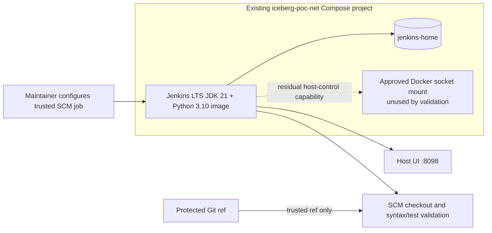

# Deployment Architecture — Unit 4 Jenkins Validation

## Deployment Context

Unit 4 deploys the target Jenkins validation runtime within the existing Docker Compose project. It reuses the Unit 3 Jenkins service and does not create a separate CI host, agent service, or Jenkins controller.

## Image and Compose Deployment

- Build context: target repository root.
- Dockerfile: `infra/jenkins/Dockerfile`.
- Final base: existing immutable `jenkins/jenkins:lts-jdk21` digest from `docker-compose.yml`.
- Validation runtime: Python 3.10, Bash, and Git. Pin the Python runtime source by digest; confirm ABI compatibility with the Jenkins base during image build.
- Compose service: existing `jenkins`, updated to build/use the local validation image while retaining the existing socket `group_add`, `8098:8080` port, `jenkins-home` volume, Docker socket mount, and `iceberg_net` network.
- No external deployment secret files are added for the validation pipeline. Optional private SCM credentials are stored in Jenkins Credentials and referenced by credential ID.

Image builds occur only as explicit deployment/build operations after Code Generation and approval. The Jenkins pipeline itself never builds or publishes the platform image.

## Jenkins Job Bootstrap and Operation

1. Operator starts the existing Compose platform using the documented deployment workflow.
2. Operator signs into Jenkins as an authorized maintainer and creates one Pipeline-from-SCM job.
3. Operator supplies the repository URL and configures the protected branch or maintainer-controlled trusted ref. If the remote is private, the operator stores a credential in Jenkins Credentials and selects its ID.
4. Operator disables arbitrary pull-request discovery, removes free-form SCM revision parameters, and restricts job configuration and manual build permissions to maintainers/trusted operators.
5. Jenkins loads the `Jenkinsfile` from the selected trusted SCM ref, queues runs per-job, allocates its built-in executor, and starts the 15-minute timeout after allocation.
6. The pipeline checks syntax and any discovered tests. Jenkins retains no more than 30 builds and 30 days of history, whichever limit is reached first.
7. Operator separately starts Airflow and runs `scripts/verify-airflow-environment-dags.sh` to verify both production and UAT DAG registration. This is not part of Jenkins CI.

Any one-off maintainer-approved revision requires an operator-controlled SCM revision change before the run; arbitrary PR revisions are not accepted. The Jenkinsfile cannot authorize its own source revision after being loaded.

## Network and Persistence

- Jenkins remains on the existing Compose network `iceberg_net` (Docker network name `iceberg-poc-net`) and requires outbound connectivity to the configured Git remote.
- Jenkins UI remains published at host port 8098 to container port 8080 on all host interfaces. No TLS termination is provided by this Compose topology; Jenkins authentication remains required.
- The existing `jenkins-home` named volume retains Jenkins configuration and job history across ordinary container recreation/stop-start. No backup/restore, host-loss recovery, RTO, or RPO is provided.
- Build workspaces are Jenkins-managed within Jenkins home; the project tree, runtime secrets, lakehouse volumes, and Bundle checkouts are not mounted into the validation job.
- Jenkins retains the Docker socket mount and socket group access, but the pipeline does not use Docker. This is a broad host-control capability and not a sandbox.

## Deployment Verification and Rollback Boundaries

Build and Test must verify image runtime tools, Compose preservation, Jenkins readiness/UI availability, trusted SCM configuration, queue/timeout/retention semantics, source validation, and secret-safe logging. If image or Jenkins initialization fails, revert the Jenkins service to the previously pinned image while preserving `jenkins-home`; do not remove or reset any named volumes. A rollback does not imply Jenkins job records are restored from backup.

## Known Operational Limitation

This approved architecture executes builds on the Jenkins built-in executor while the controller has Docker socket access. Jenkins recommends controller isolation. Trusted-source restrictions reduce exposure to arbitrary contributors but do not isolate controller processes from Docker host control. This is an accepted design constraint for the current local PoC, not a hardened multi-tenant deployment.
