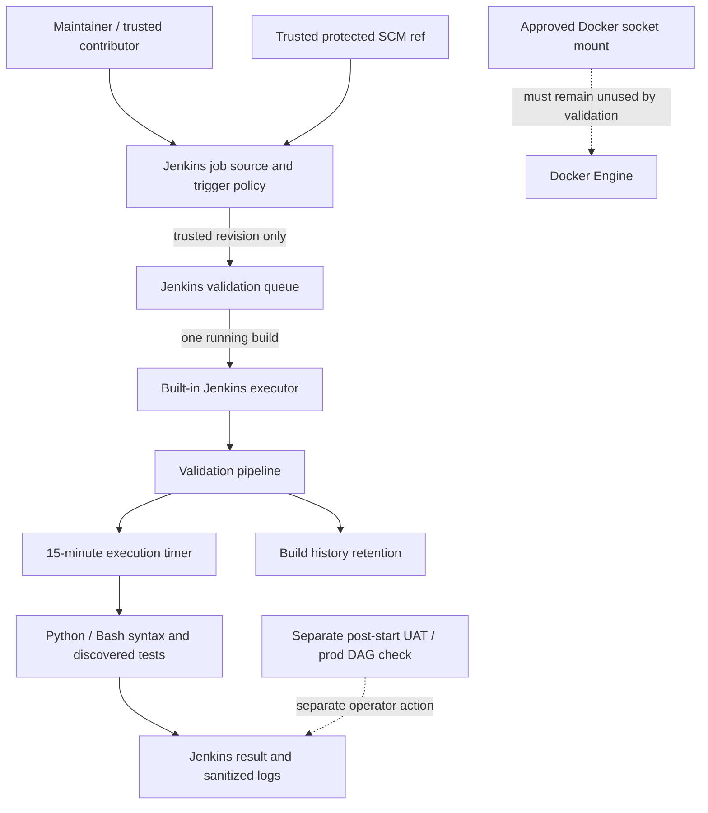

# Logical Components — Unit 4 Jenkins NFR Design

## Component View

## Components and Responsibilities

### Trusted SCM Source and Jenkins Job Policy

- Selects the protected branch or an explicitly maintainer-approved trusted revision before repository-controlled pipeline code executes.
- Does not expose arbitrary branch/ref parameters or run arbitrary pull requests.
- Keeps SCM credentials in Jenkins credentials configuration.
- Fails closed when the configured revision cannot be established as trusted.

### Jenkins Validation Queue and Executor

- Uses the approved Jenkins built-in executor.
- Runs at most one build for the validation job at a time.
- Leaves additional validation builds queued; does not cancel the active build or silently discard queued requests.
- Queue duration is not included in the build execution timeout and has no defined upper bound.

### Validation Pipeline and Execution Timer

- Starts the 15-minute execution timer only after the executor has been assigned.
- Covers source checkout and validation stages after executor allocation.
- Terminates an over-limit build and emits a sanitized timeout result.
- Does not deploy, operate Compose, build/publish platform images, mutate Git refs, or invoke Docker.

### Source Validation Steps

- Performs the approved Python and Bash syntax checks.
- Runs maintained tests only when discovered; reports an empty test suite explicitly.
- Keeps syntax evidence distinct from test coverage.
- Has no runtime secret files, lakehouse data, or persistent service mounts in its workspace.

### Build History Retention

- Applies both a 30-build maximum and a 30-day age maximum to the Jenkins validation job; whichever threshold expires first removes records.
- Operates on Jenkins-managed build records/artifacts only.
- Does not run project cleanup scripts or remove external repository, Bundle, lakehouse, or Compose data.

### Jenkins Result and Diagnostics

- Reports pass, pass-with-no-tests, failure, timeout, interruption, or rejected source with concise sanitized context.
- Does not expose credentials or imply that source validation proves runtime integration.

### Docker Socket Boundary

- Remains mounted in the approved Jenkins Compose service topology.
- Is unused by the validation pipeline and is treated as broad host control, not isolation or least privilege.
- Makes trusted-revision admission mandatory because repository code executing on the controller executor could access it.

### Separate Airflow DAG Registration Check

- `scripts/verify-airflow-environment-dags.sh` verifies registered production and UAT DAG identities after Airflow startup.
- Runs as a separate operator check; it is not a Jenkins stage and does not start services or trigger DAGs.

## Critical Interactions

### Admission and execution

Trusted Jenkins job configuration selects a protected or approved revision → Jenkins queues the validation build → one executor is assigned → the 15-minute timer starts → checkout and source checks run → Jenkins records a bounded, sanitized result.

### Queue and timeout semantics

An active build occupies the validation executor slot → additional validation builds remain queued → the active build's execution timer starts only after executor assignment → timeout terminates the active build and releases the slot for the next queued build.

### History cleanup

Jenkins records the result → the validation job's count/age policy applies → only Jenkins-managed validation history is deleted. Project source, Bundle refs and checkouts, lakehouse volumes, and other service state are outside its deletion scope.

## Design-Time Boundaries

- Infrastructure Design determines the concrete Jenkins job/trigger configuration and how maintainer approval is represented in this local setup.
- Code Generation implements the Jenkinsfile/pipeline and any trusted job configuration without widening the Compose socket or source boundary.
- If trusted revisions cannot be gated before Jenkins loads executable repository pipeline code, stop and return the constraint for explicit design approval; a Jenkinsfile-only branch check is not sufficient.
- Build and Test must verify runtime behavior; this design provides no implementation or runtime evidence.
