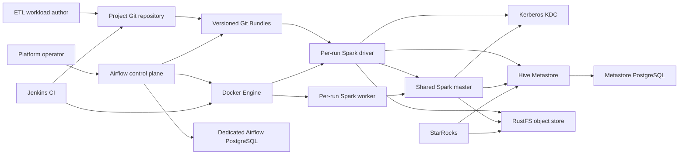
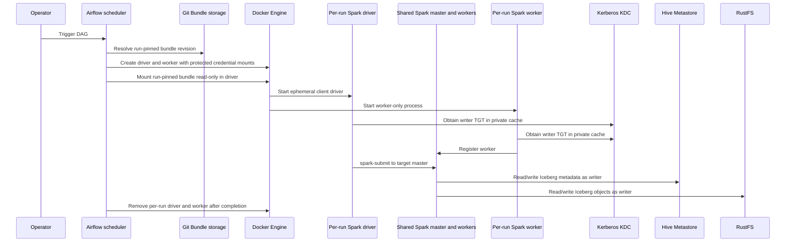

# Component Dependencies and Data Flow

## Dependency Matrix

| Component | Depends on | Communication |
|---|---|---|
| Airflow API server | Airflow PostgreSQL | Airflow database connection |
| Airflow scheduler | Airflow PostgreSQL, Docker Engine, bundle storage, target network | SQL connection, Docker Engine socket, host bind paths |
| Airflow DAG processor | Airflow PostgreSQL, Git remote, Airflow Git connection, bundle storage | SQL connection, Git HTTPS/SSH transport, host-shared bundle path |
| Per-run Spark driver | Pinned bundle, Spark image/config, Docker Engine, KDC, Spark master, Hive Metastore, RustFS | Read-only bind mounts, Kerberos, Spark standalone, Hive Thrift SASL, S3 API |
| Per-run Spark worker | Spark image/config, Docker Engine, KDC, Spark master, Hive Metastore, RustFS | Worker registration, private Kerberos TGT, Hive Thrift SASL, S3 API |
| Existing Spark service/worker | KDC, Hive Metastore, RustFS | Kerberos TGT, Hive Thrift SASL, S3 API |
| Jenkins CI | Repository checkout, Jenkins home volume, Docker Engine socket (retained) | Git checkout, shell commands, Docker Engine socket |
| Hive Metastore | Metastore PostgreSQL, KDC, RustFS | PostgreSQL, Kerberos, S3 API |
| StarRocks | Hive Metastore, RustFS | Existing Kerberos and object-store integrations, unchanged |

## Dependency Diagram

**Text alternative**: Operators use Airflow. Airflow reads run-pinned Git Bundles and asks Docker to create a temporary Spark driver and worker per run. The driver submits to the shared Spark master; the worker registers with that master. Spark Standalone may schedule executors across any registered worker. The driver and workers use the KDC, Hive Metastore, and RustFS. Hive metadata remains in its existing PostgreSQL database, and Airflow has a separate database. Jenkins validates the project repository and retains its selected Docker socket mount. StarRocks remains connected to Hive and RustFS as before.

## Data and Control Flow

**Text alternative**: The operator triggers a run; Airflow resolves the pinned bundle and creates a driver/worker pair. Each gets an independent writer TGT cache; the worker registers with the shared master and the driver submits the workload. Spark may place executors on any registered worker. Airflow removes both run containers when the run ends.

## Network and Host Path Contract

- Airflow, Jenkins, per-run drivers and workers, Spark, KDC, Hive Metastore, and RustFS join `iceberg-poc-net`.
- Compose service DNS names provide service discovery for Hive Metastore, KDC, and RustFS. Verify the Spark master-advertised URL and executor callbacks during Infrastructure Design/Build and Test; the current worker startup uses `spark://spark-iceberg:7077`, which must be checked against target Compose DNS before the driver contract is fixed.
- Docker-created container mount sources are host paths, not paths visible only inside the Airflow container. The bundle checkout path and writer credential host paths must therefore be configured consistently for the host Docker daemon.
- The project Git remote remains an explicit deployment input.
