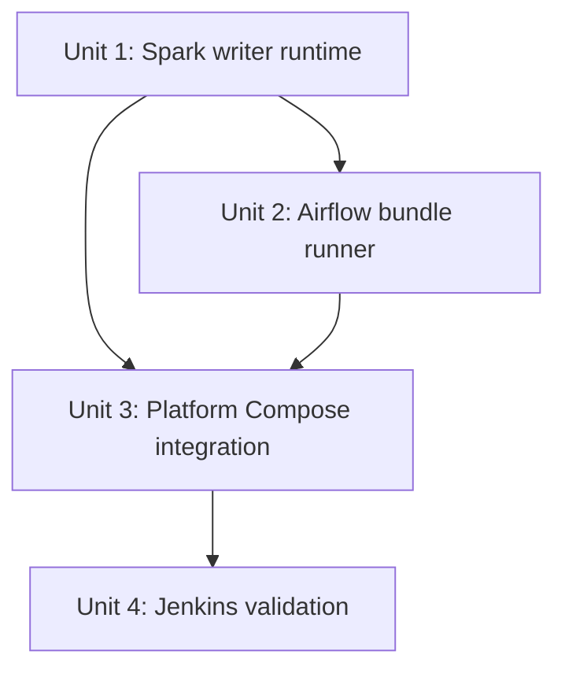

# Unit of Work Dependencies — Airflow, Jenkins, and Spark Integration

## Dependency Matrix

| Unit | Depends on | Required handoff | Integration check |
|---|---|---|---|
| Unit 1 — Spark Writer Runtime | Existing KDC, Hive Metastore, RustFS, Spark service, writer runtime credential files | Private TGT/cache lifecycle for long-lived and worker-only modes; writer S3 secret paths; Spark master-advertised URL; executor callback/network assumptions | Verify ticket bootstrap/renewal, HMS/RustFS access, endpoint advertisement, and both worker modes |
| Unit 2 — Airflow Bundle Runner | Unit 1 contract; existing Git Bundle/DAG factory source | Run-pinned bundle path; per-run driver and worker image/modes; Spark submit/register endpoint; separate credential/cache mounts; concurrency, result, and cleanup semantics | Verify pinned read-only bundle; driver/worker readiness and registration; shared scheduling; paired cleanup on success and failure |
| Unit 3 — Platform Compose Integration | Units 1 and 2 contracts; existing target Compose network and volume definitions | Service names, build contexts, host-visible paths, health/dependency conditions, socket and network requirements | Compose configuration review plus controlled integration startup without volume reset |
| Unit 4 — Jenkins Validation | Units 1–3 final source paths and CI commands | CI-only validation command/path contract; no-publish/no-deploy/no-Bundle-update boundary | Run the pipeline checks; verify no deployment or Bundle reference mutation |

## Directed Dependency Graph

**Text alternative**: First establish and review the Spark writer and remote-submission contract. Then implement Airflow's pinned-bundle driver lifecycle against that contract. Compose integration brings the Spark and Airflow contracts together with Airflow's isolated database and Jenkins topology. Jenkins validation is finalized after the source layout and commands are established.

## Coordination and Change Boundaries

- One maintainer owns the full integration. Finish one unit's contract review before starting the next, as selected in the approved plan.
- Units 1 and 2 do not introduce additional long-lived services; Unit 2 creates ephemeral driver/worker containers through the existing Docker boundary. Unit 3 owns the cross-service Compose assembly.
- Unit 3 may touch existing Spark Compose settings only to wire the approved Unit 1 runtime and per-run worker image/network/credential contract. It must preserve existing lakehouse data volumes and identity material.
- Unit 4 owns validation behavior; Unit 3 owns Jenkins service wiring. Neither unit may add publishing, deployment, or Bundle-ref mutation behavior.
- Treat the target Spark master endpoint as unresolved until its advertised hostname is verified against Compose DNS. The current worker launch URL is `spark://spark-iceberg:7077`.
- The existing lakehouse services (KDC, Hive Metastore, metastore PostgreSQL, RustFS, JupyterHub, and StarRocks) are dependencies/retained components, not units to rebuild or replace.

## Sequencing

1. Complete Unit 1 and review its writer identity, cache, master endpoint, and executor connectivity contract.
2. Complete Unit 2 against the accepted Unit 1 contract and review pinned-bundle, per-run driver/worker pair, credential mounts, shared scheduling, and cleanup contracts.
3. Complete Unit 3 by composing the accepted Spark and Airflow interfaces and integrating Jenkins service wiring without altering existing named data volumes.
4. Complete Unit 4 against the final source paths and validation commands; then run cross-unit Build and Test checks.

The graph is intentionally acyclic. Integration verification follows Unit 3, with Jenkins CI validation and full platform checks recorded at the required build/test gates.
