# Execution Plan — Airflow, Jenkins, and Spark Integration

## Detailed Analysis Summary

### Transformation Scope

- **Transformation Type**: Cross-system infrastructure and application integration in an existing local Docker Compose lakehouse.
- **Primary Changes**: Add Airflow and Jenkins services and bundle/workflow source to the target project; configure the existing Spark worker and per-run driver to use the writer Kerberos and RustFS identities; preserve the run-pinned, read-only Git Bundle and ephemeral driver behavior.
- **Related Components**: Target Compose platform, Spark runtime, Airflow Git Bundle source, Airflow DAG factory, Jenkins CI, Kerberos identity/keytab provisioning, Hive Metastore, and RustFS.

### Change Impact Assessment

- **User-facing changes**: Yes — platform operators gain integrated Airflow and Jenkins workflows; ETL authors maintain and run bundle-based jobs from this project.
- **Structural changes**: Yes — Airflow/Jenkins and bundle code join the target Compose/network boundary; the existing Spark service gains worker-side writer credential handling.
- **Data model changes**: No catalog schema or metadata database migration is required by the approved requirements.
- **API changes**: No new external application API is required. Internal contracts change for Compose networking, Spark submission, credential files, and Airflow's Docker-created container configuration.
- **NFR impact**: Yes — keytab/secret handling, private renewable ticket caches, Docker socket access, per-run cleanup, and executor credential behavior require design and verification.

### Component Relationships

- **Primary components**: Airflow Git Bundle workflow and its DAG factory; target Spark workload runtime.
- **Infrastructure components**: Target Docker Compose project/network; Airflow and Jenkins services; Docker Engine socket access; target Kerberos, Hive Metastore, and RustFS.
- **Shared components**: Git bundle environment configuration, writer identity provisioning, Spark submission/credential contract.
- **Dependent components**: Spark workers depend on KDC, Hive Metastore, and RustFS. Airflow depends on the bundle Git remote, Docker Engine, target network, and Spark master. Jenkins depends on repository source and CI configuration.
- **Supporting components**: Existing TPCH workload and JupyterHub continue using their current configurations and data.

| Component | Change type | Reason | Priority |
|---|---|---|---|
| Target Compose platform | Major | Add orchestration services, networks, mounts, and configuration while preserving existing services and volumes | Critical |
| Spark runtime | Major | Add worker-side writer identity and support the per-run remote submission contract | Critical |
| Airflow bundle source and DAG factory | Major | Bring versioned workflow code into this project and pass runtime credentials safely | Critical |
| Jenkins CI | Minor | Integrate validation-only service and checks without publishing or moving bundle refs | Important |
| Kerberos/RustFS identity provisioning | Configuration/integration | Reuse existing writer principal and credentials; no identity rotation or new account requested | Important |
| Hive Metastore, PostgreSQL, RustFS data, StarRocks, JupyterHub | Retain | No behavior changes requested; preserve platform and persistent state | Critical |

### Risk Assessment

- **Risk Level**: High — the change grants long-lived Spark workers access to shared writer credentials and integrates privileged Docker control with orchestration.
- **Rollback Complexity**: Moderate — Compose and code changes can be reverted, but runtime changes must preserve named volumes, credential files, and existing service data. Do not use volume-reset cleanup as rollback.
- **Testing Complexity**: Complex — verify Compose networking, bundle revision pinning, driver cleanup, Kerberos ticket behavior on drivers and workers, RustFS access, and a real remote Spark write.
- **Open deployment inputs**: The project Git remote and UAT/production endpoints are unknown and must remain configurable placeholders.

## Workflow Visualization

```mermaid
flowchart TD
    Start([User request])
    WD[Workspace detection complete]
    RE[Reverse engineering complete]
    RA[Requirements analysis approved]
    US[User stories approved]
    WP[Workflow planning review]
    AD[Application design execute]
    UG[Units generation execute]
    FD[Functional design execute per unit]
    NR[NFR requirements execute per unit]
    ND[NFR design execute per unit]
    ID[Infrastructure design execute per unit]
    CG[Code generation execute per unit]
    BT[Build and test execute]
    DP[Deploy handoff]
    End([Intent closure after handoff])

    Start --> WD --> RE --> RA --> US --> WP --> AD --> UG --> FD --> NR --> ND --> ID --> CG --> BT --> DP --> End

    style WD fill:#4CAF50,stroke:#1B5E20,stroke-width:3px,color:#fff
    style RE fill:#4CAF50,stroke:#1B5E20,stroke-width:3px,color:#fff
    style RA fill:#4CAF50,stroke:#1B5E20,stroke-width:3px,color:#fff
    style US fill:#4CAF50,stroke:#1B5E20,stroke-width:3px,color:#fff
    style WP fill:#4CAF50,stroke:#1B5E20,stroke-width:3px,color:#fff
    style AD fill:#4CAF50,stroke:#1B5E20,stroke-width:3px,color:#fff
    style UG fill:#FFA726,stroke:#E65100,stroke-width:3px,stroke-dasharray: 5 5,color:#000
    style FD fill:#FFA726,stroke:#E65100,stroke-width:3px,stroke-dasharray: 5 5,color:#000
    style NR fill:#FFA726,stroke:#E65100,stroke-width:3px,stroke-dasharray: 5 5,color:#000
    style ND fill:#FFA726,stroke:#E65100,stroke-width:3px,stroke-dasharray: 5 5,color:#000
    style ID fill:#FFA726,stroke:#E65100,stroke-width:3px,stroke-dasharray: 5 5,color:#000
    style CG fill:#4CAF50,stroke:#1B5E20,stroke-width:3px,color:#fff
    style BT fill:#4CAF50,stroke:#1B5E20,stroke-width:3px,color:#fff
    style DP fill:#CE93D8,stroke:#6A1B9A,stroke-width:3px,color:#000
    style Start fill:#CE93D8,stroke:#6A1B9A,stroke-width:3px,color:#000
    style End fill:#CE93D8,stroke:#6A1B9A,stroke-width:3px,color:#000
    linkStyle default stroke:#333,stroke-width:2px
```

**Text alternative**: Workspace detection, reverse engineering, requirements, and User Stories are complete. Workflow Planning is awaiting approval. Then execute Application Design, Units Generation, and per-unit Functional Design, NFR Requirements, NFR Design, and Infrastructure Design. Generate code per unit, complete Build and Test, and prepare Deploy handoff documents. No phase is skipped.

## Phases to Execute

### Inception Phase

- [x] Workspace Detection — brownfield target and sibling orchestration project identified.
- [x] Reverse Engineering — target and Airflow/Bundles source analyzed and approved.
- [x] Requirements Analysis — comprehensive requirements approved.
- [x] User Stories — two personas and six feature-based stories approved.
- [x] Workflow Planning — approved on 2026-10-26.
- [x] Application Design — approved on 2026-10-26. Airflow/Jenkins service boundaries and driver/worker contracts are documented; verify the Spark master-advertised endpoint during Infrastructure Design.
- [x] Units Generation — **EXECUTE**. Four component-aligned units, dependency map, and story map approved on 2026-10-26.

### Construction Phase

- [ ] Functional Design — **EXECUTE per unit**. Define bundle/run behavior, Spark submission and credential lifecycle, and error/cleanup semantics.
- [ ] NFR Requirements — **EXECUTE per unit**. Document the selected credential protections, Docker access boundary, testability, and local resource constraints.
- [ ] NFR Design — **EXECUTE per unit**. Design private ticket caches, secret-file mounts, renewal/failure behavior, and run cleanup.
- [ ] Infrastructure Design — **EXECUTE per unit**. Define Compose services, shared network, mounts, profiles, and service dependencies.
- [ ] Code Generation — **EXECUTE per unit (required)**. Implement and document each approved unit.
- [ ] Build and Test — **EXECUTE (required)**. Verify images, Compose integration, bundle pinning, credential access, successful writes, failures, and cleanup.

### Deploy Phase

- [ ] Deploy — **EXECUTE (handoff only)**. Prepare the PR request and any ordered deployment instructions; do not deploy services or execute operational commands.

**Skipped stages**: None. Security Baseline and Resiliency Baseline extensions are disabled by requirements selection; this does not skip the NFR design stages or explicit credential requirements. Partial PBT applies only to applicable pure functions and serialization round-trips.

## Extension Application

- **Security Baseline**: Disabled by user selection. The credential handling requirements and Docker access boundary remain explicit product requirements and will be designed and verified.
- **Property-Based Testing — Partial**: No property-bearing code is being designed in Workflow Planning, so PBT-02, PBT-03, PBT-07, PBT-08, and PBT-09 are N/A at this stage. Functional Design will identify properties; NFR Requirements will select a framework if property-based tests are applicable; code planning and Build and Test will enforce the selected subset.
- **Resiliency Baseline**: Disabled by user selection. No baseline rules are applied; required error reporting and per-run cleanup remain in the approved requirements.

## Preliminary Unit Boundaries and Change Sequence

Units Generation will confirm or adjust these existing component boundaries after Application Design. This is a sequencing proposal, not an authorization to edit application code.

1. **Target Spark writer execution support** — configure the existing Spark worker and Spark image/runtime to obtain and renew the writer TGT privately and access RustFS through file-backed writer secrets. Establish the remote `spark-submit` contract used by the driver.
2. **Airflow Git Bundle runner and workload source** — bring in the maintained bundle/DAG factory source and configure run-pinned read-only bundle mounts, per-run container creation/removal, and writer credentials in the driver. Depends on the Spark execution contract in Unit 1.
3. **Compose orchestration integration** — add/adapt Airflow and Jenkins services, networking, image builds, runtime mounts, and explicit dev versus UAT/prod placeholders. Coordinates Contracts from Units 1 and 2 and preserves existing Compose services/volumes.
4. **Jenkins validation integration** — add CI-only validation for the integrated source. Depends on final repository paths and build/validation commands established by Units 1–3.

The unit sequence is mostly sequential because the Airflow runner depends on Spark's runtime contract and Jenkins checks depend on the final source layout. Build and integration checks occur after all units. Rollback is by reverting the approved code/Compose changes while retaining named volumes and runtime credentials.

## Canonical Knowledge Impact Inventory

| Canonical path | Action | Requirement and owning component | Reason / boundary justification |
|---|---|---|---|
| `aidlc-docs/knowledge/hive-dremio-rustfs/application-design.md` | UPDATE | FR-1–FR-8, NFR-1, NFR-3, NFR-5; whole target platform | Current approved baseline says Airflow/Jenkins are deferred; update target architecture and integration boundaries while preserving StarRocks, JupyterHub, KDC, PostgreSQL, RustFS data, and existing service/data ownership. |
| `aidlc-docs/knowledge/hive-dremio-rustfs/functional-design/lakehouse-workload-and-access.md` | UPDATE | FR-4, FR-5, FR-8, NFR-1; Spark/Hive/RustFS workload access | Record the approved shared writer identity on driver and workers while preserving existing workload, StarRocks, and identity-layer behavior. |
| `aidlc-docs/knowledge/hive-dremio-rustfs/functional-design/airflow-orchestration.md` | CREATE | FR-2, FR-3, FR-7, NFR-2, NFR-5; existing Airflow bundle runner/DAG factory boundary | This distinct existing component is being integrated into the target project; document pinned bundles, driver lifecycle, and Docker boundary. |
| `aidlc-docs/knowledge/hive-dremio-rustfs/functional-design/jenkins-ci.md` | CREATE | FR-6; existing Jenkins CI boundary | Jenkins is a distinct existing component newly included in this project; document its validation-only responsibility and no-publication contract. |
| No canonical knowledge path — intent-specific test constraint | RETAIN | NFR-4; partial property-based testing | Keep this constraint in active story/workflow/build-test artifacts; it does not establish a new durable component or canonical design area. |

The two `CREATE` paths document functional responsibilities of already identified components; they do not introduce new services or boundaries. No separate new project-level knowledge area is justified. There is no separate canonical Jupyter or StarRocks functional-design file today; their relevant facts remain in the existing application and workload/access designs.

## Package Change Sequence (Brownfield)

| Order | Package/source area | Dependency and coordination |
|---|---|---|
| 1 | `infra/spark/` and Spark runtime configuration | Confirm worker-side Kerberos/TGT and RustFS behavior first; establish the submission contract. |
| 2 | Airflow bundle/DAG factory and workflow source to be located during Units Generation | Use the Spark contract; keep bundles immutable and secrets outside Git. |
| 3 | `docker-compose.yml` and new Airflow/Jenkins image/configuration areas | Integrate services with `iceberg-poc-net`; mount required source, credential files, and Docker socket with narrow paths. Preserve existing named volumes. |
| 4 | Jenkins pipeline/validation configuration | Finalize after repository paths and checks are known; Jenkins remains validation-only. |
| 5 | Documentation and canonical knowledge | Update README, operational guidance, and the canonical impact inventory after implementation and verification. |

**Testing checkpoints**: validate Spark runtime independently; validate the Airflow-created driver against the remote cluster; validate bundle and environment selection; validate Jenkins-only behavior; then run the full Compose integration checks. Avoid resetting existing volumes during tests.

## Estimates and Success Criteria

- **Remaining stages**: Units Generation, per-unit design and code generation, Build and Test, and Deploy handoff. Per-unit stages repeat for the number of units approved during Units Generation.
- **Estimated duration**: Not estimated; no delivery date, staffing, or working-hour assumptions were supplied.
- **Primary goal**: Run version-pinned Airflow bundle workloads through ephemeral drivers on the existing Spark cluster using the existing writer identity.
- **Key deliverables**: Approved component/service design; units and dependency maps; per-unit functional/NFR/infrastructure designs; Compose/images/bundles/CI integration; build/test evidence; deploy handoff.
- **Quality gates**: No secrets in source/bundles/logs; private Kerberos caches; read-only keytab and bundle mounts; worker and driver can access Hive/RustFS as writer; clean up temporary drivers on success/failure; preserve existing data; no implicit UAT/prod-to-dev routing; Jenkins does not publish or move bundle refs.
- **Integration testing**: Verify Airflow, Spark, Hive, KDC, RustFS, and Jenkins together using a sample write workload and failure cleanup scenario.
- **Release handoff**: Prepare review documents and ordered local startup/configuration guidance; no deployment is performed by the Deploy stage.
