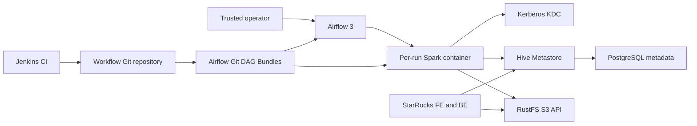
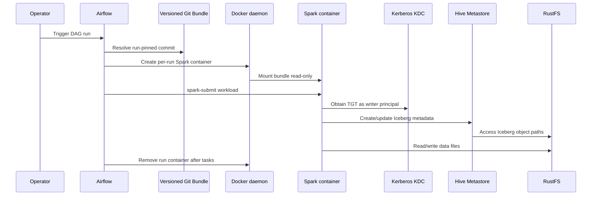

# System Architecture

## System Overview

The target is a local Docker Compose lakehouse with Hive Metastore, PostgreSQL, Kerberos, RustFS, Spark, JupyterHub, TPCH workload tooling, and StarRocks. The sibling Airflow/Jenkins project has a legacy standalone DockerOperator sample and a local Airflow 3 setup that consumes Git DAG Bundles. The bundle checkout's shared DAG factory creates one Spark Docker container per run, mounts the run's versioned bundle read-only, executes `spark-submit` in that container, and removes it during cleanup.

The target Spark configuration already names the Hive-backed Iceberg catalog `iceberg`. The target TPCH loader obtains a Kerberos TGT as `write-service-account@LAKEHOUSE.LOCAL` from a read-only keytab and uses the RustFS writer credentials from Compose secrets. The Airflow DAG factory currently mounts only the bundle and passes region/environment variables to its ephemeral container; it does not provide this writer keytab, ticket cache setup, or writer S3 credentials.

## Architecture Diagram

Text alternative: Jenkins validates Git changes. Airflow reads branch-configured versioned bundles and starts a per-run Spark container, mounting that exact bundle read-only. Spark requires the target's Kerberos writer credentials for HMS and RustFS writer credentials for S3. Hive persists metadata in PostgreSQL and uses RustFS for Iceberg objects. StarRocks continues to query the same catalog and storage.

## Component Descriptions

### Target lakehouse
- **Purpose**: Shared catalog, object store, Spark notebook/ETL runtime, and StarRocks analytics.
- **Responsibilities**: Expose `hive-metastore:9083`, `object-store:9000`, and a shared Docker network named `iceberg-poc-net`; provision workload identities and retain persistent data.
- **Dependencies**: Docker Compose, KDC, PostgreSQL, RustFS.
- **Type**: Infrastructure/application.

### Airflow 3 Git Bundle runner
- **Purpose**: Orchestrate versioned Spark jobs.
- **Responsibilities**: Resolve bundle identity and environment config, create a run-specific Spark container, mount the checkout read-only, call Spark submit, and cleanup.
- **Dependencies**: Docker daemon socket, host-visible bundle checkout, external bundle repository/configuration, Docker network, configured Spark image.
- **Type**: Application/infrastructure.

### Jenkins
- **Purpose**: CI validation gate.
- **Responsibilities**: Validate repository code/configuration; no deployment or Airflow ref update was found in the inspected Jenkinsfile.
- **Dependencies**: Jenkins container and Docker socket according to the legacy Compose setup.
- **Type**: CI infrastructure.

### Spark workload image
- **Purpose**: Run Spark SQL/Python jobs in Airflow-created containers.
- **Responsibilities**: Provide Spark 3.5.5, Iceberg 1.8.1, Hadoop/Kerberos client configuration, and workload dependencies.
- **Dependencies**: Target catalog config, Kerberos credentials, RustFS writer credentials, bundle mount, shared Docker network.
- **Type**: Application runtime.

## Data Flow

Text alternative: the operator triggers a bundle-versioned DAG. Airflow creates one container, mounts the pinned bundle read-only, and submits jobs in dependency order. Spark authenticates as the configured writer, updates Hive metadata, reads/writes RustFS objects, and Airflow removes the container after success or failure.

## Integration Points

- **External APIs**: Airflow Git provider, Docker Engine API through the mounted socket, Spark submit CLI, Hive Thrift API, RustFS S3 API, Kerberos KDC.
- **Databases**: Airflow metadata PostgreSQL in the sibling Compose; target Hive metadata PostgreSQL.
- **Third-party Services**: Git host for bundle checkout; Jenkins for CI.

## Infrastructure Components

- **Deployment Model**: Local Docker Compose; Airflow/Jenkins source stack is a separate Compose project and target infrastructure already owns the lakehouse network.
- **Networking**: Airflow task runner's Docker daemon must resolve the external `iceberg-poc-net`; Airflow host bundle path must be visible to Docker for bind mounting.
- **Storage**: Airflow metadata/log volumes; target Hive/RustFS and StarRocks named volumes; run-scoped temporary Spark containers.
- **Unknowns**: Whether Airflow/Jenkins services should be merged into the target Compose file or remain a sibling deployment; exact authoritative bundle source; whether the runtime should use the existing writer Kerberos principal, StarRocks SQL username, or both.

