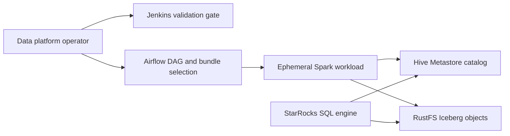

# Business Overview

## Business Context Diagram

Text alternative: operators select/trigger versioned Airflow DAGs; Jenkins validates repository changes. Airflow launches a per-run Spark container, which reads its versioned workload bundle and writes Iceberg data through Hive Metastore to RustFS using the configured writer identity. StarRocks remains an existing consumer of the same catalog and storage.

## Business Description

- **Business Description**: Local data engineering platform for scheduling and validating Spark ETL against a shared Iceberg lakehouse, with Hive Metastore metadata, RustFS object storage, and StarRocks SQL analytics.
- **Business Transactions**:
  - Validate workflow repository changes through Jenkins CI checks.
  - Select a trusted development Git reference for the Airflow dev bundle; UAT/production refs remain fixed.
  - Trigger a manual Airflow DAG pinned to a bundle version, create one ephemeral Spark container for that run, execute one or more `spark-submit` workloads, then clean up the container.
  - Authenticate Spark to Hive Metastore and RustFS using the dedicated workload writer identity and write Iceberg data.
  - Query the shared Iceberg catalog through StarRocks.
- **Business Dictionary**:
  - **DAG Bundle**: Versioned repository checkout from which Airflow parses DAGs and obtains the workload code/config for a run.
  - **Run-pinned bundle**: The exact bundle commit associated with an Airflow run and mounted read-only into its Spark container.
  - **Ephemeral Spark container**: Reusable for all Spark tasks in one DAG run and removed after success or failure.
  - **Writer identity**: Kerberos principal and separate RustFS credentials used by Spark ETL; distinct from StarRocks SQL username `write_service_account`.

## Component Level Business Descriptions

### Airflow and Git DAG Bundles
- **Purpose**: Schedule/manual-trigger orchestration and immutable workload version selection.
- **Responsibilities**: Parse Git bundles, validate environment configuration, create a Spark container per DAG run, submit declared jobs, and clean up the container.

### Jenkins
- **Purpose**: Validate and gate changes to the workflow repository.
- **Responsibilities**: Run repository checks. The inspected bundle repository's Jenkinsfile does not publish artifacts or update Airflow bundle references.

### Spark and Lakehouse
- **Purpose**: Execute ETL and maintain shared Iceberg datasets.
- **Responsibilities**: Use the target Hive catalog and RustFS warehouse with the dedicated writer identity; preserve the bundle version supplied by Airflow.

