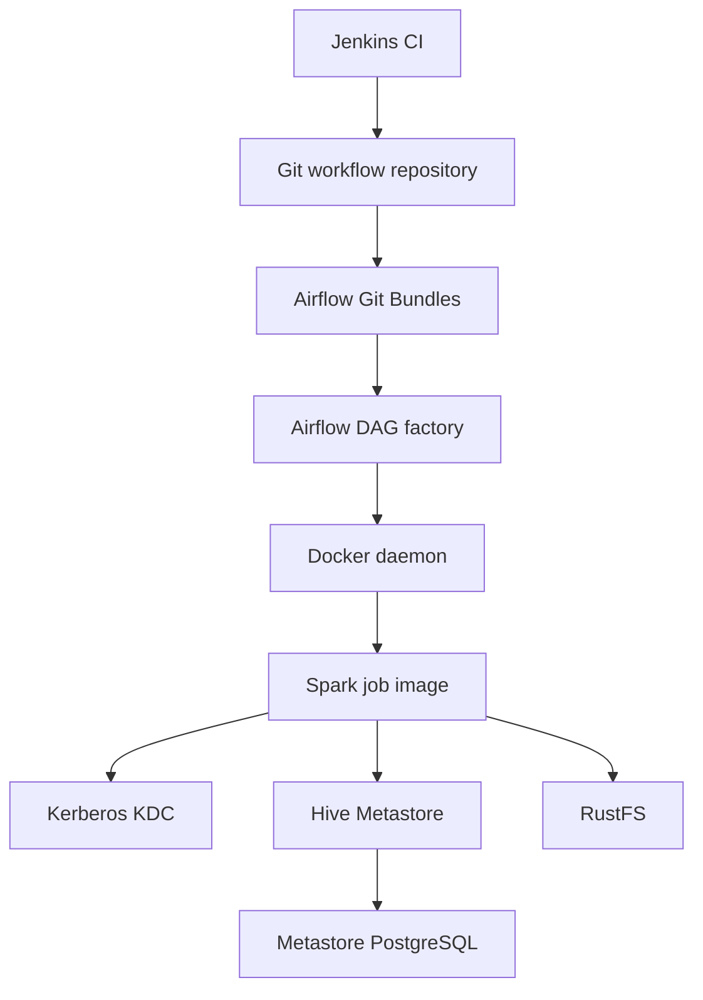

# Dependencies

## Internal Dependencies

Text alternative: Jenkins validates the Git repository; Airflow fetches bundle refs and uses the shared DAG factory. The factory uses the Docker daemon to start a Spark container. Spark depends on the target KDC, Hive Thrift endpoint, and RustFS endpoint; Hive Metastore depends on PostgreSQL.

### Airflow DAG factory depends on Docker daemon
- **Type**: Runtime.
- **Reason**: Creates/removes per-run containers and mounts the selected bundle checkout.

### Spark job depends on target lakehouse
- **Type**: Runtime.
- **Reason**: Uses Kerberos SASL to access Hive Metastore and S3-compatible RustFS to access Iceberg data.

### Git bundle depends on repository and Airflow provider
- **Type**: Runtime.
- **Reason**: Fetches versioned DAG/config/workload code from a Git ref and pins the run to the fetched version.

## External Dependencies
- **Apache Airflow** — version 3.3.2 in inspected Airflow Dockerfile; orchestration and DAG execution.
- **Airflow Git/Docker providers** — Git bundle checkout and Docker Engine API integrations.
- **Apache Spark** — 3.5.5 runtime; Python workload execution.
- **Apache Iceberg** — 1.8.1 Spark integration; catalog/table operations.
- **Hive Metastore 3.1.3** — Iceberg catalog metadata.
- **RustFS 1.0.0** — S3-compatible data storage.
- **MIT Kerberos** — service/workload authentication to Hive.
- **Jenkins** — CI validation; bundle tracking repository's Jenkinsfile does not publish releases or modify Airflow bundle refs.

