# Business Logic Model — FreeIPA Identity Foundation

## Scope

This unit makes FreeIPA the authoritative LDAP directory and Kerberos KDC for realm `LAKEHOUSE.LOCAL`. It defines human and service identity lifecycle, group membership, service-keytab transition, directory consumption, failure behavior, and rollback boundaries. RustFS S3 credentials and policies, JupyterHub runtime delivery, Hive authorization, Ranger policies, and service deployment mechanics are handled by their owning units.

The existing MIT KDC remains unchanged while this functional design is reviewed. Later implementation must validate FreeIPA in isolation and replace the MIT KDC in a staged cutover. The two independent KDC databases must never be treated as co-authoritative for the same principals.

## Actors and Responsibilities

- **Platform identity administrator** creates and disables human accounts, assigns approved groups, and administers the separate platform administrator role.
- **FreeIPA** is authoritative for human users, groups, Kerberos principals, authentication, and ticket issuance after cutover.
- **Identity provisioning workflow** creates service principals and protected keytabs using a scoped non-interactive FreeIPA identity; it does not use an unrestricted platform administrator credential for routine provisioning.
- **RustFS identity reconciler** reads FreeIPA users/groups and applies role membership to RustFS IAM. It does not change bucket policy scope based on ad hoc input.
- **Ranger UserSync** reads directory users and groups for StarRocks policy evaluation; it is a consumer and cannot write back authoritative membership.
- **Dependent services** (Hive Metastore, Spark/Airflow, StarRocks, JupyterHub) consume their assigned directory, LDAP, or Kerberos interfaces. Each service receives only credentials required for its function.
- **Lakehouse operator** executes preflight, cutover, verification, and rollback steps and records go/no-go outcomes.

## Identity Lifecycle

### Human identity

1. An administrator creates `developer-user` or `analyst-user` in FreeIPA and assigns only the approved role group: `lakehouse-developers` or `lakehouse-analysts`.
2. The platform administrator account is separately mapped to platform administration. Membership in a data-role group does not grant platform administration, and administrator status does not implicitly redefine the data-role matrix.
3. FreeIPA authentication and group lookup are verified before a downstream component grants access. JupyterHub later consumes LDAP/TLS and enforces its approved human-group allowlist.
4. On role change, the administrator updates FreeIPA group membership. RustFS and Ranger consume the updated directory state through their respective reconciliation/synchronization workflows. Session termination and S3 key revocation are performed by the owning units.
5. On offboarding, disable the FreeIPA account first; preserve its identity record and workspace/data references. Downstream role removal and active-session termination must be confirmed before declaring revocation complete.

### Service identity and keytab transition

1. Inventory every existing principal and consumer. The current provisioning code identifies `admin`, `write-service-account`, `user_a`, `user_b`, and `starrocks` in `LAKEHOUSE.LOCAL`; the Hive service principal is `hive/hive-metastore@LAKEHOUSE.LOCAL`, and the bootstrap principal is `kadmin/provisioner@LAKEHOUSE.LOCAL`. Runtime design must discover any additional principals before implementation.
2. Preserve service-principal names where compatible. Create or migrate the required principals under FreeIPA and issue new keytabs from FreeIPA-controlled key material. Do not reuse the MIT KDC bootstrap keytab as a FreeIPA credential.
3. Keep RustFS authentication separate: the writer's existing S3 access key and secret remain unchanged. A Kerberos keytab replacement must not rotate or rewrite the RustFS keys.
4. Validate each new keytab against the isolated FreeIPA instance and verify that it obtains a ticket for the expected principal. Never log keytab contents or ticket contents.
5. In the approved cutover window, switch the realm authority and update dependent services with the FreeIPA keytabs. Verify Hive/Spark, Airflow ETL, and StarRocks service paths before completing cutover.
6. Retain the old MIT KDC database, service configuration, and old keytabs as protected rollback material until the cutover is accepted. If rollback is invoked, restore the previous authority and matching old keytabs as one coordinated operation; do not leave clients split across independent authorities.

## Directory Change Propagation

- FreeIPA is the only source of truth for role-group membership.
- RustFS reconciliation and Ranger UserSync are independent consumers. Success in one does not imply success in the other.
- A new or changed group, unknown role, missing directory result, or failed synchronization must not create broader access. The consumer reports failure and the operator resolves the drift.
- A grant is complete only after the relevant consumers show the expected membership and enforcement checks pass.
- A revocation is complete only after relevant downstream memberships/permissions are removed and active sessions or credentials are invalidated by the responsible unit.
- Policy scope remains in the reviewed role-policy configuration. Adding a user to a group cannot widen the policy attached to that group.

## Functional State Model

```mermaid
stateDiagram-v2
    [*] --> MITActive
    MITActive --> IPAIsolatedValidation: FreeIPA deployed for isolated validation
    IPAIsolatedValidation --> MITActive: validation fails; no production cutover
    IPAIsolatedValidation --> CutoverReady: directory, principals, keytabs, consumers pass preflight
    CutoverReady --> FreeIPAActive: coordinated authority and service switch
    FreeIPAActive --> Accepted: dependent service and role checks pass
    FreeIPAActive --> Rollback: critical verification fails
    Rollback --> MITActive: restore old authority and matching keytabs
    Accepted --> FreeIPAActive: steady state
```

**Text alternative**: The existing MIT KDC remains active while FreeIPA is validated in isolation. Passing preflight permits a coordinated cutover to FreeIPA and its new keytabs. Successful service and role checks accept the new state. A critical failure restores the old KDC and matching old keytabs together. At no point are the independent same-realm KDCs jointly authoritative.

## Cutover Outcomes

- **Ready for cutover**: inventory is complete; LDAP/TLS and FreeIPA ticket checks pass; all required principals/keytabs have been verified; service consumers have a tested update and rollback procedure.
- **Accepted**: the FreeIPA KDC is authoritative; dependent services authenticate with new keytabs; the writer's RustFS S3 key and existing production objects remain intact; logs contain no secret material.
- **Blocked**: inventory, compatibility, or any critical service check fails. Keep current production authority and service behavior unchanged.
- **Rolled back**: restore the previous MIT KDC and matching service keytabs/configuration. Do not combine old and new same-realm authority state.

Exact cutover sequencing, maintenance impact, container topology, health checks, and secret mounting are decided in NFR and Infrastructure Design.
