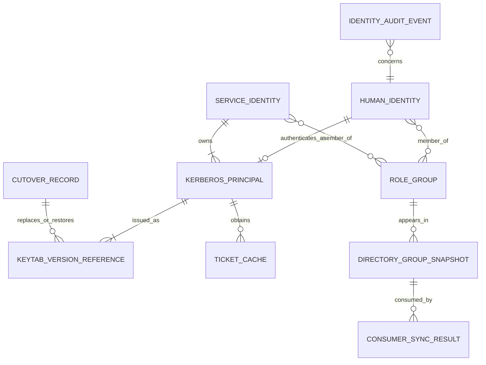

# Domain Entities — FreeIPA Identity Foundation

## Entities and Value Objects

| Concept | Attributes | Owner / lifetime | Relationships |
|---|---|---|---|
| Human Identity | Stable username; enabled/disabled status; directory identifier | FreeIPA; persists across sessions | Member of zero or more approved role groups; may have a Kerberos principal |
| Role Group | `lakehouse-developers`, `lakehouse-analysts`, `lakehouse-writers` | FreeIPA; policy lifetime | Contains human or service identities; consumed by RustFS reconciliation and/or Ranger UserSync |
| Platform Administrator Mapping | FreeIPA identity/group reference and component privilege mapping | FreeIPA plus component-specific configuration | Grants administrative capabilities independently from data-role membership |
| Service Identity | Stable principal name; service owner; interactive-login prohibition | FreeIPA; service lifetime | Owns one or more service credentials; includes the ETL writer and component service principals |
| Kerberos Principal | Principal name, realm `LAKEHOUSE.LOCAL`, enabled state, key version metadata | FreeIPA after cutover | Has issued keytabs and obtains tickets for an identity |
| Keytab Version Reference | Principal, protected secret reference/version, issuer, creation time, consumer rollout state | Secret store/runtime; versioned through migration | New FreeIPA keytab replaces an old MIT keytab for each service consumer; contents never enter ordinary records |
| Ticket Cache | Owner principal, protected runtime location, validity state/expiry | One process/session lifetime | Contains tickets derived from a keytab or user authentication; isolated between users and services |
| Directory Group Snapshot | Group and membership version/time, completeness state | Reconciliation/sync run lifetime | Read by RustFS reconciler and Ranger UserSync; cannot override FreeIPA |
| Consumer Sync Result | Consumer name, directory revision/reference, result, timestamp, sanitized error category | One sync/reconcile operation | Confirms whether downstream role state matches FreeIPA |
| Cutover Record | Source authority, target authority, preflight status, service checks, decision, rollback reference | One migration operation | Records transition from MIT-active to FreeIPA-active or rollback; contains no secrets |
| Identity Audit Event | Actor, subject, action, timestamp, result, correlation reference | Audit retention lifetime | Describes account/group/keytab lifecycle without containing credentials |

## Relationship Model

**Text alternative**: FreeIPA identities join role groups and map to principals. Principals have protected, versioned keytab references and obtain tickets in isolated caches. Directory snapshots flow to RustFS and Ranger consumers, which return sync results. A cutover record links the new keytab version to its consumers and retains a rollback reference. Audit events record lifecycle actions without credential content.

## Invariants

- FreeIPA is the single identity/group authority after accepted cutover.
- Each principal's active service keytab is issued by the currently authoritative FreeIPA KDC after cutover; old MIT keytabs are rollback-only.
- The writer's RustFS S3 key is independent from its Kerberos keytab and remains unchanged during this intent.
- A ticket cache has one identity owner and is not readable by another user or service.
- Data-role group membership does not confer platform administrator privileges.
- A directory snapshot is considered usable only when complete and tied to an identifiable sync run/revision.
- A successful consumer sync does not by itself prove effective authorization; relevant authorization probes are required.
- No domain entity or audit field contains password, keytab bytes, ticket contents, RustFS secret values, or LDAP bind-secret values.
