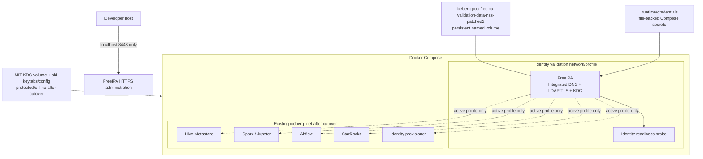

# Deployment Architecture — FreeIPA Identity Foundation

## Deployment Context

The target remains the existing local Docker Compose platform on the development host. The current Compose network is `iceberg-poc-net` (`iceberg_net`), and Kerberos clients currently use `kdc:88` from a static `krb5.conf`. FreeIPA 4.13.4 is built from the pinned AlmaLinux 9 ARM64 image at digest `sha256:103c6a787f4de0a73fb9add04564ca5895fc5423c17e52fc134dfee3a3eca46d`. The project image patches Dogtag's RA certificate bootstrap and keeps systemd journal storage volatile.

## Topology

**Text alternative**: FreeIPA currently runs in an isolated validation profile/network, with persistent state and file-backed bootstrap secrets. LDAP/TLS and Kerberos readiness pass; only HTTPS administration is mapped to localhost. Any later cutover would require FreeIPA to join the active lakehouse network and serve the stable client KDC endpoint while the previous MIT state remains offline for coordinated rollback.

## Network and Name Resolution

- FreeIPA uses a stable FQDN in the existing `lakehouse.local` DNS domain while the Kerberos realm remains `LAKEHOUSE.LOCAL`.
- FreeIPA integrated DNS is authoritative for its realm records and forwards non-authoritative queries to the configured external DNS forwarder. Compose service-name resolution must be validated when downstream clients share the reviewed network; it is not established by the isolated validation profile.
- During active cutover, preserve `kdc:88` as the Kerberos endpoint using the Compose network alias after the MIT service stops. LDAP clients use the FreeIPA FQDN over TLS.
- Use a project-defined identity subnet/address only after confirming it does not overlap host/VPN/Docker ranges. Do not hard-code a conflicting subnet.
- Validate DNS SRV, server FQDN, and current service-name lookups from each client before accepting cutover.
- Map only `127.0.0.1:8443` to FreeIPA HTTPS. No LDAP, Kerberos, DNS, or password-change host ports are published.

## Storage and Secret Mounts

| Host source | Container target | Access |
|---|---|---|
| `iceberg-poc-freeipa-validation-data-nss-patched2` named volume | FreeIPA `/data` | Isolated FreeIPA state; earlier partial validation volumes are retained |
| `.runtime/credentials/freeipa-server-install-options` | `/run/secrets/freeipa-server-install-options` | Read-only file-backed secret; entrypoint creates a symlink at `/data/ipa-server-install-options`, so secret contents are not copied into persistent state |
| `.runtime/credentials/freeipa-provisioner-password` or protected keytab reference | Provisioning workflow secret target | Read-only; routine provisioning identity, not platform `admin` |
| FreeIPA public CA certificate | LDAP client trust path | Read-only public certificate; no CA private key exposed |
| Existing `.runtime/credentials/keytabs/*.keytab` | Current MIT consumers during pre-cutover | Unchanged until the coordinated service update |
| FreeIPA-issued service keytabs | Assigned service credential paths | Read-only per consumer; issued under FreeIPA during cutover |
| Existing `kerberos-kdc-data` volume and old service keytabs | Offline rollback set | Retained unchanged until acceptance |

The writer's RustFS S3 access/secret key files are unchanged and are not part of the FreeIPA bootstrap mount. Keep all credential directories mode `0700` and secret/keytab files mode `0600` where host semantics allow.

## Startup and Health Dependencies

1. Validation profile starts independently from the MIT KDC and existing production clients, with `/data` in a dedicated named volume.
2. FreeIPA starts from file-backed initialization input with `/data` persistent.
3. Readiness waits for LDAP-over-TLS and Kerberos ticket acquisition checks; only then is FreeIPA marked healthy.
4. The identity provisioning workflow waits for FreeIPA readiness and uses its scoped provisioning identity.
5. During active cutover, existing dependent services are switched as a coordinated maintenance operation; successful Compose startup alone is not acceptance.

Health checks should use bounded command timeouts and sanitized failures. Exact timing is selected during code generation based on FreeIPA's first-run install and startup behavior.

## Backup and Rollback Architecture

- Stop FreeIPA before exporting its `/data` named volume; store a protected backup with restrictive permissions. Exclude `/data/var/log/journal` from the archive: installer process metadata was present in the historical journal, and current journaling is volatile. Test restore only into a separate isolated volume.
- Archive the MIT KDC database volume, old keytabs, static Kerberos configuration, and service configuration as a matching rollback set before cutover.
- Verify the backup inventory/checksum and restore procedure in an isolated test before production-authority switch.
- After acceptance, retain backups according to the local operator's retention decision; no automated backup service is introduced.
- Rollback switches all clients and KDC authority to the old MIT state together. Never operate both independent KDC databases as authoritative for this realm.

## Deployment Dependencies and Constraints

- The official FreeIPA container runs a complex set of identity services and needs a stable hostname, persistent storage, DNS, and container init behavior. Docker Desktop compatibility is a build/test gate, not assumed from image availability.
- The selected version-specific tag is pinned; its resolved digest and platform manifest must be captured in Compose before implementation is considered complete.
- The `/data` directory and bootstrap secrets must not be included in image build context or committed to Git. `.runtime/` is ignored by the repository.
- No changes to RustFS buckets, Hive metadata/data, StarRocks state, or user workspaces are included in Unit 1 infrastructure deployment.

## Source References

- [FreeIPA Docker/container documentation](https://www.freeipa.org/page/Docker.html)
- [FreeIPA upstream container source and image recipes](https://github.com/freeipa/freeipa-container)
- [FreeIPA server container tags](https://hub.docker.com/r/freeipa/freeipa-server/tags/)
