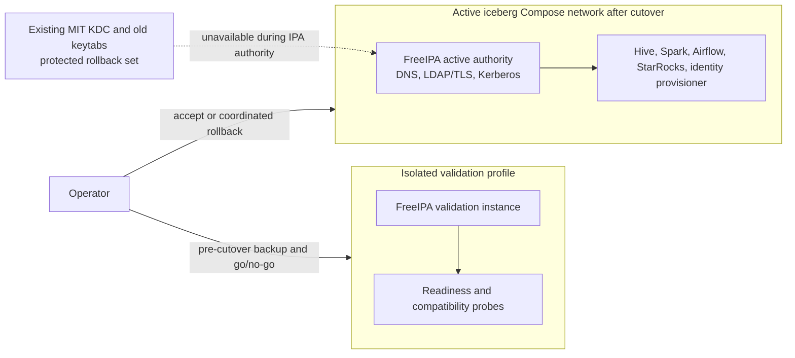

# Infrastructure Design — FreeIPA Identity Foundation

## Purpose and Scope

Add FreeIPA as the LDAP directory and Kerberos authority for `LAKEHOUSE.LOCAL` in this local Docker Compose PoC. Validate FreeIPA in isolation, then replace the current MIT KDC through a coordinated cutover. Preserve the writer's RustFS S3 key, production objects, and platform admin privilege mapping. Reissue service keytabs under FreeIPA and retain the MIT KDC database and old keytabs as protected rollback material until acceptance.

This design adds no HA/replica node, external monitoring stack, automated backup service, data migration, or bucket change. It does not yet implement Compose or change runtime identity state.

## Selected Infrastructure Decisions

| Area | Design |
|---|---|
| Image | FreeIPA 4.13.4 AlmaLinux 9 ARM64 image pinned by digest in `infra/freeipa/Dockerfile`; the Dockerfile adds the JSS-based RA certificate import fallback and volatile-journal configuration. The image was built and ran successfully on the local Rancher Desktop host. |
| Container topology | One upstream FreeIPA server container with host cgroup namespace and writable cgroup mount, as required by its systemd-based startup. On this Docker Desktop runtime the memory-controller files are nested under `/sys/fs/cgroup/docker/...`, while FreeIPA checks only the cgroup root. Pass the supported `--skip-mem-check` installer option and separately verify at least 1.2 GB available memory before startup. |
| Realm/domain | Kerberos realm remains `LAKEHOUSE.LOCAL`. Use the selected FreeIPA integrated DNS for the realm's DNS records and service discovery. Set a stable fully qualified FreeIPA hostname; exact FQDN and static network address are finalized against the available Docker network ranges during implementation. |
| DNS and service discovery | During isolated validation, FreeIPA uses a separate Compose profile/network. The Docker embedded resolver at `127.0.0.11` does not pass FreeIPA's installer forwarder validation, so validation uses configurable external `FREEIPA_DNS_FORWARDER` (default `1.1.1.1`). Integrated FreeIPA SRV/A records and external forwarding were verified. Cross-network resolution of actual Compose services remains a dependent integration gate. |
| Persistent state | Store FreeIPA `/data` in dedicated named volume `iceberg-poc-freeipa-validation-data-nss-patched2`. Earlier diagnostic/partial volumes are retained. Keep the existing `kerberos-kdc-data` and old keytabs unchanged until any separately approved cutover. |
| Bootstrap secrets | Keep installer options/passwords and bootstrap material in owner-only files under ignored `.runtime/credentials`; supply them as read-only file-backed Compose secrets. Do not place passwords in environment literals, command arguments, logs, or a persistent options file. Use a separate scoped FreeIPA service-principal provisioning identity after bootstrap. |
| TLS | Use FreeIPA's integrated CA. Distribute only the public CA certificate to LDAP clients as read-only trust configuration. Keep CA private material within protected FreeIPA state. Clients validate both chain and server identity. |
| Host publication | Keep DNS, LDAP, Kerberos, and password-change protocols internal to the Compose networks. Publish only the HTTPS administration UI to loopback (planned host port `8443` to container `443`) unless the existing host environment requires a reviewed adjustment. |
| Readiness | A dedicated sanitized readiness check validates LDAP over TLS and Kerberos ticket acquisition using a required service principal/keytab. FreeIPA is healthy only when both checks pass. Gate the identity provisioning workflow on this status. |
| Backup | Stop FreeIPA and archive `/data` with mode 0600, excluding `/data/var/log/journal`. Journaling is configured as volatile because historic installer process metadata was found in the persistent journal. A replacement archive passed integrity and credential-scan checks and was restored into a separate named volume; the MIT KDC rollback volume remains untouched. |
| Host permissions | Set `.runtime` and credential directories owner-only (`0700`) and secret/keytab files owner read/write only (`0600`) where the host filesystem supports these semantics. FreeIPA database/keytabs remain inside its named volume; avoid writable mounts for consumer credentials. |

The FreeIPA project publishes its server container from the upstream [freeipa-container project](https://github.com/freeipa/freeipa-container). Its Docker documentation describes persistent server data under `/data` and notes the added complexity of running FreeIPA in a container; the exact `/data` backup workflow and Docker Desktop behavior are therefore explicit verification items ([FreeIPA Docker documentation](https://www.freeipa.org/page/Docker.html)).

## Compose Service and Network Shape

**Text alternative**: An isolated validation instance is used to verify FreeIPA, client compatibility, DNS, TLS, and keytabs without serving production identity traffic. After preflight, the operator disables MIT authority and starts FreeIPA on the active Compose network using the stable Kerberos endpoint. All dependent services switch to FreeIPA-issued keytabs together. The old KDC and matching keytabs remain offline as one rollback set.

## Initial Provisioning and Runtime

1. Create protected credential files; Compose provisions the persistent FreeIPA named volume.
2. Start the validation profile with a stable fully qualified hostname and the selected FreeIPA integrated DNS configuration.
3. Bootstrap the FreeIPA CA, directory, realm, DNS, and initial `admin` identity using file-backed secret inputs. Do not reset or mount the MIT KDC's database into FreeIPA.
4. Create role groups and human accounts through FreeIPA administration. Create compatible service principals and issue service-specific FreeIPA keytabs using the scoped provisioning identity. Do not rotate the RustFS writer key.
5. Install the public CA trust certificate and new keytabs only in the intended client containers. Keep human credential delivery and per-user notebook setup in Unit 4.
6. Run readiness and compatibility checks, create and verify the protected backups, then perform the planned authority switch.
7. Start the active FreeIPA service and dependent clients; verify service principals and each client before accepting the cutover.

## Cutover and Rollback

### Go/no-go preflight

- Required users, groups, service principals, and service keytabs are present in FreeIPA.
- LDAP TLS validation and Kerberos ticket acquisition succeed from the intended clients.
- FreeIPA DNS resolves its FQDN/SRV records; Compose service DNS remains usable through the configured forwarding path.
- The health check is green, and the identity provisioner can authenticate using its new scoped credential.
- Protected backups of FreeIPA state and the MIT KDC plus matching keytabs/configuration exist and are readable by the operator.
- The RustFS writer S3 key reference, production bucket inventory, and admin privilege mapping are recorded for preservation verification.

### Cutover

1. Stop new identity-dependent work and record the maintenance point.
2. Stop the MIT KDC so it is no longer authoritative or reachable by clients.
3. Activate FreeIPA on the production Compose network and the configured KDC endpoint; update Kerberos and LDAP client configuration and install the new keytabs.
4. Restart or reload dependent clients in the documented order and validate Hive/Spark, Airflow writer, StarRocks, and directory consumers.
5. Accept only after critical service checks pass and the writer S3 key, production objects, and admin privileges are confirmed unchanged.

### Rollback

On any critical principal, TLS, DNS, or dependent-service failure, stop forward cutover. Stop FreeIPA from serving the realm, restore the MIT KDC with its original database and old keytabs/configuration as a coordinated set, then restart clients against MIT. Do not run both authorities for the same realm concurrently. Preserve all FreeIPA state and logs for diagnosis; do not delete buckets, production objects, or persistent volumes.

## Readiness and Diagnostics

- Readiness returns a sanitized status for LDAP TLS, Kerberos acquisition, and required principal/consumer probes.
- Use separate liveness and readiness states; process existence alone does not mean the identity service is usable.
- Readiness failure prevents the identity provisioning workflow from mutating FreeIPA or declaring a completed sync.
- Operator diagnostics include service/principal identifiers, timestamps, and sanitized failure classes only. Passwords, keytabs, tickets, bind credentials, and RustFS secrets are excluded.
- Health-check timing is set during implementation based on observed first-install/startup duration, without weakening the NFR requirement that readiness reflect both LDAP and Kerberos.

## Verification Items for Build and Test

- Selected image starts on the ARM64 Docker Desktop host with required init/cgroup behavior and a pinned digest. Verify sufficient available memory independently before startup because the supported `--skip-mem-check` option is required when Docker Desktop exposes cgroup memory files below the root path expected by FreeIPA.
- FreeIPA persistent state survives ordinary container stop/start and recreation. **Verified.**
- Integrated DNS resolves FreeIPA SRV/A records and external DNS forwarding. **Verified.** Compose service-name resolution across the isolated validation boundary remains a later integration gate.
- LDAP clients reject untrusted TLS certificates; only the intended FreeIPA HTTPS UI is host-published on loopback.
- Credential modes/mounts meet the approved protection requirements and logs remain secret-safe.
- FreeIPA backup can be inspected/restored in an isolated test without changing production state. **Verified.** MIT rollback restore and authority cutover are deferred to the separately approved cutover unit.
- Validation service keytabs authenticate. **Verified.** Downstream client integration and the writer's RustFS S3 behavior remain later gates.
- The active MIT KDC remains unchanged and authoritative. A cutover/rollback rehearsal has not been performed.

## Deferred Details

FreeIPA subnet/IP allocation, DNS forwarder configuration, installer options, scoped provisioning privilege, healthcheck behavior, backup exclusion of volatile journal data, and resolved image digest are implemented and verified for isolated validation. Shared-network client resolution and coordinated cutover remain deferred to dependent integration work.
