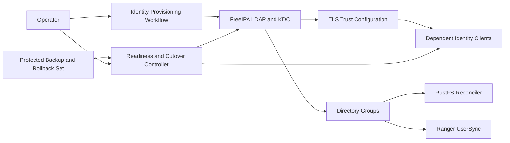

# Logical Components — FreeIPA NFR Design

## Components

| Component | Responsibility | NFR behavior |
|---|---|---|
| FreeIPA Directory/KDC | Authoritative LDAP identities, groups, Kerberos principals, and tickets after cutover | Single active authority; persistent state; readiness reflects LDAP and Kerberos availability |
| TLS Trust Configuration | Provides dependent clients with the trusted certificate authority and endpoint identity checks | LDAP connections validate certificate chain and endpoint; no insecure fallback |
| Protected Credential Store | Holds administrator bootstrap material, scoped provisioning credential, service keytabs, and rollback keytabs | Owner-only storage, per-principal separation, read-only consumer mounts where possible; never logged |
| Identity Provisioning Workflow | Creates/updates approved users, groups, service principals, and FreeIPA keytabs | Requires FreeIPA readiness; uses a scoped provisioning identity; emits sanitized results; cannot alter RustFS S3 credentials |
| Dependent Identity Clients | JupyterHub LDAP, Hive/Spark/Airflow/StarRocks Kerberos consumers, RustFS reconciler, and Ranger UserSync | Validate TLS/tickets and directory responses; fail closed when lookup/authentication is unavailable; synchronize independently |
| Readiness and Cutover Controller | Performs readiness checks and records cutover go/no-go/accepted/rollback state | Checks LDAP TLS, required principal ticket acquisition, and consumer results; blocks progression on critical failures |
| Backup and Rollback Set | Protected FreeIPA backup plus MIT KDC database, old keytabs, and previous service configuration | Created and verified before cutover; retained until acceptance; restored as a coordinated authority/keytab set |
| Operator | Reviews identity changes and cutover evidence; executes recovery | Receives sanitized status and performs manual recovery; no automatic failover is implied |

## Logical Flow

**Text alternative**: The operator invokes the provisioning workflow against FreeIPA. TLS trust and directory information are consumed by independent clients. RustFS reconciliation and Ranger UserSync consume group data but do not own it. A readiness/cutover controller checks the directory and critical clients against a protected backup/rollback set before the operator accepts or rolls back the authority switch.

## Failure Boundaries

- FreeIPA unavailable: new authentication, ticket acquisition, identity changes, and group sync fail closed; no automatic fallback authority.
- TLS trust invalid: the LDAP client rejects the connection and reports a sanitized certificate failure.
- Keytab invalid or unreadable: the affected service is not ready; other independent identity checks report their own states.
- Consumer sync incomplete: do not report the role change/cutover as fully accepted; reconcile or roll back according to the owning unit.
- Backup unavailable or unverified: cutover cannot start.
- Critical cutover check fails: stop forward rollout and restore the old KDC plus matching old keytabs/configuration together.

## Deferred Details

Concrete containers, healthcheck commands, Compose dependencies, network aliases, ports, secret mounts, backup paths, certificate setup, and provisioning privilege rules are part of Infrastructure Design. The logical design does not prescribe a particular FreeIPA image or implementation command.
