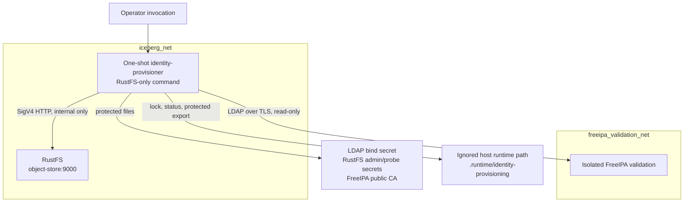

# Deployment Architecture — Unit 2 RustFS Role Reconciliation

## Logical deployment

The reconciler is the sole dual-homed component. Docker network membership permits the process to reach both named services; the container does not enable IP forwarding. FreeIPA does not join `iceberg_net`, no other workload container joins `freeipa_validation_net`, and no LDAP/Kerberos/DNS host port is published. The existing MIT KDC remains the active authority and is not involved in this reconciliation connection.

## Runtime shape

- Existing identity-provisioner image and Compose project are reused.
- An explicit RustFS-only entrypoint is invoked as a short-lived container; the aggregate provisioning entrypoint is not called.
- No new long-running container, controller, scheduler, sidecar, proxy, or host API is added.
- RustFS traffic stays on the existing internal Compose endpoint. Directory reads use LDAP TLS to the FreeIPA validation service using its public CA and matching DNS name.
- Credentials and CA trust are file mounts. Only the RustFS-only command's required files are mounted. Admin credentials are used only for RustFS IAM operations; non-root role keys are isolated to their S3 probes.
- Coordination and current status use the existing ignored host runtime directory. The IAM snapshot subdirectory is protected and operator-managed.

## Network and data paths

1. Operator invokes the explicit RustFS reconciliation command.
2. The process acquires its advisory lock and checks prior status before any mutation.
3. Read-only LDAP queries retrieve canonical identities and memberships over TLS on `freeipa_validation_net`.
4. SigV4-signed RustFS administrative requests and S3 probes use `iceberg_net`; no host-published API is involved.
5. Before replacing existing managed policy/binding state, the process writes a protected export to the runtime snapshot directory.
6. Sanitized status is atomically written to the runtime directory. Snapshot contents, secret data, and raw API bodies do not enter logs or status.

## Persistence and recovery boundaries

RustFS persistent object data is not mounted into or manipulated as files by the reconciler. Existing bucket/object state remains owned by RustFS. The reconciler's lock/status and protected exports are host-local, ignored runtime artifacts. A process crash releases the OS lock but may leave `applying` status; the next invocation must require operator inspection rather than treating the old run as complete. IAM snapshot restore is verified only against a separate isolated RustFS instance and is never automatic against the active service.

## Exposure and availability

No ports are added to the host. The deployment inherits single-host Docker Compose availability and does not claim HA or an RTO. If FreeIPA or RustFS is unavailable before mutation, the command returns `blocked`; if a dependency fails after mutation begins, it returns `partial-failure`, preserves data, and stops. A concurrent run returns `already-running` without mutation.

## Deferred to implementation verification

The exact network alias/certificate name, image package versions at the chosen immutable Debian snapshot, LDAP query attributes/ACL behavior, RustFS admin API response mapping/export completeness, and supported mutation semantics must be validated in Build and Test before any production-like policy reconciliation is accepted.
