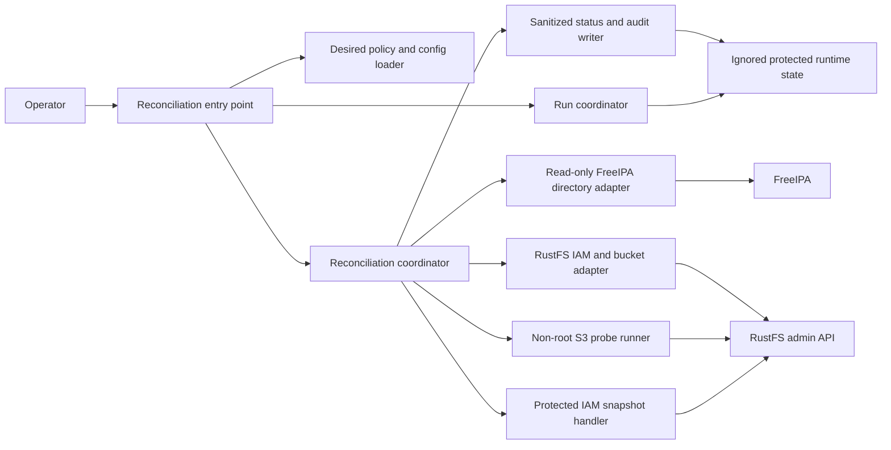

# Logical Components — RustFS Role Policies and Reconciliation

## Component view

The diagram is logical only. It does not prescribe processes, new services, network publication, filesystem paths, or API routes. Components are expected to remain within the existing operator invocation and identity-provisioner runtime unless Infrastructure Design identifies an approved implementation constraint.

## Responsibilities and boundaries

| Component | Responsibility | Security and failure boundary |
|---|---|---|
| Operator | Starts one explicit run and reviews blocked/partial outcomes. | No credentials passed on command lines; stale coordination state requires operator inspection. |
| Reconciliation entry point | Validates invocation arguments, wires adapters, obtains terminal result, and returns a non-success exit for blocked or incomplete runs. | Does not log input secrets or convert partial failure to success. |
| Run coordinator | Prevents concurrent mutating runs for the configured RustFS target and records ownership/status. | A competing run exits `already-running`; stale state is never removed automatically. Primitive/path and crash-safe semantics are Infrastructure Design decisions. |
| Desired policy/config loader | Loads version-controlled policy and non-secret configuration; validates schema, names, buckets, actions, uniqueness, and policy version. | Rejects unknown fields or permission scope before any mutation. No secret material is stored in desired policy. |
| Reconciliation coordinator | Implements phases and state transitions; builds a redacted change plan; checks conflicts; orders ensure and IAM operations; controls stop-on-error behavior. | Is the only component allowed to advance from preflight to mutation. It never asserts cross-resource atomicity. |
| Read-only FreeIPA directory adapter | Retrieves canonical users, enabled state, and membership in approved role groups. | Uses a dedicated read-only identity and validated TLS. No membership or user mutations. Identity and trust configuration are deferred. |
| RustFS IAM and bucket adapter | Reads relevant state; ensures only missing allowed buckets; manages approved IAM users/groups/policies/bindings through the pinned-image-supported interface. | Admin credential is restricted to this adapter. Explicit not-found is distinct from auth, timeout, server, and decode errors. Unknown semantics block. |
| Protected IAM snapshot handler | Captures the pre-change export/equivalent and reports safe metadata such as capture success and counts. | Sensitive content is not logged or displayed, and restore targets only an isolated test instance. |
| Non-root S3 probe runner | Performs role-specific allow/deny requests and cleans only probe-created keys. | Never uses RustFS root; results record action category and response class, not object contents or full responses. |
| Sanitized status and audit writer | Writes start/end state, policy version, duration, safe counts, verification result, and error category. | Excludes secrets, access-key IDs, full API payloads, object names, and object content; writes only to protected ignored runtime state. |

## Run sequence and contracts

1. Entry point validates operator invocation and loads validated desired state.
2. Run coordinator acquires exclusive ownership. Failure to acquire returns `already-running` before any external mutation.
3. Directory and RustFS adapters perform bounded connectivity/authentication/read checks. The coordinator rejects conflicts, unknown grants, ambiguous state, and non-absence errors before mutation.
4. Coordinator calculates an allowlisted plan. If replacing an existing managed policy or binding, snapshot handler captures protected pre-change state before the replacement.
5. Coordinator applies only the reviewed delta. A failure after any successful mutation stops the sequence and produces `partial-failure`; no automatic rollback occurs.
6. Adapters read managed policies/bindings back. Probe runner executes the required non-root positive and negative access checks.
7. Status writer records sanitized evidence and terminal state; coordinator releases ownership in a controlled finalization path.

All network boundaries require finite timeouts. Exact timeout values, safe retry categories, API routes/response codes, lock implementation, status persistence, and snapshot format are deferred to Infrastructure Design and pinned-image verification.

## Status interface

The shared status contract is `complete`, `no-change`, `blocked`, `already-running`, or `partial-failure`. A status record may include an opaque run identifier, policy version, times/duration, state, safe operation counts, verification categories, and a sanitized failure category. It must not expose principal access-key IDs, passwords, keys, complete API response bodies, object names, or object contents.

`complete` and `no-change` require both exact IAM readback and successful role probes. `blocked`, `already-running`, and `partial-failure` are non-success outcomes for the operator and automation caller.
