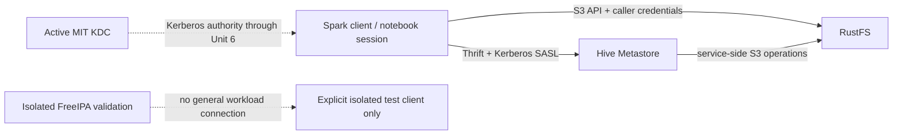

# Deployment Architecture — Hive Metastore and Direct Spark Authorization

## Topology

No new deployment unit is introduced. The existing Spark client communicates with Hive Metastore over the current internal Kerberos-SASL Thrift connection and with RustFS over the current internal S3 endpoint.

The HMS service's RustFS identity is separate from the Spark caller's object identity. The HMS metastore principal authenticates service-to-client Thrift traffic; it does not replace the Spark client's Kerberos principal. The diagram describes the existing/requested boundaries and does not add routes, aliases, networks, or ports.

## Network and exposure

- Retain existing Compose networks and internal service DNS names.
- Add no host-published HMS, RustFS, KDC, LDAP, or authorization port.
- Keep FreeIPA on its isolated validation network; do not connect general Spark, HMS, notebook, Airflow, or StarRocks clients to it during Unit 3.
- Keep the active MIT KDC as the authority for existing runtime clients until the separately approved Unit 6 cutover.
- No proxy, packet forwarding, TLS terminator, or authorization gateway is introduced.

## Credential flow and mounts

| Runtime context | Kerberos material | RustFS material | Boundary |
|---|---|---|---|
| Human test/client | Own test principal/cache; protected private cache | Same user's role-scoped S3 credentials | Must map to one user; never mount writer credentials |
| ETL Spark service | `write-service-account` service principal/keytab per existing lifecycle | Existing writer S3 credentials | Non-interactive ETL only |
| Hive Metastore | Existing Hive service principal/keytab | Existing HMS service S3 credentials, where required by current config | Service operations only; not evidence of end-user S3 authorization |
| Isolated FreeIPA test client | Only a separately approved validation principal | Test-only role S3 credentials | Must remain isolated; no authority cutover |

Credential values remain in protected file mounts/private caches and are never rendered in Compose literals, config templates, logs, or command arguments. Exact owner IDs and mount locations are existing-component implementation details to verify in Infrastructure Design review and later Build and Test.

## Storage and metadata boundaries

No production bucket, database, table, partition, object, or workspace is moved. Existing production locations are inventoried before any future approved mutation. New database locations follow the three explicit bucket roots in `infrastructure-design.md`. Test databases and probe objects must be disposable and separately inventoried; a test path that could reach production objects is not acceptable for a negative probe.

## Failure and recovery

The topology provides no HA or RTO guarantee beyond the existing local Compose setup. HMS, KDC/FreeIPA, and RustFS failures deny new operations. There is no fallback credential path. Partial operations are surfaced as incomplete for operator review. Recovery tests use a separate disposable metadata/object state and cannot replay snapshots or mutate production state.

## Change and rollout boundary

Infrastructure Design is documentation only. Any later configuration update requires its own approved Code Generation and Build and Test stages. Cross-environment metadata visibility is accepted. A failed Spark/RustFS object allow/deny probe blocks rollout and identity cutover. Analyst metadata DDL restrictions require separate architecture approval if needed. No production identity, KDC, RustFS policy, or data migration is included.
