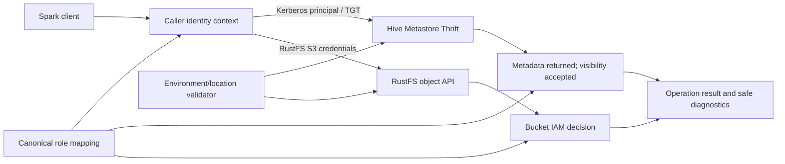

# Logical Components — Hive Metastore and Direct Spark Authorization

## Component view

This diagram is logical. It does not prescribe new processes, endpoints, services, plugins, or configuration. Cross-environment metadata visibility is accepted. The required enforcement is at RustFS for Spark data I/O using the user's own credentials. The current StorageBasedAuthorizationProvider/S3A combination does not guarantee metadata DDL restrictions.

## Responsibilities and boundaries

| Component | Responsibility | Security and failure boundary |
|---|---|---|
| Spark client | Issues HiveCatalog metadata operations and S3FileIO/S3A data operations. | Uses the signed-in user's own Kerberos and RustFS context; ETL uses `write-service-account`; no fallback between identities. |
| Caller identity context | Makes the effective Kerberos principal and RustFS credential identity available to their respective clients and correlates them to one canonical principal/role. | Does not persist passwords or emit credential values. Missing/mismatched identity is denied. Credential delivery implementation is Unit 4 scope. |
| Canonical role mapping | Resolves a canonical principal to developer, analyst, writer, admin, or deny. FreeIPA is the target source after separately approved cutover. | Unknown, conflicting, disabled, or unavailable identity state must not default to a role. Do not change the active MIT authority in Unit 3. |
| Environment/location validator | Maps database and data path to production, development, or UAT and checks bucket containment. | Rejects ambiguous, defaulted, cross-bucket, conflicting, or unapproved external locations before mutation. Existing production locations are preserved. |
| HMS Thrift client/server path | Authenticates the Spark principal through Kerberos SASL and handles database/table/partition metadata operations. | Exact principal propagation and server-side authorization behavior must be observed in Build and Test. Current settings alone are not proof of authorization. |
| Metadata service | Returns catalog/database/table metadata. | Metadata may be visible across environments; this does not grant access to object data. Metadata DDL restrictions are not guaranteed. |
| RustFS S3 client and IAM | Authorizes object list/read/write/delete requests from the caller's S3 credentials and policy. | Native object decision is independent from HMS. A denied request cannot retry with the writer/admin identity. |
| Result and safe diagnostics | Combines required layer outcomes and reports success only when all relevant decisions allow. Records bounded timing and layer-specific result categories. | No passwords, keys, keytabs, tickets, raw payloads, or data contents. Partial completion is surfaced as incomplete/failure. |

## Request sequence and contracts

1. Spark establishes a caller context and resolves the intended role. Human Kerberos and RustFS credentials must belong to the same human; ETL credentials must be the writer service identity.
2. The environment/location validator resolves the database and expected bucket. Unknown or conflicting locations fail before writes or metadata mutation.
3. Spark sends HMS operations over the existing Kerberos SASL Thrift path. The result is attributed to the actual principal HMS sees.
4. For data operations, Spark sends S3 requests directly to RustFS under the caller's S3 identity. RustFS evaluates IAM independently from HMS.
5. A data operation succeeds only when the user's RustFS policy permits the actual object requests. An HMS metadata response alone never implies data access.
6. On a timeout, missing identity, unknown response, or denial, the result is bounded and fail-closed. No broader credential is attempted.

All network calls and retries must be bounded. Exact settings and the observed effective principal/cache behavior are deferred to approved implementation verification.

## Data and state contracts

| Data | Producer / source | Consumer | Handling |
|---|---|---|---|
| Kerberos principal and ticket cache | Current approved identity authority (MIT until Unit 6 cutover) | Spark/HMS SASL | Per-user/service context; restrictive private storage; no ticket contents in logs |
| RustFS credentials | Unit 2 RustFS identity/policy mapping | Spark S3A/S3FileIO | Caller-scoped policy; writer credentials remain ETL-only |
| Role membership | FreeIPA after approved cutover | Role resolver and later supported authorization layer | Unknown/conflict denies; caching and revocation delay measured |
| Database/table/partition locations | HMS metadata | Location validator, Spark, RustFS clients | Explicit environment mapping; production state preserved; conflicting paths block |
| Authorization evidence | HMS/RustFS responses and safe diagnostics | Operator/test record | Layer, action, decision, bounded reason/time; no secrets or data contents |

## Resilience and observability contracts

- HMS, KDC/FreeIPA, and RustFS are independent dependencies; failure at one layer cannot imply allow at another.
- Transient retries are finite; authorization, authentication, conflict, and invalid-input failures are not retried as another principal.
- Cache and role changes have no assumed immediate effect. Build and Test measures effective delay and records the tested configuration.
- Logs distinguish authentication and object authorization outcomes without logging raw dependency exceptions. Do not claim metadata authorization decisions that are not enforced.
- Any future metadata/location changes require a reviewed pre-change inventory and disposable recovery rehearsal.
- Spark/RustFS object authorization must pass the role matrix before any architecture transition or user replacement. If analyst metadata DDL must be restricted, that requires a separately approved HMS authorizer design.

## NFR traceability

| Requirement | Logical component / contract |
|---|---|
| `HMS-NFR-01`–`02` | Spark client and bounded request contracts |
| `HMS-NFR-03`–`06` | Identity context, role mapping, failure handling, and revocation measurement |
| `HMS-NFR-07`–`09` | Identity context, HMS path, RustFS IAM path, least-privilege boundaries |
| `HMS-NFR-10` | Result and safe diagnostics |
| `HMS-NFR-11`–`12` | Location validator and preservation/failure contracts |
| `HMS-NFR-13`–`14` | Existing component/version boundary and disposable verification |

## Deferred decisions

No new service or plugin is chosen. Build and Test must establish that direct Spark uses role-specific RustFS credentials and enforces the object policy. Cross-environment metadata visibility is accepted. Any requirement to block analyst metadata DDL returns to architecture review before an alternate enforcement component is designed or added.
