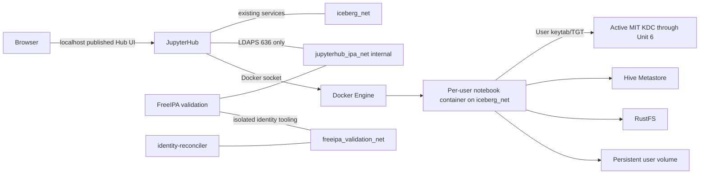

# Unit 4 Deployment Architecture — FreeIPA JupyterHub Authentication

## Target Compose view

Only JupyterHub and FreeIPA share `jupyterhub_ipa_net`. The FreeIPA validation service remains attached to its existing validation network for the already scoped identity reader; JupyterHub is not added to that shared validation network. No notebook server receives a FreeIPA network attachment or the LDAP reader secret. The existing loopback-only HTTPS port remains for administrators; LDAP/LDAPS is never published on the host.

## Service/network assignments

| Service | Networks | Host ports | Secret/credential exposure |
|---|---|---|---|
| `jupyterhub` | Existing `iceberg_net` plus internal `jupyterhub_ipa_net` | Existing `127.0.0.1:8008` UI only | Hub crypt key, FreeIPA read-only query password, FreeIPA CA; none mounted into notebooks |
| `freeipa-validation` | Existing `freeipa_validation_net` plus internal `jupyterhub_ipa_net` | Existing `127.0.0.1:8443` HTTPS only | FreeIPA server state and CA; no LDAP port publication |
| `identity-reconciler` | Existing `identity_test_net` and `freeipa_validation_net` | None | Its own existing read-only FreeIPA query password and test RustFS creds; not shared with Hub |
| Notebook server | Existing `iceberg_net` only | Existing per-user JupyterHub proxy path | That user's keytab/S3 pair read-only; private ticket tmpfs; unique workspace |
| MIT KDC, HMS, RustFS | Existing `iceberg_net` | Existing service-specific exposure unchanged | Existing service credentials remain service-only |

## Network and trust sequence

1. JupyterHub resolves `ipa.lakehouse.local` only on the dedicated internal network and connects on TCP 636.
2. The Hub validates the certificate against the read-only mounted CA and verifies the certificate SAN matches the requested endpoint.
3. Login uses the submitted user's FreeIPA bind. Directory lookup and pre-spawn membership checks use a separate least-privileged Hub reader identity over the same validated LDAPS channel.
4. DockerSpawner creates notebook containers on `iceberg_net` only. The Hub passes per-user keytab/S3 file mounts and a workspace mapping; it does not pass its LDAP reader password or crypt key.
5. Notebook ticket acquisition continues against the active MIT KDC. No FreeIPA KDC endpoint or alias is added to Spark containers before Unit 6.

## Local startup/readiness behavior

- FreeIPA validation remains profile-gated. The deployment command used for JupyterHub integration must explicitly enable the FreeIPA validation profile, wait for its healthy state, and then start/retain JupyterHub. A missing/unhealthy service must make LDAP login and pre-spawn lookup fail closed.
- Compose dependency health may improve ordering, but runtime authentication must still handle FreeIPA loss after startup. No JupyterHub startup path may select `DummyAuthenticator` if the profile, DNS, CA, or secret is missing.
- Do not alter the existing base startup flow until the user approves the detailed design and subsequent implementation plan. Stage rollout instructions and profile behavior in the implementation's documentation.

## Preservation and isolation

- Keep `jupyterhub-data` and all existing named user volumes.
- The existing admin mapping remains bound to its current workspace only after the admin identity ambiguity is resolved; no other account inherits it.
- New developer/analyst workspaces are distinct and persistent.
- Legacy `user_a` and `user_b` volumes, credentials, and data are retained but not exposed to the replacement users automatically.
- The new LDAPS network must not include Spark notebook containers, RustFS, HMS, or the RustFS reconciliation container.

## Deployment verification items

Before acceptance, inspect rendered Compose network membership and published ports; verify only Hub/FreeIPA join the new internal network; validate the certificate SAN and CA from inside Hub; exercise allowed/denied LDAPS bind and reader permissions; confirm FreeIPA outage denies login/spawn; inspect each notebook's mounts; verify MIT `klist` identity and RustFS role outcomes; stop a user server after revocation and confirm the ticket cache is destroyed while the workspace remains.
