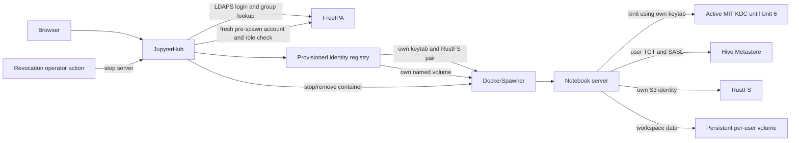

# Logical Components — FreeIPA JupyterHub Authentication and Per-User Spark Identity

## Component view

This is a logical design only. It does not add services or prescribe endpoint/network changes. The active MIT KDC remains authoritative until Unit 6. FreeIPA is used as JupyterHub's directory and login authority in this unit.

## Responsibilities and boundaries

| Component | Responsibility | Security/failure boundary |
|---|---|---|
| Browser | Submits interactive credentials and accesses the user's notebook UI. | Credentials are sent only through the configured protected Hub transport; no credential is copied to notebooks. |
| JupyterHub authenticator | Validates the account against FreeIPA LDAPS and returns minimal identity/group state. | TLS chain and hostname are verified; errors, missing groups, locked users, or unknown results deny. Never persist submitted passwords. |
| Spawn authorization check | Re-queries current FreeIPA account and role membership before each server creation. | Serialized login auth state is insufficient by itself. Missing/conflicting role or directory failure blocks spawn. Exact client/API compatibility is verified later. |
| Identity registry | Maps canonical username to exact role, expected Kerberos principal, credential-file references, and workspace name. | Provisioning-owned; entries are explicit, complete, and validated. No arbitrary path creation from user-supplied names. |
| DockerSpawner | Creates and stops one user container with its matched mounts and environment. | Bounded Docker API/start behavior; only own credential files mounted read-only; no partial-start fallback. Container removal preserves the named workspace volume. |
| Notebook bootstrap | Obtains a user TGT from the user's keytab and verifies the principal before starting Jupyter. | TGT cache is private tmpfs; mismatch or kinit failure prevents notebook launch. No writer or alternate principal. |
| Active MIT KDC | Issues tickets for existing HMS/Spark trust during the transition. | Sole active KDC until coordinated Unit 6 cutover; do not split same-realm principals across MIT and FreeIPA authorities. |
| Hive Metastore | Receives Spark metadata requests authenticated with the notebook's user TGT. | This is separate from RustFS object authorization. A successful HMS operation does not imply data access. |
| RustFS | Applies the user's own S3 IAM policy to each notebook Spark object request. | Denials fail the query; no service identity fallback. |
| Workspace volume | Persists the user's notebook files across normal server stops/restarts. | Unique per canonical account. Credential files and ticket cache are outside the volume. |
| Revocation operator action | Stops an active user's notebook after role removal/account disable. | Completion requires container stop and ticket-cache destruction; record safe request/completion timing. |
| Safe diagnostics | Records identity decision and lifecycle result for operators. | Allowlisted categories and bounded fields only; never include secrets, raw LDAP payloads, tickets, or user data. |

## Authentication and spawn sequence

1. The authenticator validates the user against FreeIPA over verified LDAPS and resolves account state and role membership.
2. JupyterHub admits only the exact developer role, exact analyst role, or the explicit `admin` account. The writer role and role conflicts are denied.
3. When the user requests a server, the spawn authorization component queries FreeIPA again. Any outage or stale/unrecognized result denies before Docker create.
4. The registry resolves the username to one complete identity record. The Hub validates all host-side file references under the configured credential root and the expected principal.
5. DockerSpawner mounts the user's own keytab and RustFS credentials read-only, their named workspace read-write, and required example material read-only. It configures private tmpfs for Kerberos cache.
6. The notebook bootstrap obtains the expected user's ticket from the active MIT KDC and verifies it. Only then does it start Jupyter/Spark.
7. Spark authenticates to HMS with the user TGT and accesses RustFS with the matching user S3 credentials. Each enforcement layer decides independently.

## Data and state contracts

| State/data | Source | Consumer | Handling |
|---|---|---|---|
| Submitted password | Browser login request | FreeIPA bind operation | Validated, not persisted in auth state, logs, or notebook environment |
| Account/group result | FreeIPA LDAPS | Authenticator and pre-spawn check | Minimal canonical username, enabled state, exact group membership; fresh query before spawn |
| Encrypted auth state | JupyterHub | Hub request handling | Protected crypt key; only necessary identity/group data; not sole spawn authorization source |
| Identity registry record | Provisioning workflow | Hub pre-spawn hook | Explicit user/role/principal/files/workspace mapping; missing or conflicting record denies |
| Kerberos keytab | Protected per-user credential file | Only that user's notebook | Read-only mount; never copied to workspace or logged |
| Kerberos TGT cache | Active MIT KDC | Notebook Spark/HMS client | Per-container private tmpfs; destroyed when container stops |
| RustFS credential pair | Provisioning workflow | Only that user's notebook Spark client | Read-only mounts; RustFS enforces the user's bucket policy |
| Workspace | Named Docker volume | One user's notebook | Persistent user data; not a secret or ticket-cache location |
| Authorization evidence | Hub/spawner outcomes | Operators/test records | Safe role/result/failure/timing fields only |

## Resilience and observability contracts

- FreeIPA, Hub, Docker, KDC, and credential files are independent required dependencies. A failure at one does not imply allow at another.
- LDAP and Docker operations are bounded. Authentication/authorization never retries under another principal or stale state.
- New login/spawn requires current FreeIPA status. Active-server revocation is explicit and measured; no immediate-revocation SLA is implied.
- Workspace volume identity is preserved independently from container identity. Server removal must not remove the workspace.
- Hub/container diagnostics distinguish auth, role authorization, mapping, ticket, spawn, HMS, and RustFS failure categories without raw secrets or payloads.
- No new audit service, HA component, secret manager, or session controller is introduced by this design.

## NFR traceability

| Requirement | Logical component/contract |
|---|---|
| `JH-NFR-01`–`02` | Fixed scope; bounded authenticator, spawn check, Docker, and bootstrap calls |
| `JH-NFR-03`–`06` | Fail-closed dependencies, spawn-time authorization, operator revocation action |
| `JH-NFR-07`–`08` | Authenticator, identity registry, notebook bootstrap, per-user credential boundaries |
| `JH-NFR-09`–`11` | Safe diagnostics, persistent workspace separation, failure contracts |
| `JH-NFR-12`–`13` | Version/network approval gates and isolated evidence/inventory requirements |

## Deferred decisions

Infrastructure Design must specify the stable internal FreeIPA LDAPS hostname, certificate trust mount, Hub network path, crypt-key delivery, exact finite timeout values, and identity registry representation. The selected authenticator must be shown to support the spawn-time membership refresh without stale auth-state reliance. No package, network, service, or runtime change is implied by these logical components.
