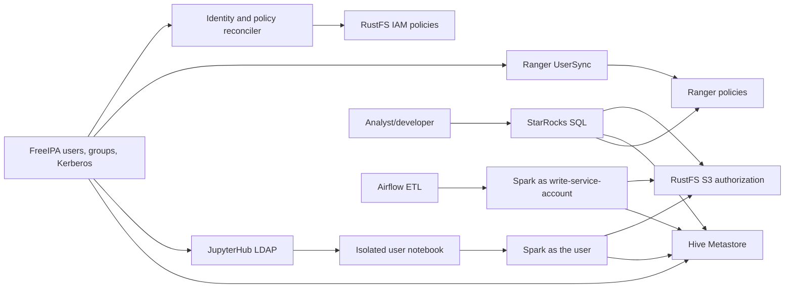

# Execution Plan — Central Identity and Environment Access

## Transformation scope

Replace the test-user access model with FreeIPA-backed human/service identities and environment-scoped RustFS, Hive/Spark, JupyterHub, and StarRocks/Ranger authorization. Preserve the production `lake` bucket, its objects, `admin` privilege mapping, the writer's RustFS S3 access key, and user workspaces. Reissue service Kerberos keytabs under FreeIPA. Create `lake-dev` and `lake-uat` without migrating existing data.

This is a brownfield local Docker Compose proof of concept. It is not a production-readiness exercise. The sibling `opensource-lakehouse` workload source is not in scope for changes; only its configured services and identities interact with this project.

## Impact assessment

| Area | Change | Priority | Reason |
|---|---|---:|---|
| FreeIPA/Kerberos | Add FreeIPA and migrate service/user authentication in a staged manner | Critical | Central identity source; must not break existing service principals |
| RustFS | Add role groups, per-user identities, policies, and two buckets | Critical | Actual S3 object enforcement for direct Spark access |
| Hive/Spark | Enforce per-user metadata/data authorization and explicit locations | Critical | Direct Spark bypasses Ranger and HiveServer2 is absent |
| JupyterHub | Replace local/dummy auth with FreeIPA LDAP and per-user credential isolation | Critical | Human notebook identity must survive through Spark to storage |
| Ranger/StarRocks | Add UserSync and supported StarRocks Ranger authorization | High | Governs StarRocks queries only |
| Existing `admin`, writer, data and workspaces | Preserve admin privilege mapping, writer's RustFS S3 key, data, and workspaces; replace Kerberos service keytabs under FreeIPA | Critical | No data migration, volume reset, or RustFS S3 key rotation |
| Documentation/operations | Add role policy, identity lifecycle, startup, verification, and rollback guidance | Important | Operators need distinct group, policy, reconciliation, and revocation procedures |

## Architecture and component flow

Text alternative: FreeIPA owns users/groups and Kerberos. The reconciler mirrors role assignments to RustFS IAM; Ranger UserSync supplies directory groups for StarRocks policy checks. Human notebook Spark uses the requesting user identity. Airflow ETL remains on the existing writer identity. HMS and RustFS enforce direct Spark metadata and object access respectively.

## Risk and rollback

**Risk level: High.** Identity is security-critical, multiple independent enforcement planes must agree, and the existing direct Spark/HMS/S3A authorization behavior must be proven. Principal risks are FreeIPA realm/DNS compatibility, per-user credential isolation in Docker/Jupyter, HMS storage authorization semantics over S3A, and Ranger/StarRocks version compatibility.

Rollback is staged by unit. Validate FreeIPA in isolation before cutover. Retain the MIT KDC and its old keytabs as protected rollback material until all required services pass verification against FreeIPA; never use the independent same-realm KDC databases as co-authorities. If a unit fails, restore prior service settings and old keytabs; do not delete RustFS buckets, objects, named volumes, or notebook workspaces, and do not rotate the writer's RustFS S3 key. Do not retire `user_a`/`user_b` until the replacement matrix passes; do not continue cutover if Unit 3’s HMS/S3A gate fails.

## Construction and verification sequence

Every unit follows the per-unit review loop: Functional Design → NFR Requirements → NFR Design → Infrastructure Design → Code Generation. Review/approval gates apply between stages. No tests are added or run unless requested; the later Build and Test stage is still required by the approved acceptance criteria.

| Order | Unit | Critical outcomes and exit gate |
|---:|---|---|
| 1 | FreeIPA Identity Foundation | Isolated LDAP/TLS and Kerberos validation, then staged same-realm KDC replacement with new keytabs and verified rollback; no existing service breaks |
| 2 | RustFS Policies and Reconciliation | Declarative role policy, per-user IAM, bucket creation, exact allow/deny S3 behavior, preserved writer and production state |
| 3 | Hive Metastore and Direct Spark Authorization | Verify S3A/RustFS positive and negative metadata and object access for each role; failure blocks dependent notebook rollout and cutover |
| 4 | JupyterHub Per-User Spark Identity | LDAP group admission, isolated per-user keys/tickets, no writer key in human notebook, revocation stops active sessions |
| 5 | Ranger and StarRocks Authorization | Compatible UserSync/plugin; correct query allow/deny matrix, without claiming direct Spark enforcement |
| 6 | Staged Cutover and Integrated Verification | Complete the matrix, preserve data/credentials/workspaces, disable old users only after passing evidence, verify rollback |

## Package change sequence

1. Add FreeIPA service/configuration and protected identity provisioning; validate in isolation, then replace MIT Kerberos in a staged same-realm cutover while retaining old KDC/keytabs only for rollback.
2. Add declarative role policy configuration and extend the RustFS identity provisioner; add `lake-dev` and `lake-uat` idempotently.
3. Update Hive/Spark identity and authorization configuration and explicit database locations; verify Unit 3 before notebook rollout.
4. Configure JupyterHub LDAP/group admission and per-user credential provisioning/mount isolation.
5. Add Ranger/UserSync and StarRocks plugin/policy configuration after pinned-version compatibility is established.
6. Add staged cutover, positive/negative access probes, preservation checks, and operator rollback guidance.

All paths above are subject to source-tree inspection during unit design. Secrets and generated credentials remain under ignored/protected runtime locations and out of Git, logs, and ordinary environment values.

## Canonical knowledge impact inventory

| Canonical path | Action | Reason |
|---|---|---|
| `aidlc-docs/knowledge/hive-dremio-rustfs/application-design.md` | Update after verification | Record new identity and enforcement components and their verified boundaries |
| `aidlc-docs/knowledge/hive-dremio-rustfs/functional-design/lakehouse-workload-and-access.md` | Update after verification | Replace old role matrix only after successful cutover; retain writer behavior |
| New identity/access functional design knowledge page | Create only if needed at closure | Capture durable operator procedure and policy lifecycle if not already covered canonically |
| `README.md` and operational guidance | Update during implementation | Explain startup, identity administration, role policy change, reconciliation, verification, and rollback |

Archive artifacts remain immutable. Canonical knowledge changes are proposed after implementation and verification, not during planning.

## Workflow progress

- [x] Requirements approved.
- [x] Personas and stories approved.
- [x] Application design and six-unit decomposition approved.
- [x] Dependency matrix and story map approved for continuation.
- [x] Execution plan prepared.
- [ ] Review execution plan before starting Unit 1 Functional Design.
- [ ] Complete unit design and code-generation loops for Units 1–6.
- [ ] Integrated Build and Test; report passed and unverified criteria separately.
- [ ] Deploy handoff and closure review.

## Approval gate

Review this execution plan before Unit 1 Functional Design begins. Approval authorizes continuing through AI-DLC design stages; it does not itself authorize destructive data operations or service cutover. All runtime changes remain behind their unit-level review gates.
