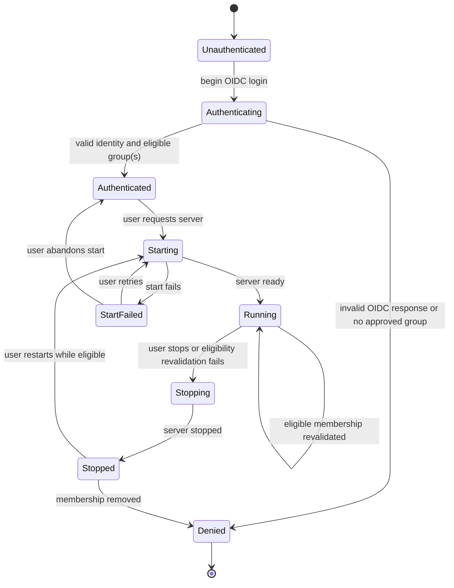

# Unit 1 Business Logic Model — JupyterHub Foundation and OIDC Admission

## Actors and outcomes

- **User:** initiates Keycloak login, starts/stops their Jupyter server, and retains their own notebooks in a persistent home.
- **Hub:** validates the OIDC result, checks eligible groups, stores protected auth state, and coordinates that user's server lifecycle.
- **Keycloak:** authenticates the user and supplies the stable identity and group membership used for admission.
- **Spawner:** creates or stops the server associated with one admitted Hub user.

The successful outcome is one authenticated and eligible Hub user attached to one isolated server and one persistent home. An unauthenticated, ineligible, or invalid session does not create or retain an authorized running server.

## Login and admission workflow

1. An unauthenticated user begins browser-based OIDC Authorization Code login with the `lakehouse` realm. Hub creates request-bound state and nonce values.
2. Keycloak authenticates the user and redirects to the registered callback with an authorization result.
3. Hub verifies the response correlation and identity claims. Invalid state, nonce, issuer, signature, or callback data ends in denial without creating an authenticated Hub session.
4. Hub evaluates the user's `role-default-developer` and `role-default-analyst` group memberships.
5. If neither group is present, Hub denies admission and server spawn. Owner/writer group membership alone is not sufficient.
6. If exactly one approved group is present, Hub admits the corresponding user journey. If both are present, Hub preserves both memberships; Polaris later applies the union of their grants. Under the current grant matrix this yields developer write access to dev plus analyst production-read access.
7. Hub persists the authenticated user's OAuth auth state encrypted. Refresh tokens and confidential-client credentials remain Hub-side.
8. When the user requests a server, Hub confirms the user remains eligible, then starts/reuses that user's server and binds it to the user's isolated persistent home.

## Server lifecycle

The first journey supports one default server per Hub user. Repeated start requests while a start is in progress do not create duplicate servers. A stopped server may be restarted only while the user remains eligible.

## Eligibility change and revocation workflow

- Group membership is evaluated at login and before spawn.
- If membership is removed while the server is running, the Hub stops that server at the next auth-state/admission revalidation. If no automatic revalidation event is available, the operator must stop it. The system does not claim instantaneous detection between checks.
- Once the Hub observes ineligibility, it denies future spawns and does not restore the server until the user becomes eligible again.
- The persistent home remains attached to the same Hub user identity when the server stops or fails. Stopping a server is not a request to delete user data.
- Unit 2 separately specifies the token broker's per-session authorization check and token refresh behavior; this Unit 1 rule does not grant the broker an identity fallback.

## Failure paths

| Condition | Functional result |
|---|---|
| OIDC state/nonce/identity validation fails | Deny login; do not create authenticated state or spawn. |
| Keycloak is unavailable during login or group resolution | Fail closed; no new session or spawn. |
| Group membership is absent or only owner/writer | Deny login/admission and spawn. |
| Auth-state persistence fails | Do not spawn; return a generic authentication/session failure. |
| Spawner start fails | Mark start failed, clean partial server resources, retain the user's home, and allow a controlled retry while eligible. |
| Group removed while running | Stop at next admission revalidation; operator stop is fallback if no revalidation occurs. |
| Stop requested | Stop server; retain the per-user home. |

Logs may report the validated user identity, lifecycle transition, correlation ID, and failure class. They must not contain OIDC access tokens, refresh tokens, or client secrets.

## Scope handoff

Unit 1 finishes after a user can log in, pass group admission, spawn/stop/restart their isolated server, and retain their own home. Unit 2 owns token-broker issuance and Spark token handoff. Unit 3 owns Polaris claim mapping and data authorization.
