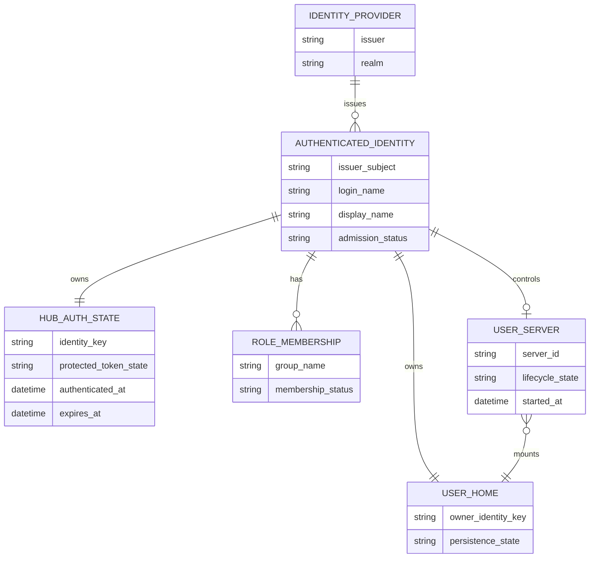

# Unit 1 Domain Entities — JupyterHub Foundation and OIDC Admission

## Entity model

## Entity definitions

### Identity Provider

Represents the configured Keycloak realm trusted by Hub for interactive sign-in. Its issuer identifies the authority that issued an authentication result. Unit 1 does not provision or administer the realm.

### Authenticated Identity

Represents one Hub user authenticated by an identity provider. The stable identity key is the issuer plus subject; the login name and display name are attributes and must not be treated as substitutes for the stable key. Admission status is derived from current approved group memberships.

### Role Membership

Represents a user's current membership in a Keycloak role group. For Hub admission, the accepted group values are `role-default-developer` and `role-default-analyst`. Both may coexist and are preserved; downstream Polaris authorization applies the union of grants. Other role groups do not confer Hub admission.

### Hub Auth State

Represents Hub-owned OIDC session data linked to one authenticated identity, including protected OAuth token material and timestamps needed to assess the Hub session. It is encrypted at rest and unavailable to another user or user server. Unit 2 defines access-token refresh and token-broker exchange details.

### User Server

Represents the one default Jupyter/Spark server associated with an authenticated identity. Lifecycle states are starting, running, stopping, stopped, failed, or denied. The server may start only while its owner is currently eligible.

### User Home

Represents the persistent notebook/file storage owned by one stable Hub identity. It is mounted only by that identity's server. Server stop/restart does not delete it; token state and confidential credentials are not stored there.

## Relationships and invariants

- An authenticated identity is tied to one trusted issuer/subject pair; login/display names are not the stable storage owner key.
- An identity may have zero or more role memberships, but spawn eligibility requires at least one of the two approved groups.
- One identity owns at most one default server and exactly one logical persistent home for this initial journey.
- A server can access only its owner's home and can run only while the owner's admission is valid.
- Hub auth state is associated with one identity and remains Hub-side; a user home is a separate persistence boundary.
- Deleting or stopping a server does not imply deleting the identity's home or the Hub's lifecycle/audit record.
