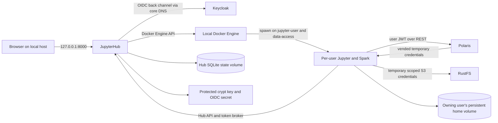

# Unit 1 Deployment Architecture — Local Compose

## Deployment model

Deploy one local Compose project on the supported developer host. Reuse the existing Keycloak, Polaris, RustFS, and PostgreSQL services. Build the Hub and Spark-enabled single-user images locally from pinned upstream bases, then start Hub. Complete image builds before user spawn; runtime server startup must not pull or build images.



## Network membership

```text
core:          Keycloak DB, Keycloak, Polaris DB, Polaris, RustFS, JupyterHub
jupyter-user:  JupyterHub, each spawned user server
data-access:   Polaris, RustFS, each spawned user server
```

Compose services may join both their control and data networks. Spawned servers must join `jupyter-user` for Hub callbacks and broker calls, and `data-access` for Polaris/RustFS. They must not join `core`. The Hub uses its Docker API capability to attach the data-access network before it marks a server ready. The Docker socket and credential mounts stay exclusively in the Hub service.

## Persistent resource map

| Resource | Owner | Retained on normal stop/recreate | Deletion path |
|---|---|---|---|
| `jupyterhub-state` local named volume | JupyterHub | Yes | Explicit operator cleanup only; backup with matching crypt key. |
| Per-user home named volume | One stable Hub identity | Yes, including user disable/removal | Explicit operator cleanup after review; independent from container removal. |
| Hub crypt-key file | Host protected runtime credentials | Yes; do not regenerate if it exists | Explicit credential rotation/recovery procedure. |
| OIDC confidential-client secret file | Host protected runtime credentials | Yes; Keycloak client secret must remain synchronized | Explicit rotation procedure updates Keycloak and Hub together. |
| Built Hub/single-user images | Local Docker image store | Reusable across server spawns | Image cleanup after checking no running/rollback dependency. |

## Operator sequence

1. Prepare `.runtime/credentials` and run the idempotent local Keycloak client/secret bootstrap.
2. Build Hub and single-user images from the pinned inputs; capture resolved image digests and package lock versions.
3. Start/check Keycloak, Polaris, RustFS, and database dependencies; start JupyterHub.
4. Confirm Hub health and browser access on `http://jupyterhub.localhost:8000` before attempting a server spawn.
5. Validate one developer and one analyst server concurrently, then record callback/spawn timings and verify home-volume persistence across normal restarts.
6. Stop with Compose without the `--volumes` option. Use the separate home/state cleanup procedure only when permanent deletion is intended.

## Failure and capacity boundaries

- Hub callback processing target: at most 5 seconds after callback receipt, excluding Keycloak user interaction.
- User server readiness target: at most 120 seconds after an admitted spawn request, with images already available locally.
- Maximum: two simultaneous single-user containers. Initial host-tunable per-server defaults: 1 CPU and 2 GiB RAM; tune against host capacity and document actual values used for verification.
- On failed network attachment or readiness: remove the partial server/container, retain Hub state and home, log a safe category, and require a deliberate retry.
- Keycloak outage, invalid OIDC data, missing approved group, or auth-state persistence failure denies login/admission. Polaris and RustFS authorization behavior remains governed by the existing token and grant configuration.

## Local-only boundary

Hub is published only on loopback. This deployment does not provide public DNS, TLS termination, high availability, automated backups, an external metrics/logging backend, a message broker, or host-level egress filtering. Use a separately reviewed design before exposing it beyond the local machine.
