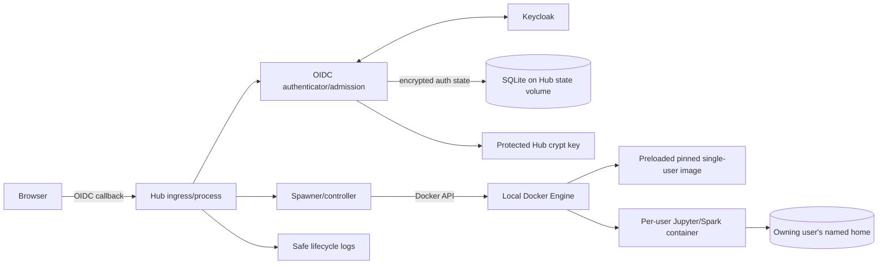

# Unit 1 Logical Components — NFR Design

## Logical component inventory

| Component | State / responsibility | Protection and lifecycle |
|---|---|---|
| Hub ingress and process | Handles the local browser URL, OIDC callback, user lifecycle requests, and safe operational logs. | Loopback-only local HTTP; health check reflects process readiness. |
| OIDC authenticator/admission module | Validates OIDC callback state and identity, evaluates developer/analyst group membership, and creates Hub auth state. | Fails closed; no password grant; accepts no username as proof of identity. |
| Hub state store (SQLite) | Stores Hub users, server state, and encrypted OAuth auth state. | File on a dedicated persistent Hub named volume; only Hub can read/write it. SQLite is chosen for one Hub with two users and no HA. |
| Hub crypt key and OIDC client secret | Enables auth-state encryption and confidential Keycloak operations. | Protected runtime credential files mounted read-only into Hub only; separate from database and user-home volumes. |
| Spawner/controller | Creates/stops one server container per admitted Hub identity and applies host-tunable CPU/memory limits. | Docker Engine API available only to Hub; partial-spawn cleanup is idempotent; no automatic retry. |
| Pinned Hub image | Contains the approved JupyterHub 6.1.1 runtime and pinned compatible Hub-side dependencies. | Version and immutable digest pinned; built/pulled before user spawn. |
| Matching Spark-enabled single-user image | Hosts Jupyter and Spark for one user; JupyterHub package version matches Hub. | Version and base digest pinned; built/pulled before spawn. It contains no Hub client secret, refresh token, or Docker socket. |
| Per-user server container | Runs a user's Jupyter/Spark process and holds only that user's runtime context. | Isolated container; no Docker API, Hub database, provider root credential, or other user's volume. |
| Per-user home volume | Persists notebooks and user files across normal server/service restarts. | One volume per stable Hub identity, mounted only in its owner server. It is not a credential store. |
| Lifecycle log stream | Records authentication and spawn outcomes, safe timing, identity, and correlation metadata. | No token/secret/user-data values; service-local logs only, without an external log or metrics dependency. |

## Data and control flows

## Trust and storage boundaries

- **Hub control plane:** owns the SQLite database, crypt key, confidential OIDC client secret, and Docker Engine API access.
- **User data plane:** each server owns one home volume and is isolated from Hub database/secrets, Docker Engine, and other users' volumes.
- **Provider boundary:** Unit 1 does not pass Polaris or RustFS administration credentials to the user runtime. Broker and storage-token details belong to later units.
- **Persistence:** Hub DB volume, crypt key file, and per-user homes are separate resources. To preserve auth state after restart, the DB and crypt key must remain a matching pair.
- **Availability:** no failover or multi-Hub coordination is modeled. A failed Hub process is restarted by the local operator/Compose policy; active user sessions may be interrupted.

## Spawn failure handling

1. Spawner creates a server with the user's identity, configured resource limits, and only that user's home mount.
2. If readiness fails, Spawner stops/removes the partial container and releases any transient container resources.
3. Spawner leaves the user's home and Hub auth-state DB intact, records a safe failure category, and returns control without automatic retry.
4. A user/operator may deliberately retry after the failure is understood; the retry reuses the same identity/home and cannot attach another user's state.

## Deferred implementation parameters

Infrastructure Design selects exact host-specific CPU/memory values, Compose health/readiness probes, volume names, credential mount paths, and image digests. These parameters must preserve the boundaries and targets defined here.
