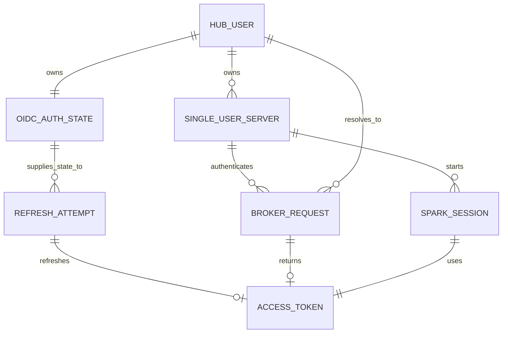

# Unit 2 Domain Entities — Hub Token Broker and Spark Session Identity

## Entities

### Hub User

The authenticated Hub principal resolved from JupyterHub-owned state. It has one stable subject and may own one default server. The broker does not accept a caller-provided identity as authority.

### Single-User Server

An isolated Jupyter server owned by one Hub user. It has a server identifier, lifecycle status, and Hub-issued API token. The token authenticates broker calls and maps to exactly this Hub user/server binding.

### Encrypted OIDC Auth State

Hub-protected state associated with one Hub user. It contains that user's access token, refresh token, expiry metadata, and authenticator data required to refresh the same Keycloak session. The record is encrypted at rest; only the short-lived access token may be returned to the user's runtime.

### Access Token

A short-lived Keycloak JWT representing one Hub user and containing the claims Polaris needs to authenticate and authorize that user. It has an expiry timestamp and is used by one Spark session. It is returned with expiry metadata and is not persisted by the user runtime.

### Refresh Attempt

A transient per-user operation that acquires a refresh lock, re-reads current auth state, and refreshes only when the access token has 60 seconds or less remaining. It updates encrypted auth state before releasing waiting requests and does not separately persist token material.

### Spark Session

A local-mode Spark runtime associated with the requesting single-user server. At startup it receives one access JWT and configures Polaris REST authentication in memory. Its identity does not change during the session.

### Broker Request

A transient request authenticated by a Hub API token. It resolves to one server/user binding and returns only that user's current access token and expiry, or a safe denial category with correlation ID.

## Relationships

## Identity and lifecycle invariants

1. A broker request resolves through a valid Hub server API token to one Hub user and server; caller-provided identifiers do not alter the relationship.
2. Every returned access token comes from that user's encrypted auth state or a refresh of that same state.
3. Concurrent refresh attempts for one user are serialized; requests for different users remain isolated.
4. Refresh tokens exist only in Hub-owned encrypted auth state and Keycloak refresh exchanges. They are not attributes of a Broker Request or Spark Session.
5. A Spark Session uses the access token issued at startup and has no transition to another user's identity.
6. Revocation, auth-state loss, server mismatch, or refresh failure transitions a broker operation to Denied; no shared identity is substituted.
