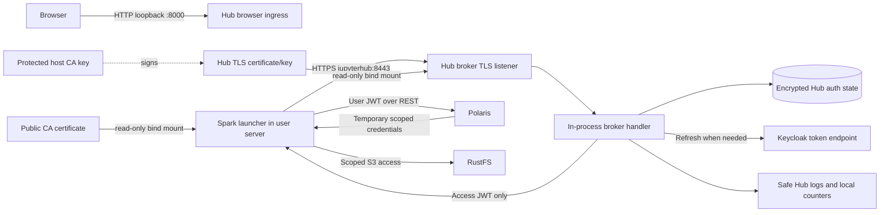

# Unit 2 Deployment Architecture — Internal Hub Token Broker

## Deployment model

Reuse the approved single-host Docker Compose deployment and existing JupyterHub service. Unit 2 adds an in-process internal HTTPS broker listener and read-only TLS material. It does not add a broker container or publish the broker port on the host.



## Network and port map

| Network | Members | Unit 2 path |
|---|---|---|
| `core` | Existing provider services and Hub | Hub reaches Keycloak for OIDC and refresh. Broker listener is not bound to the Hub's `core` interface. |
| `jupyter-user` | Hub at stable configured IP; spawned user servers | User servers resolve `jupyterhub` to the Hub's user-network IP and call internal TLS port `8443`; no host port mapping. |
| `data-access` | Polaris, RustFS, spawned user servers | Spark uses the user's access JWT with Polaris, then the vended scoped credentials with RustFS. |

The published browser endpoint remains `127.0.0.1:${JUPYTERHUB_HOST_PORT:-8000}:8000`. Broker port 8443 is only bound to the Hub's `jupyter-user` address and is never published. The configured bridge subnet and stable Hub IP must be validated against host/VPN/Docker routes before Compose startup.

## Runtime certificate material

```text
.runtime/credentials/jupyterhub-broker-ca-key.pem       host-only, mode 0600
.runtime/credentials/jupyterhub-broker-server.crt       Hub read-only mount
.runtime/credentials/jupyterhub-broker-server-key.pem  Hub read-only mount, mode 0600
.runtime/container-mounts/jupyterhub-broker-ca.crt      user-server read-only mount
```

The CA signing key never enters a container. The server certificate SAN includes `jupyterhub`. User servers configure the broker HTTP client with the explicit CA file and hostname verification. Certificate preparation is a host-side prerequisite; rotation is explicit and restarts Hub and affected user servers. Replacing the CA requires updating the trust certificate and recreating servers.

## Startup sequence

1. Prepare persistent Unit 1 runtime credentials and broker CA/server certificates idempotently.
2. Validate certificate file modes, chain, SAN, expiry, key match, and the configured network range. Abort before Compose starts the Hub on any failure.
3. Build/start the existing Hub and provider services. Hub opens the internal TLS listener only after successful material validation and includes listener readiness in health status.
4. Admit and spawn a user server on `jupyter-user` and `data-access`; mount that user's persistent home and the public CA certificate read-only.
5. Before each Spark session, acquire the user-bound access token over internal HTTPS and configure the exact token in Spark memory.

## Operational constraints

- No code, runtime credentials, containers, or data resources are changed by this deployment design document.
- The Hub remains the only component with Docker Engine access and Hub state access.
- Keycloak, PostgreSQL, and Hub control credentials remain inaccessible to user servers.
- Safe structured Hub logs and process-local counters support diagnostics; no metrics scrape endpoint or new monitoring infrastructure is introduced.
- TLS failure is fail-closed; there is no HTTP fallback or client verification bypass.
